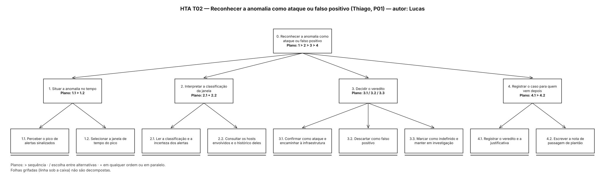
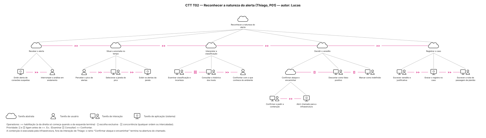
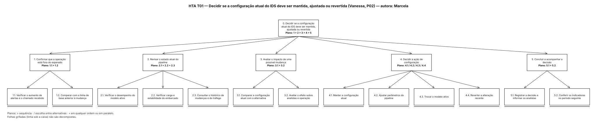
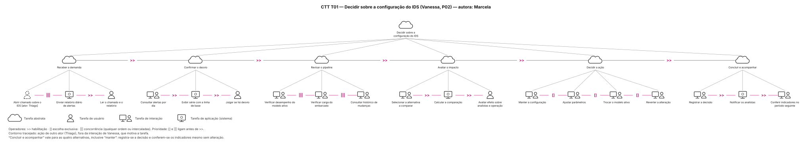

# Entrega 5 — Análise de tarefas: HTA, GOMS e CTT

**Data:** 13/09/2026 · **Revisada em:** 12/11/2026     
**Status:** `🟩 concluída (revisada após feedback)`     
**Responsabilidade:** cada integrante modela pelo menos 1 HTA, 1 GOMS e 1 CTT.

> **Revisão de 12/11/2026, a partir do [feedback da Entrega 05](../feedbaks/Feedback_Professor_Entrega05_Equipe21.md).** Mudanças em relação à versão de 13/09/2026:
>
> 1. **IDs padronizados.** **T01** é a tarefa de Vanessa e **T02** a de Thiago, e as três técnicas de cada tarefa usam o mesmo ID. Os arquivos agora são `hta_t01.svg`, `ctt_t01.svg`, `hta_t02.svg` e `ctt_t02.svg`. Os diagramas da versão anterior, exportados do Figma, foram para [`assets/05_tarefas/versao_inicial/`](../assets/05_tarefas/versao_inicial/). Os *placeholders* `hta_t01.svg` (antigo) e `ctt_t03.svg` foram removidos.
> 2. **HTAs:**
>    - Cada tarefa zero tem *input* e *feedback* na tabela.
>    - As folhas não têm mais plano, e todo plano cita apenas filhos que existem.
>    - Tabela e diagrama usam a mesma notação: `>`, `/` e `+`.
> 3. **GOMS:**
>    - Os dois modelos foram reescritos em hierarquia indentada `GOAL 0 → GOAL n → METHOD → SELECTION RULE → operadores`.
>    - Os operadores são concretos, e cada método termina com uma verificação.
>    - No de Vanessa, as etapas deixaram de ser tratadas como métodos.
> 4. **CTTs:**
>    - Os operadores são `>>` (habilitação), `[]` (escolha) e `|||` (concorrência).
>    - Os dois modelos ganharam o motivador externo e tarefas de aplicação (sistema).
>    - Os nós decompostos passaram a ser abstratos.
> 5. **Escopo:**
>    - Thiago tem agora a saída “indefinido”.
>    - O rótulo “Bloquear o host” virou “Confirmar como ataque e encaminhar à infraestrutura”.
>    - Vanessa tem quatro alternativas harmonizadas nas três técnicas: manter, ajustar parâmetros, trocar o modelo ativo e reverter.
> 6. **Síntese da equipe e checklist** foram preenchidos.
>
> As tarefas partem dos cenários revisados da [Entrega 04](04_cenarios_problema.md).

## Objetivo da atividade

Modelar tarefas importantes sob perspectivas complementares: decomposição hierárquica (HTA), estrutura de metas/métodos/operadores (GOMS) e relações temporais entre tarefas (CTT). Como o TCC não previa interface, as tarefas descrevem **o que a pessoa faz com os resultados do IDS**, e não o funcionamento interno do algoritmo.

## Seleção das tarefas

| ID | Tarefa | Persona/cenário de origem | Frequência / criticidade (estimativa da equipe) | Autor responsável | Arquivos |
|---|---|---|---|---|---|
| T01 | Decidir se a configuração atual do IDS deve ser mantida, ajustada ou revertida | Vanessa (P02) / C02 | Frequência: baixa, ocorre a cada alteração ou suspeita (H05). Criticidade: alta, porque afeta tudo o que os analistas veem (H27) | Marcela Nalesso | [`hta_t01.svg`](../assets/05_tarefas/hta_t01.svg), [`ctt_t01.svg`](../assets/05_tarefas/ctt_t01.svg) |
| T02 | Reconhecer a anomalia como um ataque ou falso positivo | Thiago (P01) / C01 | Frequência: alta, várias vezes por turno (H11). Criticidade: alta, porque o erro custa nos dois sentidos (H12) | Lucas Kerr do Amaral | [`hta_t02.svg`](../assets/05_tarefas/hta_t02.svg), [`ctt_t02.svg`](../assets/05_tarefas/ctt_t02.svg) |

> Frequência e criticidade são medidas diferentes e, aqui, ambas são **estimativas da equipe**. Nenhuma foi verificada (H11, H12 e H05 seguem abertas na matriz de rastreabilidade).

---

## HTA — T02: Reconhecer a anomalia como um ataque ou falso positivo

**Autor(a):** Lucas Kerr do Amaral — 22.123.032-9

### Descrição da tarefa

Thiago, analista de SOC nível 2 em plantão noturno, inicia a tarefa quando o IDS sinaliza uma sequência de conexões suspeitas a partir de um mesmo segmento (cenário C01). Ele situa a anomalia no tempo, interpreta a classificação junto com o histórico dos hosts e decide o veredito: ataque (encaminhado à infraestrutura), falso positivo ou indefinido. Depois registra o caso para quem continua. A contenção é executada pela infraestrutura, fora da tarefa de Thiago.

### Diagrama



### Decomposição e planos

| ID | Objetivo/operação | Plano | *Input* / *feedback* (tarefa 0) · ação e problema/recomendação (subtarefas) |
|---|---|---|---|
| 0 | Reconhecer a anomalia como um ataque ou falso positivo | 1 > 2 > 3 > 4 | ***Input:*** o IDS sinaliza conexões suspeitas a partir de um mesmo segmento enquanto Thiago escreve outra análise; a operação cobra uma resposta sobre a lentidão do portal. ***Feedback:*** Thiago vê o veredito e a justificativa gravados no caso. Se encaminhou, vê o número do chamado aceito pela infraestrutura. A nota de passagem lista o que foi verificado e o que falta. Se o veredito for 3.3, esta execução termina com o caso aberto; retomar a investigação é uma nova execução da tarefa |
| 1 | Situar a anomalia no tempo | 1.1 > 1.2 | Só é possível escolher a janela depois de perceber onde está o pico. **Recomendação:** destacar picos e permitir ir direto ao período |
| 1.1 | Perceber o pico de alertas sinalizados | — | **Problema (C01):** misturado ao restante do tráfego, o volume de alertas não indica onde olhar |
| 1.2 | Selecionar a janela de tempo do pico | — | **Recomendação:** a seleção deve manter o pico em contexto e mostrar o período escolhido |
| 2 | Interpretar a classificação da janela | 2.1 + 2.2 | As duas consultas podem ser feitas em qualquer ordem; em C01, Thiago alterna entre elas. O julgamento (3) depende das duas |
| 2.1 | Ler a classificação e a incerteza dos alertas | — | **Problema (C01):** a classificação não diz o critério. **Recomendação:** apresentar classificação, incerteza e critério separados (RC03) |
| 2.2 | Consultar os hosts envolvidos e o histórico deles | — | **Problema (C01):** o histórico não está no console e exige *script* próprio (H13). **Recomendação:** histórico e comportamento habitual junto do alerta |
| 3 | Decidir o veredito | 3.1 / 3.2 / 3.3 | Alternativas exclusivas. A escolha depende de 2 (ver regra de seleção do GOMS) |
| 3.1 | Confirmar como ataque e encaminhar à infraestrutura | — | Thiago **pede** a contenção; quem bloqueia é a infraestrutura. **Recomendação:** confirmação do encaminhamento visível a Thiago |
| 3.2 | Descartar como falso positivo | — | O descarte com justificativa é o dado que Vanessa precisa contar em C02 |
| 3.3 | Marcar como indefinido e manter em investigação | — | Saída que de fato ocorre em C01. **Recomendação:** o indefinido não pode ser forçado a virar binário |
| 4 | Registrar o caso para quem vem depois | 4.1 > 4.2 | A nota de passagem resume o registro, por isso o registro vem antes |
| 4.1 | Registrar o veredito e a justificativa | — | **Problema (C01):** os critérios ficam nos *scripts* e na memória |
| 4.2 | Escrever a nota de passagem de plantão | — | **Problema (C01):** a nota sai incompleta e torna Thiago um gargalo |

**Legenda dos planos:** `>` sequência · `/` escolha entre alternativas · `+` em qualquer ordem ou em paralelo.

**Verificação do HTA:**

- **O objetivo 0 representa uma meta do usuário?** Sim. Thiago precisa julgar se a anomalia é um ataque real, um falso positivo ou se ainda não dá para dizer.
- **As subtarefas são necessárias e suficientes?** Sim, dentro do recorte. Cobrem localização temporal, interpretação, veredito com as três saídas de C01 e registro para o próximo turno. A retomada da análise interrompida fica como *input* e não como subtarefa, porque pertence a outra tarefa.
- **Os planos indicam ordem, alternativa, repetição ou condição?** Sim:
  - sequência em 0, 1 e 4;
  - ordem livre em 2;
  - escolha em 3;
  - condição de término descrita no *feedback* da tarefa 0.
- **A decomposição parou em nível útil para o projeto de interação?** Sim. As folhas correspondem a decisões e consultas que a interface precisa apoiar, sem descer a cliques.

---

## GOMS — T02: Reconhecer a anomalia como um ataque ou falso positivo

**Autor(a):** Lucas Kerr do Amaral — 22.123.032-9

**Hipóteses de interação usadas na modelagem.** São suposições para descrever operadores. **Não** são capacidades já implementadas:

- painel com a série temporal de alertas;
- seletor de período;
- lista de alertas com classificação e incerteza;
- consulta ao histórico de um host, no próprio painel ou por *script* (prática atual de C01);
- campo de justificativa no caso;
- ação “encaminhar” que gera um chamado para a infraestrutura;
- campo de nota de passagem.

```
GOAL 0: Reconhecer a anomalia como ataque ou falso positivo
  GOAL 1: Situar a anomalia no tempo
    METHOD 1.A: localizar o pico na série temporal          (método único)
      PERCEIVE  o aumento de alertas no painel
      LOCATE    o pico na série temporal
      SELECT    o início do pico na série
      SELECT    o fim do pico na série
      VERIFY    o período exibido corresponde ao pico e a lista mostra só os alertas dessa janela

  GOAL 2: Interpretar a classificação da janela
    GOAL 2.1: Ler a classificação e a incerteza
      METHOD 2.1.A:                                          (método único)
        SELECT    o primeiro alerta da lista
        READ      a classificação, a incerteza e o critério informados
        RECALL    o que é habitual para aquele serviço e horário
        VERIFY    leu a classificação de todos os alertas do mesmo padrão
    GOAL 2.2: Consultar o histórico dos hosts
      METHOD 2.2.A: consultar o histórico no painel
        SELECT    o host de origem do alerta
        SELECT    “histórico de comunicação”
        READ      com quem o host falou nos últimos 7 dias e em que volume
        VERIFY    o histórico exibido é do host selecionado e cobre o período pedido
      METHOD 2.2.B: consultar o histórico por script próprio
        TYPE      o comando do script com o IP do host e o período
        WAIT      a saída do script
        READ      as contagens por destino e por dia
        VERIFY    o script retornou dados do período inteiro, sem erro
      SELECTION RULE 2.2:
        IF o painel tem histórico do host para o período    THEN use METHOD 2.2.A
        IF o histórico não está disponível ou está incompleto THEN use METHOD 2.2.B

  GOAL 3: Decidir o veredito
    METHOD 3.A: confirmar como ataque e encaminhar
      DECIDE    que o padrão corresponde a um ataque
      SELECT    os alertas do padrão
      SELECT    “confirmar como ataque”
      TYPE      a justificativa
      SELECT    “encaminhar à infraestrutura”
      VERIFY    o chamado foi criado com número e aparece como recebido pela infraestrutura
    METHOD 3.B: descartar como falso positivo
      DECIDE    que o tráfego corresponde a um comportamento legítimo conhecido
      SELECT    os alertas do padrão
      SELECT    “falso positivo”
      TYPE      a justificativa do descarte
      VERIFY    os alertas aparecem como descartados, com a justificativa
    METHOD 3.C: marcar como indefinido
      DECIDE    que a informação disponível não basta
      SELECT    os alertas do padrão
      SELECT    “indefinido”
      TYPE      o que já foi verificado e o que falta verificar
      VERIFY    o caso aparece como aberto, com a anotação
    SELECTION RULE 3:
      IF classificação, histórico e contexto apontam para um ataque         THEN use METHOD 3.A
      IF o tráfego corresponde a um comportamento legítimo conhecido do ativo THEN use METHOD 3.B
      IF as evidências são contraditórias ou insuficientes (caso de C01)      THEN use METHOD 3.C

  GOAL 4: Registrar o caso para quem vem depois
    METHOD 4.A:                                              (método único)
      SELECT    “nota de passagem”
      TYPE      os hosts, o veredito, o que foi verificado e o que falta
      SELECT    o destinatário (próximo turno)
      SELECT    “salvar”
      VERIFY    a nota aparece na fila do próximo turno, ligada ao caso
```

**Leitura do modelo:**

- **G1, G2 e G4 têm um único método.** Não foram inventadas alternativas para elas.
- **G2.2 tem duas formas reais de execução**, que vêm da prática descrita em C01: o painel ou o *script* próprio.
- **G3 concentra a decisão.** Os três métodos são alternativas exclusivas, equivalentes ao plano `3.1 / 3.2 / 3.3` do HTA e à escolha `[]` do CTT.
- **3.A encaminha, não bloqueia.** O método se chama “confirmar como ataque e encaminhar” porque o operador de Thiago é o encaminhamento; o bloqueio é da infraestrutura.
- **3.B e 3.C geram o registro que Vanessa precisa contar** para avaliar o modelo (coordenação C01 ↔ C02).

---

## CTT — T02: Reconhecer a anomalia como um ataque ou falso positivo

**Autor(a):** Lucas Kerr do Amaral — 22.123.032-9

### Descrição

Mesma tarefa do HTA T02, vista pelas relações temporais. A raiz abstrata se divide em cinco subtarefas abstratas, ligadas por habilitação (`>>`):

1. receber o alerta;
2. situar a anomalia no tempo;
3. interpretar a classificação;
4. decidir o veredito;
5. registrar o caso.

O **motivador externo** está explícito: a tarefa de aplicação “Emitir alerta de conexões suspeitas” leva Thiago a interromper a análise em andamento, uma tarefa de usuário.

### Diagrama



### Legenda e relações temporais usadas

| Operador | Significado | Onde aparece no modelo |
|---|---|---|
| `>>` | Habilitação: a tarefa da direita só começa quando a da esquerda termina | Entre as cinco subtarefas da raiz; Emitir alerta `>>` Interromper a análise; Perceber o pico `>>` Selecionar a janela `>>` Exibir os alertas da janela; Confirmar e pedir a contenção `>>` Abrir chamado; Escrever veredito `>>` Gravar o registro `>>` Escrever a nota de passagem |
| `\|\|\|` | Concorrência: as tarefas podem ocorrer em qualquer ordem ou intercaladas | Examinar classificação e incerteza `\|\|\|` Consultar o histórico dos hosts |
| `[]` | Escolha exclusiva | Confirmar ataque e encaminhar `[]` Descartar como falso positivo `[]` Marcar como indefinido |

Prioridade: `[]` e `|||` ligam antes de `>>`. Assim, `Examinar ||| Consultar >> Confrontar` significa que as duas consultas, em qualquer ordem, habilitam o confronto com o que Thiago conhece do ambiente.

**Tipos de tarefa:**

| Tipo | Tarefas |
|---|---|
| Abstrata | A raiz e as cinco subtarefas decompostas: receber o alerta, situar a anomalia no tempo, interpretar a classificação, decidir o veredito e registrar o caso; além de “Confirmar ataque e encaminhar” |
| Usuário | Interromper a análise em andamento; Perceber o pico de alertas; Confrontar com o que conhece do ambiente |
| Interação | Selecionar a janela do pico; Examinar classificação e incerteza; Consultar o histórico dos hosts; Confirmar e pedir a contenção; Descartar como falso positivo; Marcar como indefinido; Escrever veredito e justificativa; Escrever a nota de passagem de plantão |
| Aplicação (sistema) | Emitir alerta de conexões suspeitas; Exibir os alertas da janela; Abrir chamado para a infraestrutura; Gravar o registro no caso |

A ação humana e o processamento do sistema estão separados em três pontos:

- Thiago seleciona a janela `>>` o sistema exibe os alertas dela.
- Thiago confirma o ataque `>>` o sistema abre o chamado.
- Thiago escreve o veredito `>>` o sistema grava o registro.

A contenção não aparece como tarefa: é feita pela infraestrutura, fora da interação de Thiago. O ramo “Confirmar ataque e encaminhar” termina na abertura do chamado.

---

## HTA — T01: Decidir se a configuração atual do IDS deve ser mantida, ajustada ou revertida

**Autor(a):** Marcela Nalesso - 22.222.011-3

### Descrição da tarefa

Vanessa, administradora responsável pelo IDS, inicia a tarefa quando recebe o relatório diário com alertas acima da média e o chamado de Thiago perguntando se o modelo mudou (cenário C02). Ela confirma o desvio, revisa o estado do pipeline, avalia o impacto de uma possível mudança e decide entre quatro alternativas: manter, ajustar parâmetros, trocar o modelo ativo ou reverter a alteração recente. Depois registra a decisão, informa os analistas e confere os indicadores no período seguinte.

### Diagrama



### Decomposição e planos

| ID | Objetivo/operação | Plano | *Input* / *feedback* (tarefa 0) · ação e problema/recomendação (subtarefas) |
|---|---|---|---|
| 0 | Decidir se a configuração atual do IDS deve ser mantida, ajustada ou revertida | 1 > 2 > 3 > 4 > 5 | ***Input:*** relatório diário com alertas cerca de três vezes acima da média e chamado de Thiago perguntando se o modelo ou os parâmetros mudaram, depois de uma alteração feita por Vanessa na sexta. ***Feedback:*** a decisão está no histórico de mudanças, com motivo e estado anterior. A configuração em vigor é a pretendida, seja a mesma, a ajustada, a trocada ou a revertida. Os analistas confirmaram o recebimento do aviso. No período seguinte, alertas e carga estão dentro da faixa que Vanessa definiu |
| 1 | Confirmar que a operação está fora do esperado | 1.1 > 1.2 | O sinal precisa ser lido antes de ser comparado |
| 1.1 | Verificar o aumento de alertas e o chamado recebido | — | **Problema (C02):** o sinal chega por dois canais separados (relatório e chamado) |
| 1.2 | Comparar com a linha de base anterior à mudança | — | **Problema (C02):** a linha de base precisa ser montada à mão, com *script* e planilha. **Recomendação:** antes/depois da alteração visível |
| 2 | Revisar o estado atual do pipeline | 2.1 + 2.2 + 2.3 | As três verificações são independentes e podem ser feitas em qualquer ordem |
| 2.1 | Verificar o desempenho do modelo ativo | — | **Problema (C02):** a única referência é o conjunto de teste do treinamento, e não há contagem de vereditos dos analistas |
| 2.2 | Verificar carga e estabilidade do embarcado | — | Em C02, mostra o ganho que a alteração trouxe |
| 2.3 | Consultar o histórico de mudanças e do tráfego | — | **Problema (C02):** mudanças ficam numa planilha `[H]`; eventos externos, como a nova versão do portal, chegam por conversa |
| 3 | Avaliar o impacto de uma possível mudança | 3.1 > 3.2 | O efeito sobre pessoas só pode ser estimado depois de saber o que muda tecnicamente |
| 3.1 | Comparar a configuração atual com a alternativa | — | A alternativa pode ser a configuração anterior ou um modelo candidato |
| 3.2 | Avaliar o efeito sobre analistas e operação | — | **Recomendação:** mostrar o efeito previsto antes de confirmar (F03, R02) |
| 4 | Decidir a ação de configuração | 4.1 / 4.2 / 4.3 / 4.4 | Alternativas exclusivas (ver regra de seleção do GOMS) |
| 4.1 | Manter a configuração atual | — | “Manter” também é decisão e também precisa ser registrada e comunicada |
| 4.2 | Ajustar parâmetros do pipeline | — | Por exemplo, corrigir o valor da janela de agregação do estágio 1 |
| 4.3 | Trocar o modelo ativo | — | Promover um modelo candidato |
| 4.4 | Reverter a alteração recente | — | Voltar à configuração anterior registrada |
| 5 | Concluir e acompanhar a decisão | 5.1 > 5.2 | Vale para as quatro alternativas, inclusive 4.1 |
| 5.1 | Registrar a decisão e informar os analistas | — | **Problema (C02):** os analistas não sabiam da alteração de sexta (R03) |
| 5.2 | Conferir os indicadores no período seguinte | — | Fecha a tarefa: compara alertas e carga com a faixa esperada |

**Legenda dos planos:** `>` sequência · `/` escolha entre alternativas · `+` em qualquer ordem ou em paralelo.

**Verificação do HTA:**

- **O objetivo 0 representa uma meta do usuário?** Sim. Vanessa precisa decidir, com fundamento, o destino de uma alteração que pode ter piorado a detecção.
- **As subtarefas são necessárias e suficientes?** Sim. Cobrem leitura do sinal, diagnóstico, avaliação de impacto, decisão e acompanhamento. A etapa final vale também para “manter”.
- **Os planos indicam ordem, alternativa, repetição ou condição?** Sim:
  - sequência em 0, 1, 3 e 5;
  - ordem livre em 2;
  - escolha em 4.

  Todo plano cita apenas filhos existentes, e a tabela e o diagrama usam a mesma notação.
- **A decomposição parou em nível útil?** Sim. As folhas são decisões e consultas que a área de troca de modelo precisa apoiar.

---

## GOMS — T01: Decidir se a configuração atual do IDS deve ser mantida, ajustada ou revertida

**Autor(a):** Marcela Nalesso - 22.222.011-3

**Hipóteses de interação usadas na modelagem.** São suposições, **não** capacidades implementadas:

- caixa de entrada com o relatório diário e os chamados;
- histórico de mudanças do pipeline;
- série de alertas por dia com marcação da data da alteração;
- painel de carga do embarcado;
- tela de comparação entre a configuração atual e uma alternativa;
- comandos “manter”, “ajustar”, “trocar modelo” e “reverter”;
- aviso aos analistas.

Na prática atual (C02), parte disso é feita com planilha e *script*.

```
GOAL 0: Decidir se a configuração atual do IDS deve ser mantida, ajustada ou revertida
  GOAL 1: Confirmar que a operação está fora do esperado
    METHOD 1.A:                                              (método único)
      READ      o relatório diário: total de alertas da madrugada
      READ      o chamado de Thiago
      SELECT    a série de alertas por dia
      SELECT    o período: 7 dias antes e depois da última alteração
      COMPARE   a média antes e depois da alteração
      VERIFY    o desvio persiste por mais de um dia e não é um pico isolado

  GOAL 2: Localizar a causa provável
    METHOD 2.A: começar pela configuração
      SELECT    o histórico de mudanças do pipeline
      READ      data, parâmetro e valor anterior da última alteração
      COMPARE   o início do desvio com a data da alteração
      SELECT    o painel de carga do embarcado
      READ      a carga antes e depois da alteração
      VERIFY    sabe se o desvio começou depois da alteração e o que ela mudou na carga
    METHOD 2.B: começar pelo tráfego
      SELECT    a série de alertas por segmento
      COMPARE   os segmentos entre si
      RECALL    eventos conhecidos no período (nova versão de sistema, campanha, manutenção)
      VERIFY    sabe se o desvio é geral ou concentrado em um segmento
    SELECTION RULE 2:
      IF há alteração registrada no pipeline nos últimos dias   THEN use METHOD 2.A
      IF não há alteração registrada no período                 THEN use METHOD 2.B
      (Se 2.A não explicar o desvio, Vanessa ainda executa 2.B. Em C02 ela precisa dos dois.)

  GOAL 3: Avaliar o impacto da alternativa
    METHOD 3.A: comparar com a configuração anterior
      SELECT    “comparar com a versão anterior”
      READ      alertas, alertas confirmados e carga nas duas versões
      ESTIMATE  o efeito sobre o volume de trabalho dos analistas
      VERIFY    a comparação usa o mesmo período e o mesmo tráfego nas duas versões
    METHOD 3.B: comparar com um modelo candidato
      SELECT    o modelo candidato
      SELECT    “comparar com o modelo ativo”
      READ      o desempenho por cenário e a carga prevista
      ESTIMATE  o efeito sobre o volume de trabalho dos analistas
      VERIFY    o candidato foi avaliado em dados recentes, e não só no conjunto de teste
    SELECTION RULE 3:
      IF a alternativa considerada é voltar à configuração anterior THEN use METHOD 3.A
      IF a alternativa considerada é um modelo novo                 THEN use METHOD 3.B

  GOAL 4: Decidir a ação de configuração
    METHOD 4.A: manter
      SELECT    “manter configuração”
      TYPE      o motivo
      VERIFY    a configuração ativa é a mesma de antes e a decisão foi registrada
    METHOD 4.B: ajustar parâmetros
      SELECT    o parâmetro a ajustar
      TYPE      o novo valor
      READ      o efeito previsto
      SELECT    “confirmar ajuste”
      VERIFY    o parâmetro ativo exibe o novo valor
    METHOD 4.C: trocar o modelo ativo
      SELECT    o modelo candidato
      READ      o efeito previsto
      SELECT    “promover”
      VERIFY    o modelo ativo exibido é o candidato, com a data de agora
    METHOD 4.D: reverter a alteração recente
      SELECT    a alteração no histórico
      SELECT    “reverter”
      VERIFY    a configuração ativa é a anterior à alteração
    SELECTION RULE 4:
      IF o desvio não se deve à alteração, ou o ganho compensa o custo   THEN use METHOD 4.A
      IF a alteração foi útil, mas o valor do parâmetro está exagerado   THEN use METHOD 4.B
      IF o modelo ativo é insuficiente e há candidato avaliado melhor     THEN use METHOD 4.C
      IF a alteração piorou a detecção e não há ajuste seguro conhecido   THEN use METHOD 4.D

  GOAL 5: Concluir e acompanhar a decisão
    METHOD 5.A:                                              (método único)
      TYPE      no histórico: decisão, motivo e estado anterior
      SELECT    “avisar analistas”
      TYPE      o que muda para quem investiga (ou que nada muda)
      VERIFY    o aviso aparece como lido pelos analistas do turno
      (no período seguinte)
      SELECT    a série de alertas e a carga desde a decisão
      VERIFY    alertas e carga estão dentro da faixa esperada
```

**Leitura do modelo:**

- **As etapas viraram metas.** As cinco “etapas” da versão anterior (diagnosticar, revisar, avaliar, decidir, validar) são submetas sequenciais de GOAL 0, e não métodos alternativos.
- **Métodos alternativos aparecem só onde existem formas diferentes de chegar à mesma meta:**
  - **G2:** começar pela configuração ou pelo tráfego;
  - **G3:** comparar com a versão anterior ou com um candidato;
  - **G4:** as quatro ações.
- **Cada alternativa de G4 tem condição de uso e verificação própria.** Elas deixaram de ser uma lista de operadores do mesmo método.
- **G5 vale também para “manter”.** Nesse caso, o aviso diz que nada muda.

---

## CTT — T01: Decidir se a configuração atual do IDS deve ser mantida, ajustada ou revertida

**Autor(a):** Marcela Nalesso - 22.222.011-3

### Descrição

A raiz abstrata “Decidir sobre a configuração do IDS” se divide em seis subtarefas abstratas, ligadas por habilitação:

1. receber a demanda;
2. confirmar o desvio;
3. revisar o pipeline;
4. avaliar o impacto;
5. decidir a ação;
6. concluir e acompanhar.

O **motivador externo** está explícito em “Receber a demanda”:

- o chamado aberto por Thiago (contorno tracejado), que é ação de outro ator, fora da interação de Vanessa;
- o relatório diário enviado pelo sistema.

Chamado e relatório chegam em qualquer ordem e habilitam a leitura de Vanessa.

### Diagrama



### Legenda e relações temporais usadas

| Operador | Significado | Onde aparece no modelo |
|---|---|---|
| `>>` | Habilitação | Entre as seis subtarefas da raiz; Consultar alertas por dia `>>` Exibir série com a linha de base `>>` Julgar se há desvio; Selecionar a alternativa `>>` Calcular a comparação `>>` Avaliar efeito; Registrar a decisão `>>` Notificar os analistas `>>` Conferir indicadores |
| `\|\|\|` | Concorrência | Abrir chamado [Thiago] `\|\|\|` Enviar relatório diário; Verificar desempenho do modelo `\|\|\|` Verificar carga do embarcado `\|\|\|` Consultar histórico de mudanças |
| `[]` | Escolha exclusiva | Manter a configuração `[]` Ajustar parâmetros `[]` Trocar o modelo ativo `[]` Reverter a alteração |

Prioridade: `[]` e `|||` ligam antes de `>>`.

**Tipos de tarefa:**

| Tipo | Tarefas |
|---|---|
| Abstrata | A raiz e as seis subtarefas decompostas |
| Usuário | Ler o chamado e o relatório; Julgar se há desvio; Avaliar efeito sobre analistas e operação. Também “Abrir chamado sobre o IDS”, tracejada porque o ator é Thiago |
| Interação | Consultar alertas por dia; Verificar desempenho do modelo ativo; Verificar carga do embarcado; Consultar histórico de mudanças; Selecionar a alternativa a comparar; Manter a configuração; Ajustar parâmetros; Trocar o modelo ativo; Reverter a alteração; Registrar a decisão; Conferir indicadores no período seguinte |
| Aplicação (sistema) | Enviar relatório diário de alertas; Exibir série com a linha de base; Calcular a comparação; Notificar os analistas |

**Encerramento coerente com a alternativa adotada.** “Concluir e acompanhar” vem depois da escolha (`[]`) e vale para qualquer um dos quatro ramos. Se Vanessa **mantém**, ela registra a decisão, os analistas são avisados de que nada muda e ela confere os indicadores no período seguinte. Não há uma etapa de “validar a mudança” que só faria sentido se algo tivesse sido alterado.

---

## Síntese da equipe

**Decisões que exigem apoio da interface**

| Decisão | Quem | Informação necessária | Alternativas | Retorno esperado | Risco de interpretação |
|---|---|---|---|---|---|
| Veredito sobre um padrão de alertas | Thiago (T02, G3) | Classificação, incerteza e critério, separados; histórico do host e comportamento habitual; janela do pico | Ataque e encaminhar / falso positivo / indefinido | Veredito gravado; número do chamado aceito; caso aberto, se indefinido | Ler confiança alta como certeza; forçar um veredito binário quando a informação não basta |
| Destino de uma alteração do pipeline | Vanessa (T01, G4) | Antes/depois da alteração; vereditos dos analistas contáveis; carga do embarcado; efeito previsto | Manter / ajustar / trocar o modelo / reverter | Configuração ativa visível com data; aviso lido pelos analistas; indicadores no período seguinte | Atribuir à alteração um efeito que veio do tráfego (nova versão do portal em C02); usar o conjunto de teste como referência de produção |

**Problemas de interação que apareceram nas modelagens**

- **Contexto disperso.** Em T02, G2.2 tem um método por *script* porque o histórico do host não está onde está o alerta (H13).
- **Sem referência de comparação.** Em T01, G1 e G3 dependem de uma linha de base que hoje é montada à mão.
- **Os vereditos de Thiago são a matéria-prima de Vanessa.** 3.B e 3.C de T02 produzem o registro que G3 de T01 precisa contar. Sem esse registro, Vanessa decide às cegas.
- **A alteração não chega a quem investiga.** O GOAL 5 de T01 (avisar os analistas) e a pergunta de Thiago em C01 são as duas pontas do mesmo problema (R03).

**O que segue para a prototipação (Entrega 06) e para a avaliação (Entregas 12–14)**

- **De T02:**
  - seleção da janela com o resultado atualizado;
  - classificação, incerteza e critério separados;
  - registro do veredito com as três saídas;
  - confirmação do encaminhamento;
  - nota de passagem.
- **De T01:**
  - indicação da configuração e do modelo ativos, com data;
  - comparação entre a versão atual e a alternativa;
  - efeito previsto antes de confirmar;
  - registro da decisão, inclusive “manter”;
  - aviso aos analistas.
- **Ponto de contato entre as duas tarefas:** saber qual modelo está ativo e desde quando (R03).

**O que continua hipótese:** a ordem real das consultas, os critérios para distinguir falso positivo de incidente, como uma alteração chega hoje aos analistas e onde Vanessa registra mudanças (H13, H27, H30, H31). Essas questões devem ser verificadas com usuários antes de virarem regra de seleção definitiva.

## Checklist

- [x] Cada integrante produziu ao menos 1 HTA, 1 GOMS e 1 CTT.
- [x] Cada artefato identifica autor e tarefa, com o mesmo ID nas três técnicas.
- [x] Diagramas são legíveis e possuem fonte editável (SVG com texto).
- [x] HTA contém planos, não apenas árvore de tópicos, e os planos citam somente filhos existentes.
- [x] HTA registra *input* e *feedback* da tarefa zero.
- [x] GOMS distingue Goals, Methods, Selection Rules e Operators, com hierarquia indentada e verificação ao fim de cada método.
- [x] CTT usa operadores temporais (`>>`, `[]`, `|||`) e tipos de tarefa coerentes, com motivador externo e tarefa de sistema.
- [x] Há texto explicando cada diagrama.
- [x] Tarefas estão ligadas a cenários/personas na rastreabilidade.
- [x] Em TCC técnico, as tarefas descrevem o que a pessoa faz com a contribuição/resultados, não passos internos do código.
- [x] CRUDs, relatórios, filtros e atividades administrativas foram escolhidos por relevância ao objetivo do usuário.
