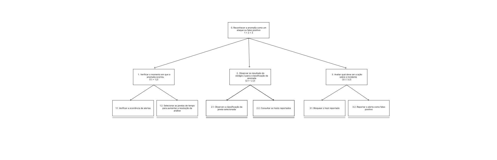
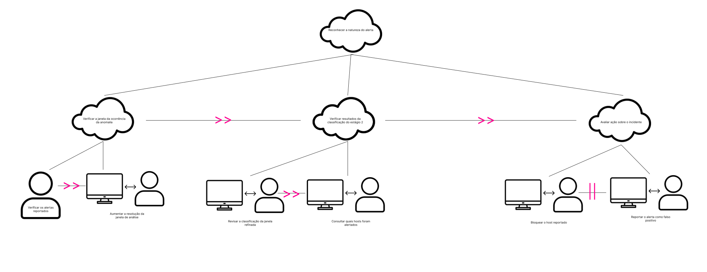
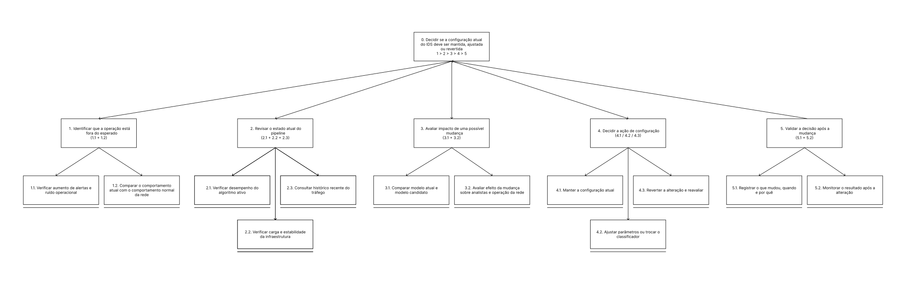
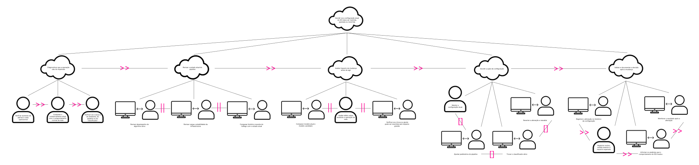

# Entrega 5 — Análise de tarefas: HTA, GOMS e CTT

**Data:** 13/09/2026     
**Status:** `🟩 concluída`     
**Responsabilidade:** cada integrante modela pelo menos 1 HTA, 1 GOMS e 1 CTT. As três técnicas podem abordar a mesma funcionalidade ou funcionalidades distintas, conforme a orientação da disciplina.

## Objetivo da atividade

Modelar tarefas importantes sob perspectivas complementares: decomposição hierárquica (HTA), estrutura de metas/métodos/operações (GOMS) e relações temporais entre tarefas (CTT). O diagrama deve ser acompanhado de interpretação textual.

## Para projetos cujo TCC não previa interface

Modele **tarefas humanas relacionadas ao uso da contribuição técnica**, e não a implementação interna do algoritmo. Exemplos de boas tarefas para análise:

- investigar uma consulta de baixo desempenho;
- configurar uma análise e selecionar parâmetros;
- submeter um dataset e verificar sua validade;
- acompanhar uma execução demorada;
- comparar dois resultados/modelos;
- interpretar uma recomendação e decidir se a aceita;
- localizar uma execução anterior usando busca/filtros;
- gerar e compartilhar um relatório;
- administrar papéis/permissões quando isso for parte do trabalho real;
- revisar um alerta e registrar uma decisão.

Um CRUD pode gerar tarefas relevantes, mas “cadastrar usuário” só merece modelagem se tiver significado no domínio (papéis, validações, riscos, permissões, dependências).

## Seleção das tarefas

| ID | Tarefa | Persona/cenário de origem | Frequência/criticidade | Autor responsável |
|---|---|---|---|---|
| T01 | Decidir se a configuração atual do IDS deve ser mantida, ajustada ou revertida | Vanessa / Cenário 02 | Alta | Marcela Nalesso |
| T02 | Reconhecer a anomalia como um ataque ou falso positivo | Thiago / Cenário 01 | Alta frequência e alta criticidade | Lucas Kerr do Amaral |

> Priorize tarefas necessárias para que o usuário alcance objetivos centrais. Não desperdice a modelagem em ações triviais isoladas, como “clicar em login”, se o objetivo relevante é maior. Da mesma forma, não modele o funcionamento interno do algoritmo como se fosse uma tarefa humana.

---

## HTA — T02: Reconhecer a anomalia como um ataque ou falso positivo

**Autor(a):** Lucas Kerr do Amaral — 22.123.032-9

### Descrição da tarefa

Thiago, analista de SOC nível 2 em plantão noturno, inicia a tarefa quando o IDS sinaliza uma sequência de conexões suspeitas a partir de um mesmo segmento de rede (cenário C01). O objetivo é julgar se aquelas conexões correspondem a um ataque real ou a um falso positivo do classificador. Para isso, ele localiza o momento em que a anomalia ocorreu, refina a janela de tempo, interpreta a classificação do estágio 2 e consulta os hosts envolvidos. A tarefa se conclui quando Thiago decide a ação sobre o incidente: encaminhar o bloqueio do host reportado ou reportar o alerta como falso positivo.

### Diagrama

### Decomposição e planos

| ID | Objetivo/operação | Plano/ordem | Problema ou decisão de design observada |
|---|---|---|---|
| 0 | Reconhecer a anomalia como um ataque ou falso positivo | 1 > 2 > 3 | A decisão final depende de contexto temporal e da classificação do modelo; nenhuma etapa pode ser pulada sem prejudicar o julgamento. |
| 1 | Verificar o momento em que a anomalia ocorreu | 1.1 + 1.2 | Thiago precisa situar a anomalia no tempo antes de interpretá-la; a interface deve destacar picos e permitir ir direto ao período relevante. |
| 1.1 | Verificar a ocorrência de alertas | 1 | O volume bruto de alertas é o primeiro sinal, mas misturado ao restante do tráfego não indica onde olhar (C01). |
| 1.2 | Selecionar as janelas de tempo para aumentar a resolução da análise | 1 | O refinamento da janela reduz o ruído; o filtro de período deve ser direto e manter o contexto do pico selecionado. |
| 2 | Observar o resultado do estágio 2 para a classificação da anomalia | 2.1 + 2.2 | A classificação só é útil se Thiago entender o critério; termos de ML precisam de explicação na própria tela (RC03). |
| 2.1 | Observar a classificação da janela selecionada | 2 | A classificação deve ser apresentada já filtrada pela janela escolhida em 1.2, sem que Thiago precise refazer o filtro. |
| 2.2 | Consultar os hosts reportados | 2 | Saber quais origens/destinos foram alertados permite confrontar o modelo com o que Thiago conhece do ambiente. |
| 3 | Avaliar qual deve ser a ação sobre o incidente | 3.1 / 3.2 | Ponto de decisão: as saídas são alternativas exclusivas e precisam ser registradas com sua justificativa. |
| 3.1 | Bloquear o host reportado | 3 | O bloqueio é executado pela equipe de infraestrutura; na interface, a ação corresponde a confirmar o incidente e encaminhar a solicitação. |
| 3.2 | Reportar o alerta como falso positivo | 3 | O registro de falsos positivos é o sinal que alimenta a reavaliação do classificador por Vanessa (coordenação C01 ↔ C02). |

**Legenda dos planos:** `>` sequência; `+` ambas as subtarefas são executadas; `/` escolha entre alternativas.

**Verificação do HTA:**

- O objetivo 0 representa uma meta do usuário? Sim. Thiago precisa julgar se a anomalia sinalizada é um ataque real ou um falso positivo, que é o recorte do fluxo de investigação.
- As subtarefas são necessárias e suficientes? Em grande parte. Elas cobrem localização temporal, interpretação da classificação e decisão. A terceira saída prevista no cenário C01 — marcar como indefinido e seguir investigando — e o registro da decisão para o próximo turno ainda não aparecem no diagrama.
- Os **planos** indicam ordem, alternativa, repetição ou condição? Sim. Há sequência no nível principal (1 > 2 > 3), execução conjunta em 1 e 2 e escolha explícita em 3.
- A decomposição parou em nível útil para projeto de interação? Sim. As folhas correspondem a ações sobre a interface (filtrar janela, consultar hosts, reportar alerta) sem descer ao nível de cliques.

---

## GOMS — T02: Reconhecer a natureza do alerta

**Autor(a):** Lucas Kerr do Amaral — 22.123.032-9

### Goal

`G0: reconhecer a natureza do alerta (ataque ou falso positivo)`

A meta principal se divide nas mesmas três submetas do CTT T02, executadas em sequência (`G1 >> G2 >> G3`). G1 e G2 têm um único método; a escolha entre métodos aparece em G3, que é o ponto de decisão de Thiago.

### Métodos, operadores e regras de seleção

**G1: verificar a janela da ocorrência da anomalia**

- **Method M1.1:** localizar e refinar a janela da anomalia
  - Operators:
    - Perceber o volume de alertas reportados no painel
    - Identificar o pico na série temporal
    - Selecionar a janela de tempo do pico
    - Aumentar a resolução da janela de análise

**G2: verificar resultados da classificação do estágio 2**

- **Method M2.1:** interpretar a classificação da janela refinada
  - Operators:
    - Revisar a classificação da janela refinada
    - Ler a categoria prevista e a confiança atribuídas pelo modelo
    - Consultar quais hosts foram alertados
    - Confrontar os hosts alertados com o que conhece do ambiente
    - Decidir se a classificação corresponde a um ataque

**G3: avaliar ação sobre o incidente**

- **Method M3.1:** bloquear o host reportado
  - Operators:
    - Selecionar o host reportado
    - Confirmar o alerta como incidente
    - Encaminhar a solicitação de bloqueio à equipe de infraestrutura
    - Registrar a decisão e o que a fundamentou
- **Method M3.2:** reportar o alerta como falso positivo
  - Operators:
    - Selecionar o alerta
    - Marcar o alerta como falso positivo
    - Registrar a justificativa do descarte
- **Selection Rule SR1:** usar M3.1 quando a classificação do estágio 2 e o contexto dos hosts confirmam um ataque; usar M3.2 quando o tráfego alertado corresponde a um comportamento legítimo conhecido do ambiente (por exemplo, um pico de acessos ao portal).

M3.1 e M3.2 são alternativas exclusivas para a mesma submeta, equivalentes à escolha entre “Bloquear o host reportado” e “Reportar o alerta como falso positivo” no CTT e ao plano `3.1 / 3.2` no HTA. O bloqueio em si é executado pela equipe de infraestrutura, fora da interface; o operador de Thiago é o encaminhamento. Os falsos positivos registrados por M3.2 são o sinal que leva Vanessa a reavaliar o classificador (coordenação C01 ↔ C02).

> Não chame qualquer passo de “método”. Em GOMS, métodos são sequências alternativas capazes de atingir uma meta; regras de seleção explicam quando escolher entre eles.

---

## CTT — T02: Reconhecer a natureza do alerta

**Autor(a):** Lucas Kerr do Amaral — 22.123.032-9

### Descrição

Modelagem da mesma tarefa do HTA T02 sob a perspectiva das relações temporais. A tarefa abstrata raiz, “Reconhecer a natureza do alerta”, se divide em três subtarefas abstratas executadas em sequência: verificar a janela da ocorrência da anomalia, verificar os resultados da classificação do estágio 2 e avaliar a ação sobre o incidente. Cada uma é decomposta em tarefas folha de usuário ou de interação, terminando em uma escolha entre bloquear o host reportado ou reportá-lo como falso positivo.

### Diagrama

### Legenda e relações temporais usadas

| Operador/relação | Significado no diagrama | Exemplo no modelo |
|---|---|---|
| `>>` | Habilitação (sequência): a tarefa da direita só começa quando a da esquerda termina | Verificar a janela da ocorrência da anomalia `>>` Verificar resultados da classificação do estágio 2 `>>` Avaliar ação sobre o incidente |
| `>>` | Habilitação entre folhas | Verificar os alertas reportados `>>` Aumentar a resolução da janela de análise; Revisar a classificação da janela refinada `>>` Consultar quais hosts foram alertados |
| `\|\|` | Alternativa entre as duas ações finais (no HTA, plano `3.1 / 3.2`) | Bloquear o host reportado `\|\|` Reportar o alerta como falso positivo |

**Tipos de tarefa:**

| Tipo | Ícone | Tarefas |
|---|---|---|
| Abstrata | nuvem | Reconhecer a natureza do alerta; Verificar a janela da ocorrência da anomalia; Verificar resultados da classificação do estágio 2; Avaliar ação sobre o incidente |
| Usuário | pessoa | Verificar os alertas reportados |
| Interação | monitor + pessoa | Aumentar a resolução da janela de análise; Revisar a classificação da janela refinada; Consultar quais hosts foram alertados; Bloquear o host reportado; Reportar o alerta como falso positivo |

A relação predominante é de habilitação: Thiago só consegue interpretar a classificação depois de refinar a janela de tempo, e só decide a ação depois de saber quais hosts foram alertados. A primeira folha é uma tarefa de usuário porque consiste em perceber o volume de alertas no painel, sem operar a interface; as demais exigem manipulação (filtrar, consultar, registrar) e são de interação. A decisão final é uma escolha exclusiva entre confirmar o incidente — encaminhando o bloqueio à infraestrutura — e reportar falso positivo.

---

## HTA — T01: Decidir se a configuração atual do IDS deve ser mantida, ajustada ou revertida

**Autor(a):** Marcela Nalesso - 22.222.011-3   

### Descrição da tarefa

Vanessa, como administradora responsável pela operação do IDS e pela estabilidade da infraestrutura, inicia a tarefa quando observa aumento de alertas, ruído operacional e comportamento anômalo na rede. O objetivo é confirmar se o cenário exige manter a configuração atual, ajustar parâmetros do pipeline ou reverter uma alteração recente. A tarefa se conclui quando a decisão é tomada com base em diagnóstico, avaliação de impacto e validação do efeito sobre a operação da rede.

### Diagrama

### Decomposição e planos

| ID | Objetivo/operação | Plano/ordem | Problema ou decisão de design observada |
|---|---|---|---|
| 0 | Decidir se a configuração atual do IDS deve ser mantida, ajustada ou revertida | 1 > 2 > 3 > 4 > 5 | Vanessa precisa diagnosticar, avaliar risco e validar a decisão antes de agir. |
| 1 | Identificar que a operação do IDS está fora do comportamento esperado | 1.1 > 1.2 | O desvio deve ser confirmado antes de qualquer ajuste. |
| 1.1 | Verificar aumento de alertas e ruído operacional | 1 | O sinal inicial é relevante, mas não é suficiente para justificar uma mudança. |
| 1.2 | Comparar o comportamento atual com a linha de base da rede | 1 | A comparação evita decisões baseadas em anomalias isoladas ou temporárias. |
| 2 | Revisar o estado atual do pipeline | 2.1 || 2.2 || 2.3 | A causa do problema pode estar no algoritmo, na infraestrutura ou no comportamento recente do ambiente. |
| 2.1 | Verificar desempenho do algoritmo ativo | 2 | O algoritmo pode estar gerando falsos positivos ou classificações inadequadas. |
| 2.2 | Verificar carga e estabilidade da infraestrutura | 2 | A infraestrutura pode estar degradada mesmo quando o algoritmo está funcional. |
| 2.3 | Consultar o histórico recente do tráfego e dos alertas | 2 | O histórico ajuda a distinguir variação legítima de comportamento de falha operacional. |
| 3 | Avaliar impacto de uma possível mudança | 3.1 || 3.2 || 3.3 | A decisão precisa considerar risco, reversibilidade e efeito sobre a operação. |
| 3.1 | Comparar o modelo atual e o modelo candidato | 3 | A análise entre alternativas reduz a chance de ajustar o sistema pela causa errada. |
| 3.2 | Avaliar o efeito da mudança sobre analistas e operação da rede | 3 | As mudanças impactam diretamente o trabalho de investigação e a estabilidade do trânsito. |
| 4 | Decidir a ação de configuração | 4.1 [] 4.2 [] 4.3 [] 4.4 | A alternativa escolhida depende do diagnóstico e do risco estimado. |
| 4.1 | Manter a configuração atual | 4 | Manter é apropriado quando o comportamento está estável e aceitável. |
| 4.2 | Ajustar parâmetros do pipeline ou classificador ativo | 4 | O ajuste é adequado quando o problema é de calibração e não de falha estrutural. A troca é relevante quando a qualidade de detecção do modelo atual é insuficiente.  |
| 4.3 | Reverter a alteração e reavaliar | 4 | A reversão é preferível quando a alteração piorou o ambiente ou aumentou ruído. |
| 5 | Validar a decisão após a mudança | 5.1 > 5.2 > 5.3 > 5.4 | A validação confirma se a ação teve o efeito desejado e se a equipe foi informada. |
| 5.1 | Registrar o que mudou, quando e por quê | 5 | O registro cria rastreabilidade e suporte para análise posterior. |
| 5.2 | Monitorar o resultado após a alteração | 5 | A confirmação do efeito é essencial para saber se a decisão foi correta. |

**Verificação do HTA:**

- O objetivo 0 representa uma meta do usuário? Sim. Vanessa precisa decidir de forma fundamentada se deve manter, ajustar ou reverter a configuração do IDS.
- As subtarefas são necessárias e suficientes? Sim. Elas cobrem diagnóstico, revisão do pipeline, avaliação de impacto, tomada de decisão e validação final.
- Os **planos** indicam ordem, alternativa, repetição ou condição? Sim. Há sequência principal, paralelismo nas verificações e escolha explícita entre alternativas de ação.
- A decomposição parou em nível útil para projeto de interação? Sim. A estrutura chega ao nível de decisão e validação operacional, que é útil para definir requisitos de interface e informação.

---

## GOMS — T02: Decidir se a configuração atual do IDS deve ser mantida, ajustada ou revertida

**Autor(a):** Marcela Nalesso - 22.222.011-3   

### Goal

`G0: decidir se a configuração atual do IDS deve ser mantida, ajustada ou revertida`

### Métodos, operadores e regras de seleção

- **Method M1:** Diagnosticar que a operação saiu do esperado
  - **Selection Rule SR1:** usar M1 quando houver aumento de alertas, ruído operacional e sinais de que o sistema saiu do comportamento esperado
  - Operators:
    - M1.1: Verificar aumento de alertas e ruído operacional
    - M1.2: Comparar o comportamento atual com o comportamento normal da rede
    - M1.3: Verificar se a causa é do ambiente, do pipeline ou do classificador
- **Method M2:** Revisar o estado atual do pipeline
  - **Selection Rule SR2:** usar M2 quando a causa do desvio ainda não está clara e a pessoa precisa verificar a saúde do pipeline antes de agir
  - Operators:
    - M2.1: Revisar desempenho do algoritmo ativo
    - M2.2: Revisar carga e estabilidade da infraestrutura
    - M2.3: Comparar histórico recente do tráfego com o estado atual
- **Method M3:** Avaliar impacto da mudança antes de agir
  - **Selection Rule SR3:** usar M3 quando já existe uma possível mudança de parâmetro ou classificador e é necessário estimar impacto antes de aplicar alteração
  - Operators:
    - M3.1: Comparar modelo atual e modelo candidato
    - M3.2: Avaliar efeito sobre analistas e operação da rede
    - M3.3: Verificar se a troca ou ajuste pode ser revertida sem impacto grande
- **Method M4:** Decidir a ação de configuração
  - **Selection Rule SR4:** usar M4 quando o diagnóstico já foi concluído e a decisão de ação precisa ser tomada
  - Operators:
    - M4.1: Manter a configuração atual
    - M4.2: Ajustar parâmetros do pipeline
    - M4.3: Trocar o classificador ativo
    - M4.4: Reverter a alteração e reavaliar
- **Method M5:** Validar e documentar a decisão após a mudança
  - **Selection Rule SR5:** usar M5 quando a alteração foi aplicada e é necessário registrar e acompanhar o efeito para confirmar se a decisão foi correta
  - Operators:
    - M5.1: Registrar a alteração no histórico de configuração
    - M5.2: Registrar motivo, estado anterior e impacto esperado
    - M5.3: Informar os analistas que o comportamento do IDS mudou
    - M5.4: Monitorar o resultado após a alteração

> Não chame qualquer passo de “método”. Em GOMS, métodos são sequências alternativas capazes de atingir uma meta; regras de seleção explicam quando escolher entre eles.

---

## CTT — T03: Decidir se a configuração atual do IDS deve ser mantida, ajustada ou revertida

**Autor(a):** Marcela Nalesso - 22.222.011-3   

### Descrição

Vanessa identifica um desvio no comportamento do IDS, revisa o estado do pipeline, compara alternativas de configuração e decide se a operação deve ser mantida, ajustada ou revertida. A tarefa termina quando a decisão é validada, registrada e comunicada para que a equipe entenda a alternativa adotada e monitorize os efeitos da mudança.

### Diagrama

### Legenda e relações temporais usadas

| Operador/relação | Significado no diagrama | Exemplo no modelo |
|---|---|---|
| `>>` | Sequência | `M1 >> M2 >> M3 >> M4 >> M5` |
| `||` | Concorrência/paralelismo | `M2.1 || M2.2 || M2.3` |
| `[]` | Escolha entre alternativas | `M4.1 [] M4.2 [] M4.3 [] M4.4` |
| `>` | Habilitação | a etapa de validação é habilitada somente após a decisão de ação |
| `*` | Repetição | pode ocorrer em ciclos de ajuste e reavaliação |

Os métodos M1 a M5 representam uma sequência principal de execução: primeiro Vanessa diagnostica a anomalia, depois revisa o pipeline, em seguida avalia a mudança, toma a decisão e, por fim, valida o efeito da decisão. O tipo de tarefa varia conforme a etapa: M1 é uma tarefa abstrata e de usuário, M2 envolve interação com o sistema e revisão de dados operacionais, M3 é de interação e avaliação, M4 combina abstração, decisão do usuário e interação com informações do ambiente, e M5 combina interação, usuário e sistema para registrar e monitorar a ação. A relação principal é sequencial, com paralelismo na revisão do pipeline e escolha explícita entre manter, ajustar, trocar ou reverter a configuração.

---

## Síntese da equipe

Quais problemas de interação, oportunidades e requisitos apareceram a partir das modelagens? Quais tarefas irão para o protótipo e para o teste de usabilidade?

## Checklist

- [ ] Cada integrante produziu ao menos 1 HTA, 1 GOMS e 1 CTT.
- [ ] Cada artefato identifica autor e tarefa.
- [ ] Diagramas são legíveis e possuem fonte editável quando possível.
- [ ] HTA contém planos, não apenas árvore de tópicos.
- [ ] GOMS distingue Goals, Operators, Methods e Selection Rules.
- [ ] CTT usa operadores temporais e tipos de tarefa coerentes.
- [ ] Há texto explicando cada diagrama.
- [ ] Tarefas estão ligadas a cenários/personas na rastreabilidade.
- [ ] Em TCC técnico, as tarefas descrevem o que a pessoa faz com a contribuição/resultados, não passos internos do código.
- [ ] CRUDs, relatórios, filtros e atividades administrativas foram escolhidos por relevância ao objetivo do usuário.
