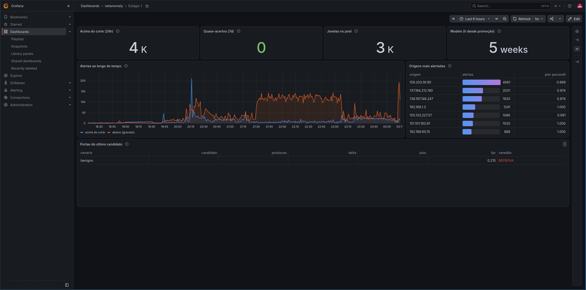
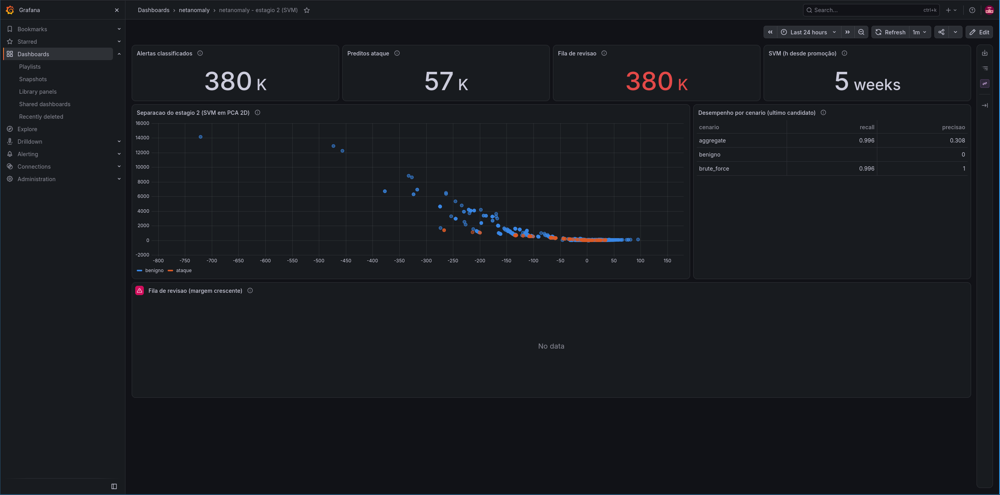
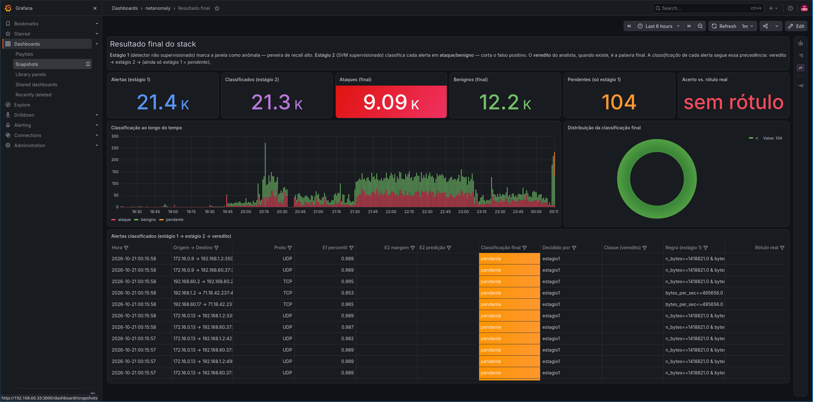
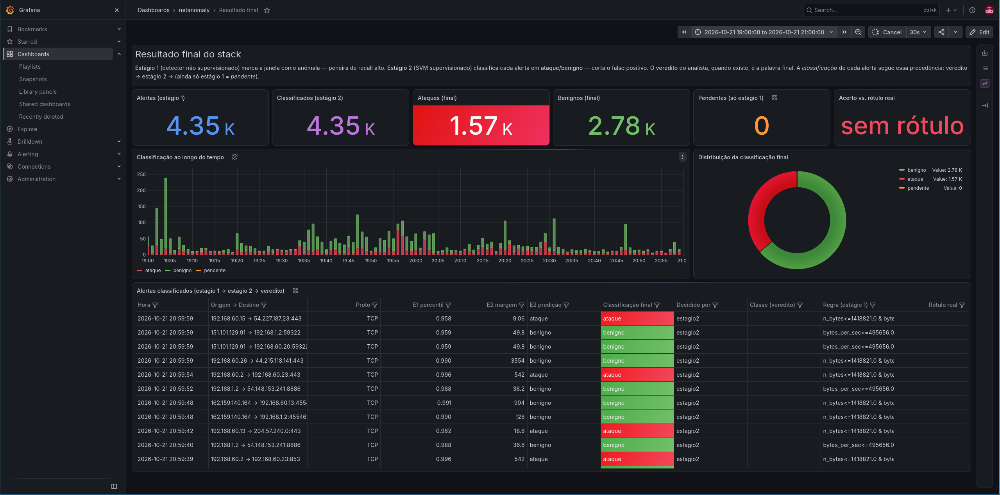

# Entrega 6 — Prototipação em papel

**Data:** 09/10/2026 · **Revisada em:** 16/11/2026  
**Status:** `🟩 Concluído`  
**Responsabilidade:** 1 solução integrada por equipe

## Objetivo da atividade

Externalizar rapidamente ideias de interação em baixa fidelidade para explorar alternativas antes de investir em detalhes visuais. O valor da atividade está no **ciclo construir → simular → observar → revisar**, não na beleza do desenho.

> **O que se ganha:** os painéis mostram volumes, distribuições e classificações **reais** do pipeline, e não números inventados. Isso deixa à vista problemas que o papel esconderia, como contagens que não batem entre telas e painéis vazios.
>
> **O que se perde, e como tratamos isso:** um painel com dados reais tem aparência de alta fidelidade, e o acabamento visual pode **mascarar problemas de fluxo**. Por isso a análise abaixo olha para **estrutura** (o que cada painel responde, a ordem e o caminho entre eles) e não para cor, tipografia ou estilo do gráfico. Além disso, o Grafana é uma ferramenta de **leitura**: ele não permite registrar uma decisão nem encaminhar um caso. Na v1 essas partes do fluxo ficaram sem representação (seção 3.4); a seção 3.5 mostra como foram representadas na v2. A troca do modelo também acontece fora dele, por uma ferramenta de **linha de comando** do pipeline — isso é decisão de escopo, e não lacuna: nos painéis, a administradora **verifica as métricas**; a execução da troca não é demonstrada.

## 1. Escopo do protótipo

**Personas:** P01 — Thiago Albuquerque (analista de SOC, fluxo de investigação) e P02 — Vanessa Toledo (administradora da plataforma, fluxo de configuração/validação)  
**Cenários/tarefas cobertos:** C01 (alerta de tráfego anômalo durante a operação) e C02 (aumento de alertas depois de uma alteração do pipeline). Atividades A01, A02 e A03 da Entrega 01. Tarefas da Entrega 05: **T02** — reconhecer a anomalia como um ataque ou falso positivo (Thiago, C01) e **T01** — decidir se a configuração atual do IDS deve ser mantida, ajustada ou revertida (Vanessa, C02)  
**Versões tratadas neste documento:** **v1** — dashboards Grafana D01–D03, capturas de 09/10/2026 (seções 3 e 4); **v2** — revisão no Figma (Entrega 11, 30/10/2026): D03 revisado e telas D04–D06. As capturas v1 ficam preservadas como registro histórico; a v2 é referenciada apenas para mostrar o que mudou e por quê (seções 3.5 e 5)  
**Objetivos principais:**

- Mostrar, de forma navegável, **como um alerta atravessa o pipeline em dois estágios** (detector não supervisionado → SVM supervisionado → veredito do analista) e qual é o resultado final de cada alerta;
- Dar a Thiago um panorama de entrada que responda “há algo fora do padrão agora?” antes do detalhe (RC01), e uma lista de alertas em que ele veja **quem decidiu** a classificação (RC03);
- Dar a Vanessa o desempenho de cada estágio e o resultado do **portão de promoção** do modelo candidato, para comparar o modelo em produção com o candidato antes de trocar (C02);
- Tornar visível **há quanto tempo o modelo ativo foi promovido**, que é o ponto de contato entre os dois fluxos (Entrega 03, “Da coordenação entre os dois”).

**O que a v1 cobre de cada tarefa.** Para T02, a v1 cobre a leitura do panorama e o exame dos alertas; o registro do veredito e o encaminhamento não se completam nos painéis (seção 3.4) e foram prototipados na v2 (D04). Para T01, a v1 foi **delimitada à consulta das métricas**: a execução da troca continua por linha de comando e não entra neste protótipo. Essa delimitação não encerra a exploração da tarefa: comparar candidato e produção, confirmar a troca e revertê-la, que T01 exige (quatro alternativas: manter, ajustar, trocar, reverter), foram prototipados na v2 (D05 e D06), com a troca **simulada** (seção 3.5).

## 1.1 Possíveis famílias de interface

Das famílias sugeridas, o protótipo explora apenas as que as tarefas pedem:

| Família | Usada? | Onde | Justificativa |
|---|---|---|---|
| Dashboard para monitoramento | **Sim** | D01, D02, D03 (indicadores do topo e séries temporais) | A01: perceber se há algo fora do padrão (RC01) |
| Alertas/ocorrências com ação de resposta | **Parcial** | D03, tabela “Alertas classificados” | A02: a tabela lista os alertas e quem decidiu, mas **não permite agir** (registrar veredito, encaminhar) |
| Relatório/resultados com explicação | **Sim** | D03, painel de texto “Resultado final do stack”; D02, separação SVM e desempenho por cenário | RC03: explicar de onde vem a classificação |
| Comparação entre versões | **Parcial** | D01, “Portão do último candidato”; D02, “Desempenho por cenário (último candidato)” | C02/A03: comparar candidato e produção antes de promover |
| Histórico com filtros | **Parcial** | D03, filtros por coluna da tabela | A02/RC04: recortar por origem, protocolo e classificação. Falta a contagem de resultados após o filtro |
| Configuração/parametrização | **Não** | — | A troca de modelo é feita por linha de comando, fora do painel; aqui só se **verificam as métricas** e se **observa** o efeito dela |
| Administração, login, CRUD | **Não** | — | Nenhuma tarefa priorizada depende disso |

## 2. Fluxos escolhidos

O fluxo principal é um **conjunto de três dashboards no Grafana**, na pasta `netanomaly`. Cada dashboard corresponde a uma etapa do pipeline. A navegação entre eles é feita pela lista de dashboards da pasta.

| Fluxo | Tarefa/objetivo | Por que foi priorizado |
|---|---|---|
| PF01 — Investigação a partir do resultado final | **T02.** Thiago abre **D03 (Resultado final)**, vê os totais por classificação, percebe o pico na série temporal, filtra a tabela por origem/classificação e identifica quais alertas ainda estão **pendentes** (só estágio 1) e quais já têm decisão (C01, A01 → A02) | É o núcleo do recorte de IHC. A priorização se apoia em **hipóteses ainda não investigadas**: que A01 seja a atividade mais frequente (H11) e A02 a mais crítica (H12). Elas justificam a ordem dos fluxos, mas não viraram fato; a coleta da Entrega 07 é que deve sustentá-las ou não |
| PF02 — Validação do modelo por estágio | **T01 (parte de consulta).** Vanessa abre **D01 (Estágio 1)** para ver o volume acima do corte, quase-acertos, origens mais alertadas e o portão do último candidato. Em seguida abre **D02 (Estágio 2 — SVM)** para ver a separação entre benigno e ataque, a fila de revisão e o desempenho por cenário (C02, A03) | A troca de modelo muda o que Thiago vê; Vanessa precisa saber o efeito **antes** de promover (P02, “ver a consequência antes de confirmar”) |
| PF03 — Ponto de contato entre os fluxos | Em **D01 e D02** (não em D03), o indicador “Modelo/SVM (h desde promoção)” mostra há quanto tempo o modelo ativo está em produção. Na v1, quem está em D03 precisa sair para D01 ou D02 para ver esse dado; repetir o indicador em D03 era proposta (seção 5) e foi feito na v2 (F01.1 ③, “Modelo ativo: SVM v7 · desde 27/10”) | Thiago precisa ver que o modelo mudou e desde quando (C01, Q4; H27) |

## 3. Telas e estados

Para não colidir com os IDs de persona (P01, P02), as telas são numeradas como **D01–D03** (dashboards) e os estados relevantes como **D0x-Ey**.

### Mapa de navegação

```text
Pasta "netanomaly" (lista de dashboards do Grafana)
 ├── D01  Estágio 1 — detector não supervisionado ──┐
 ├── D02  Estágio 2 — SVM supervisionado ───────────┤  (sem link direto entre eles:
 └── D03  Resultado final do stack ─────────────────┘   volta-se sempre à lista)

Controles comuns a todos: intervalo de tempo (ex.: "Last 6 hours"),
navegação ‹‹ ›› no tempo, zoom out, refresh automático (1m).
```

### D01 — Estágio 1 (detector não supervisionado)



| Região | Conteúdo | Pergunta que responde | Persona/tarefa |
|---|---|---|---|
| Indicadores do topo | **Acima do corte (24h)** 4K · **Quase-acertos (7d)** 0 · **Janelas no pool** 3K · **Modelo (h desde promoção)** 5 semanas | “Quanto o detector está sinalizando e há quanto tempo o modelo está ativo?” | P02 (C02); o último indicador também serve a P01 (PF03) |
| Alertas ao longo do tempo | Série temporal com duas linhas: **acima do corte** (azul) e **abaixo, gravado** (laranja) | “Quando o volume mudou?” | P01 (A01), P02 (C02) |
| Origens mais alertadas | Tabela com origem, barra de alertas e **pior percentil** | “Quem gera mais alertas?” | P01 (A02, recorte por origem — RC02) |
| Portão do último candidato | Tabela cenário × candidato × produção × delta × piso × fpr × **veredito** | “O candidato pode substituir o modelo em produção?” | P02 (A03) |

**Estados e controles:**

- **D01-E1 — candidato reprovado:** o portão mostra `benigno · fpr 0.215 · REPROVA` em vermelho.
- **D01-E2 — mudança de intervalo:** ao alterar o intervalo de tempo, a série e a tabela de origens são recalculadas. O indicador “Acima do corte” continua fixo em 24h e “Quase-acertos” em 7 dias, independentemente do intervalo escolhido.

### D02 — Estágio 2 (SVM supervisionado)



| Região | Conteúdo | Pergunta que responde | Persona/tarefa |
|---|---|---|---|
| Indicadores do topo | **Alertas classificados** 380K · **Preditos ataque** 57K · **Fila de revisão** 380K (vermelho) · **SVM (h desde promoção)** 5 semanas | “Quanto o SVM classificou e quanto espera revisão?” | P02 (C02), P01 (PF03) |
| Separação do estágio 2 (SVM em PCA 2D) | Dispersão dos alertas projetados em duas dimensões, coloridos como **benigno** (azul) e **ataque** (laranja) | “O SVM está separando bem as duas classes?” | P02 (C02) |
| Desempenho por cenário (último candidato) | Tabela cenário × recall × precisão: aggregate 0.996/0.308, benigno –/0, brute_force 0.996/1 | “Em quais cenários o candidato acerta?” | P02 (A03) |
| Fila de revisão (margem crescente) | Lista dos alertas mais próximos da fronteira do SVM, isto é, os mais incertos | “O que um humano deveria olhar primeiro?” | P01 (A02) |

**Estados e controles:**

- **D02-E1 — fila vazia:** o painel “Fila de revisão” mostra **No data**, enquanto o indicador “Fila de revisão” no topo mostra 380K em vermelho.
- **D02-E2 — mudança de intervalo:** este dashboard abre com “Last 24 hours”; D01 e D03 abrem com “Last 6 hours”.

### D03 — Resultado final do stack



| Região                                                   | Conteúdo                                                                                                                                                                                                                             | Pergunta que responde                                                   | Persona/tarefa              |
| -------------------------------------------------------- | ------------------------------------------------------------------------------------------------------------------------------------------------------------------------------------------------------------------------------------ | ----------------------------------------------------------------------- | --------------------------- |
| Texto explicativo                                        | Explica os dois estágios e a **precedência** da classificação: estágio 2 → estágio 1 (“pendente”)                                                                                                                                    | “De onde vem a classificação que estou vendo?”                          | P01 (RC03)                  |
| Indicadores do topo                                      | **Alertas (estágio 1)** 20.2K · **Classificados (estágio 2)** 20.2K · **Ataques (final)** 6.76K, em destaque vermelho · **Benignos (final)** 13.4K · **Pendentes (só estágio 1)** 0 · **Acerto vs. rótulo real** “sem rótulo”      | “Quanto do que foi sinalizado é ataque e quanto ainda não tem decisão?” | P01 (A01)                   |
| Classificação ao longo do tempo                          | Barras empilhadas por intervalo: ataque, benigno e pendente                                                                                                                                                                          | “Quando os ataques se concentraram?”                                    | P01 (A01)                   |
| Distribuição da classificação final                      | Rosca com as três classes e os valores na legenda (benigno 13.4K, ataque 6.76K, pendente 0), nas mesmas cores da série temporal                                                                                                                                                                                                                     | “Qual a proporção entre as classes?”                                    | P01 (A01)                   |
| Alertas classificados (estágio 1 → estágio 2 → veredito) | Tabela com hora, origem → destino, protocolo, **E1 percentil**, **E2 margem**, **E2 predição**, **classificação final** (com cor), **decidido por**, classe do veredito, **regra (estágio 1)** e rótulo real. Cada coluna tem filtro | “Qual conexão, por que foi sinalizada e quem decidiu?”                  | P01 (A02, RC02, RC03, RC04) |

**Estados e controles:**

- **D03-E1 — alerta pendente:** a linha apareceria com classificação final `pendente` em laranja e `decidido por: estagio1`, com as colunas do estágio 2 e do veredito vazias. *(Nas capturas atuais “Pendentes (só estágio 1)” está em 0 e o estado não ocorre: todo alerta do período foi classificado pelo estágio 2.)*
- **D03-E2a — alerta classificado pelo SVM:** a classificação final é `ataque` ou `benigno` e `decidido por` mostra `estagio2`. **Visível na captura:** todas as linhas da tabela estão neste estado. `estagio2` identifica a **etapa** do pipeline, não a versão do modelo que classificou.
- **D03-E2b — alerta com veredito do analista:** pela precedência descrita no painel, a classificação final passaria a vir do veredito e `decidido por` indicaria o analista. **Não demonstrado na v1:** a coluna “Classe (veredito)” está vazia em todas as linhas e o Grafana não permite preenchê-la. Representado na v2 (D04, seção 3.5).
- **D03-E3 — filtro aplicado:** os ícones de funil nos cabeçalhos filtram a tabela por valor (por exemplo, só `ataque`, só `TCP`, uma origem). Os indicadores do topo **não** acompanham o filtro.
- **D03-E4 — sem rótulo real:** o indicador “Acerto vs. rótulo real” mostra **sem rótulo** em vermelho quando não há verdade de referência para o período.
- **D03-E5 — recorte curto em torno do pico:** com o intervalo reduzido a duas horas (19h–21h de 21/10; captura na seção 4.1), os indicadores recalculam (4.35K alertas, 1.57K ataques, 2.78K benignos, contra 20.2K/6.76K/13.4K na janela de 6h) e a série revela a composição do pico. É o estado em que o painel mais responde — e é alcançado por um gesto do usuário, não oferecido pela interface.

### 3.4 Lacunas do fluxo (o que a v1 não representa)

| Lacuna                                                                                                                                       | Tarefa afetada                                         | Por que ficou de fora                                                                                                        |
| -------------------------------------------------------------------------------------------------------------------------------------------- | ------------------------------------------------------ | ---------------------------------------------------------------------------------------------------------------------------- |
| Registrar o veredito (ataque, benigno ou **indefinido**) com a justificativa                                                                 | A02 — C01 (as três saídas da decisão)                  | O Grafana é somente leitura. A coluna “Classe (veredito)” existe, mas não há como preenchê-la pelo painel                    |
| Encaminhar o caso à infraestrutura e escrever a passagem de plantão                                                                          | A02 — C01 (Q5)                                         | Fora do que o Grafana oferece. Precisa de tela própria ou integração com o sistema de chamados                               |
| Detalhe de uma conexão (histórico da origem com aquele destino, volume habitual do ativo)                                                    | A02 — jornada de P01, etapa 4                          | Não há drill-down da linha da tabela para uma visão da conexão                                                               |
| Confirmar a promoção do candidato e desfazer a troca                                                                                         | A03 — P02 (“confirmação explícita e caminho de volta”) | Decisão de escopo: o portão só **mostra** o veredito e a promoção é executada pela **ferramenta de linha de comando** do pipeline, que não entra neste protótipo                                                        |
| Estimar o efeito da promoção antes de aplicá-la (quanto chegaria a mais ou a menos ao analista) e a carga do modelo no equipamento embarcado | A03 — P02 (“ver a consequência antes de confirmar”)    | Os painéis descrevem o que **já** aconteceu; não há previsão de efeito nem custo de processamento ao lado do veredito do portão                |
| Histórico do que mudou em cada promoção, quando e por quem                                                                                   | A03 — P02; C01, Q4                                     | O indicador “h desde promoção” dá a idade do modelo ativo, mas não há registro da mudança a que atribuir um efeito observado |
| Sinal de Thiago para Vanessa de que as ocorrências não estão se confirmando                                                                  | Coordenação C01 ↔ C02                                  | Nenhum painel registra nem agrega essa informação                                                                            |

### 3.5 Estados e respostas necessários para concluir as tarefas

As capturas da v1 mostram os painéis e um recorte de tempo, mas vários estados de que T01 e T02 dependem eram só descritos. A tabela abaixo escolhe os prioritários e diz, para cada um, **o que a pessoa aciona, o que muda, como reconhece o resultado e como volta ou corrige**. As representações estão na v2 (Figma, Entrega 11), cujos quadros estão no repositório em [`assets/11_figma/`](../assets/11_figma/). Bloqueio de rede, sistema de chamados e execução real da troca de modelo **não** são implementados: o protótipo mostra o percurso até o ponto em que outra equipe ou ferramenta assume.

| Estado | Tarefa | O que a pessoa aciona | O que muda na tela | Como reconhece o resultado | Como volta ou corrige | Na v1 | Na v2 |
|---|---|---|---|---|---|---|---|
| Alerta pendente (só detector) | T02 | Nada; ou restringe por “Classificação: pendente” | A linha aparece com a classificação `pendente` (âmbar + texto) e sem dados do estágio 2; a tabela ordena ataque e pendente primeiro | Indicador “Pendentes (só detector)” com a janela declarada; *badge* com texto, não só cor | Não há ação a desfazer: o estado muda sozinho quando o estágio 2 classifica | Descrito, não ocorre na captura (D03-E1, 0 pendentes) | F01.1, linha e indicador ([`f01.svg`](../assets/11_figma/f01.svg)) |
| Filtro (restrição) aplicado | T02 | “+ Adicionar critério ▾” (ex.: origem, classificação) | Critérios aparecem por extenso acima da tabela; contagem “312 de 4.350 alertas” | O número de linhas restantes e os critérios ficam visíveis o tempo todo | Remover cada critério no próprio rótulo; com restrição vazia, F01.1V sugere qual critério remover | Filtro nativo por coluna, sem contagem (D03-E3, sem captura) | F01.1 ⑦ e F01.1V ([`f01_5_estados.svg`](../assets/11_figma/f01_5_estados.svg)). Alcance dos indicadores: esboço 5.1-C |
| Classificação do modelo × veredito humano | T02 | Abre a linha (detalhe do alerta) | Painel lateral com classificação, quem classificou (com versão do modelo), contexto, motivo do sinal, incerteza | “quem decidiu: modelo supervisionado (SVM v7)”; ainda sem veredito | “✕ Fechar” volta à lista com a restrição preservada | Só `decidido por: estagio2`; veredito sempre vazio (D03-E2a/E2b) | F01.2 ([`f01_2_detalhe.svg`](../assets/11_figma/f01_2_detalhe.svg)). Rótulo a revisar: AU04/AU05 (seção 4.5) |
| Registro do veredito | T02 | “Registrar veredito deste alerta” ou “Registrar veredito dos 312 alertas” | D04, passo 1 de 2: alertas abrangidos já preenchidos; decisão **sem valor padrão** (ataque / benigno / indefinido); justificativa pré-preenchida com os dados consultados | Resumo do que será gravado antes do botão, cujo rótulo repete a decisão; aviso se há alertas de incerteza alta (F01.3A) | Justificativa vazia → F01.3E mantém o que foi escrito e diz o que falta; depois de gravar, “Desfazer” volta a F01.3 preenchido | Inexistente (Grafana é somente leitura; HC12, sev. 4) | F01.3 ([`f01_3_veredito.svg`](../assets/11_figma/f01_3_veredito.svg)) |
| Encaminhamento e passagem de plantão | T02 | “Enviar encaminhamento” (passo 2 de 2; não aparece se a decisão for benigno) | Destinatário (Infraestrutura por padrão) e texto gerado a partir do veredito, revisável | Faixa “Encaminhado à Infraestrutura às 21:06”; a contenção fica explícita como responsabilidade da equipe destinatária; itens em aberto vão para a passagem de plantão | Antes do envio, o texto é editável. **Corrigir depois do envio não foi prototipado** (pendente) | Inexistente (fora dos painéis, passo A9) | F01.4 ([`f01_4_encaminhamento.svg`](../assets/11_figma/f01_4_encaminhamento.svg)) |
| Coleta parada (sem dados ≠ zero) | T02, T01 | Nada (estado do sistema) | Faixa vermelha de coleta parada; indicadores tracejados, cinza, “sem dados desde 20:31” em vez de 0 | Mensagem diz o que houve, que isso não significa ausência de alertas e o que fazer | “Voltar a atualizar” quando a coleta retorna; a ação de recuperação ainda é só textual (AU10) | “No data” sem causa em D02-E1 | F01.1E ([`f01_5_estados.svg`](../assets/11_figma/f01_5_estados.svg)) |
| Candidato reprovado | T01 | Abre a comparação do candidato | Resultado “✕ REPROVADO” em âmbar, com cenário e métrica que reprovaram (21,5% do benigno marcado como ataque; máximo 5%) | Botão de promover indisponível, com o motivo escrito no próprio botão | Voltar ao modelo em produção; outros candidatos ainda não acessíveis (AU08) | `REPROVA` com candidato, produção, delta e piso vazios (D01-E1) | F02.1E ([`f02_3_estados.svg`](../assets/11_figma/f02_3_estados.svg)) |
| Troca do modelo (confirmar e reverter) | T01 | “Promover SVM v8 para produção…” → “Confirmar troca” | Diálogo com o que muda, efeito previsto para os analistas, perda de detecção, carga prevista e **motivo obrigatório** | Fechamento com modelo ativo, horário, autor e aviso feito; aviso e marcação da troca em D03 (F02.3T); entrada em D06 | “Cancelar” antes; “Voltar ao v7…” depois, com o mesmo diálogo (F02.4R), registrado como reversão | Fora do protótipo (CLI; passo B6) | F02.2, F02.3, F02.4 ([`f02_2_confirmacao.svg`](../assets/11_figma/f02_2_confirmacao.svg), [`f02_3_estados.svg`](../assets/11_figma/f02_3_estados.svg), [`f02_4_historico.svg`](../assets/11_figma/f02_4_historico.svg)). **Troca simulada** |

**O que cada versão cobre de cada tarefa:**

| Tarefa | v1 — Grafana (esta entrega) | v2 — Figma (Entrega 11) | Fora do protótipo |
|---|---|---|---|
| T02 — Thiago | Panorama, recorte de tempo, leitura das colunas de cada alerta | + restrição com contagem, detalhe do alerta, registro do veredito com três saídas, encaminhamento, passagem de plantão, estados de ausência de dado | Bloqueio/contenção; sistema de chamados real |
| T01 — Vanessa | **Consulta** das métricas dos dois estágios e do portão | + sinal vindo dos analistas (alertas não confirmados), comparação candidato × produção com critério, efeito previsto, confirmação, reversão, histórico de trocas | Execução real da troca (CLI do pipeline); treino de candidatos; alternativa “ajustar” (parâmetros) ainda sem tela |

## 4. Simulação / walkthrough

Duas demonstrações, uma por persona, sobre os painéis **como estão hoje**. Cada uma mostra **o que a pessoa precisa fazer**, **em que tela ela faz** e **o que os dados daquela tela querem dizer**. O recorte de cada fluxo é diferente:

- **Fluxo A — Thiago (P01):** investiga um possível ataque e precisa chegar a um julgamento. Usa D03 como painel principal e recorre a D01 pontualmente. O encaminhamento da decisão acontece fora dos painéis.
- **Fluxo B — Vanessa (P02):** **apenas verifica as métricas** do detector e do classificador, em D01 e D02. Se decidir trocar o modelo, a troca é feita por uma **ferramenta de linha de comando**, fora do Grafana — não faz parte desta demonstração.

**Natureza destas demonstrações.** As seções 4.1 e 4.2 são um *walkthrough* **dos próprios autores** sobre a v1: explicam o percurso esperado e a leitura dos dados, mas **não** mostram como outra pessoa compreende e percorre a interface. A validação formativa com participante externo à construção está na seção 4.5.

**Classificação não é confirmação.** Em toda a demonstração, “ataque” e “benigno” são **classificações do modelo**. Nas capturas, todas as linhas têm `decidido por: estagio2`, veredito humano vazio e “Acerto vs. rótulo real” = “sem rótulo”: nada na tela confirma que uma classificação está certa. Onde a leitura depende disso, o passo indica o que Thiago ou Vanessa precisariam consultar para confirmar ou contestar.

### 4.1 Fluxo A — investigação de um possível ataque (P01, PF01/PF03)

**Situação:** o portal interno do atendimento ficou lento no começo da noite de 21/10, a operação reclamou e o IDS vem sinalizando conexões de um mesmo segmento. Thiago precisa descobrir o que aconteceu e se alguma conexão exige ação.

| #   | O que ele precisa fazer                                         | Tela / painel                                                                                       | O que a tela mostra                                                                                                                                                                                                     | O que o dado significa                                                                                                                                                                                                                                                                                                                                   |
| --- | --------------------------------------------------------------- | --------------------------------------------------------------------------------------------------- | ----------------------------------------------------------------------------------------------------------------------------------------------------------------------------------------------------------------------- | -------------------------------------------------------------------------------------------------------------------------------------------------------------------------------------------------------------------------------------------------------------------------------------------------------------------------------------------------------- |
| A1  | Saber se há algo fora do padrão antes de abrir qualquer detalhe | **D03**, indicadores do topo                                                                        | Alertas (estágio 1) 20.2K · Classificados (estágio 2) 20.2K · Ataques (final) 6.76K · Benignos (final) 13.4K · Pendentes 0 · Acerto vs. rótulo real “sem rótulo”                                                        | Na janela de 18h às 00h, o detector marcou 20.2K janelas de tráfego como anômalas e o SVM classificou **todas** elas; cerca de um terço foi **classificado** como ataque. “Pendentes 0” significa que nenhum alerta parou no estágio 1. “Sem rótulo” significa que não há verdade de referência para o período: a tela não permite saber quantas dessas classificações estão corretas                                                                                                                 |
| A2  | Situar o episódio no tempo                                      | **D03**, “Classificação ao longo do tempo”                                                          | Barras empilhadas por faixa de poucos minutos, com picos de ~450 alertas às 18h15, 18h45 e 22h30 sobre um fundo constante de 50–100                                                                                     | Cada barra é o volume de alertas daquela faixa, dividido por classificação final: vermelho = classificado como ataque, verde = classificado como benigno, laranja = pendente. A altura responde “quando houve mais movimento”; a composição responde “movimento de quê”                                                                                                                      |
| A3  | Ver a proporção entre as classes no período                     | **D03**, “Distribuição da classificação final”                                                      | Rosca com benigno 13.4K e ataque 6.76K (pendente 0), nas mesmas cores da série                                                                                                                                          | A proporção acumulada da janela inteira. Serve de referência para comparar com o que aparece nos recortes menores                                                                                                                                                                                                                                        |
| A4  | Verificar se o pico de volume é o ataque                        | **D03**, arrastando sobre a série para recortar **19h–21h de 21/10** (figura abaixo)                | Com o recorte: 4.35K alertas, 1.57K ataques, 2.78K benignos. A barra das 19h05 chega a ~240 alertas, quase cinco vezes as vizinhas, e é quase toda **verde**; as frações vermelhas aparecem espalhadas pelas duas horas | Os indicadores e os gráficos acompanham o intervalo selecionado. A leitura possível é: **o SVM classificou a maior parte do pico como benigno**. Isso é resultado do classificador, não prova de que o tráfego era legítimo: o painel mostra “sem rótulo”, as linhas do pico têm `decidido por: estagio2` e veredito vazio. Para confirmar ou contestar, Thiago precisaria consultar: a margem dos alertas do pico (perto da fronteira, a classificação é frágil); origem e destino dessas conexões e se correspondem a um serviço conhecido do horário (ex.: atualização ou *backup*); o volume habitual daquele destino no mesmo horário; e o relato da operação. A v1 não oferece o histórico origem–destino (seção 3.4). A parcela classificada como ataque, espalhada pelo período, é o que **motiva** continuar a investigação, e também precisa ser confirmada                                                                                                                        |
| A5  | Descobrir de onde vem o tráfego sinalizado                      | **D03**, tabela “Alertas classificados”, filtro da coluna origem; **D01**, “Origens mais alertadas” | Na tabela, pares como `192.168.60.2 → 192.168.60.23:853` e `162.159.134.234 → 192.168.60.214`. Em D01: 159.203.19.181 com 4061 alertas e pior percentil 0.999; depois 137.184.212.190 (2031) e 138.197.146.247 (1920)   | A tabela dá a conexão individual; D01 dá o ranking de quem mais dispara o detector. “Pior percentil” é o caso mais extremo daquela origem: 0.999 significa que uma janela dela ficou entre as 0,1% mais anômalas                                                                                                                                         |
| A6  | Entender por que aquela conexão foi sinalizada                  | **D03**, colunas E1 percentil, Regra (estágio 1), E2 margem e E2 predição                           | Ex.: percentil 0.996 · regra `n_bytes<=1418821.0 & bytes_per_sec<=495656.0` · margem 271 · predição `ataque`                                                                                                            | **E1 percentil**: o quanto a janela se afasta do normal segundo o detector — quanto mais perto de 1, mais atípica. **Regra**: a combinação de atributos (volume em bytes, bytes por segundo) que enquadrou a janela. **E2 margem**: a distância até a fronteira de decisão do SVM — margem alta é classificação segura, margem baixa é caso de fronteira |
| A7  | Saber quem produziu aquela classificação                        | **D03**, colunas “Classificação final”, “Decidido por” e “Classe (veredito)”                        | Classificação final colorida (`ataque` vermelho, `benigno` verde); “Decidido por” com `estagio2` em todas as linhas; “Classe (veredito)” vazia                                                                          | A precedência está escrita no painel: **veredito do analista → estágio 2 → estágio 1**. “Decidido por: estagio2” quer dizer que a classificação exibida veio do SVM; coluna de veredito vazia quer dizer que nenhum analista revisou aquele alerta. `estagio2` identifica a **etapa** do pipeline, não a **versão** do modelo que classificou: para saber qual modelo foi, Thiago precisa cruzar a hora da linha com a idade do modelo em D01/D02 (passo A8)                                                                                                                |
| A8  | Verificar se o modelo mudou no período investigado               | **D01** ou **D02**, indicador “Modelo/SVM (h desde promoção)”                                       | 5 semanas                                                                                                                                                                                                               | O indicador é **relativo ao momento da consulta**: diz que a **última** promoção ocorreu cerca de cinco semanas antes de o painel ser aberto. Ele não é um histórico de configuração. Como essa data é anterior a 21/10, o modelo ativo agora já estava ativo no recorte investigado, **a menos que** tenha havido outra troca seguida de reversão, que o indicador não mostra. Também não diz **o que** mudou na última promoção. Para afirmar que não houve troca no período, Thiago precisaria do histórico de promoções com datas (na v2: D06 e a marcação da troca na série, F02.3T)                                                                                                                                                                    |
| A9  | Registrar a decisão e encaminhar                                | **Fora dos painéis**                                                                                | —                                                                                                                                                                                                                       | Os dashboards são somente leitura. Registrar o veredito, abrir o chamado para a infraestrutura e escrever a passagem de plantão acontecem em outras ferramentas (seção 3.4)                                                                                                                                                                              |



*Figura — passo A4: o mesmo D03 recortado em duas horas em torno do pico. A barra das 19h05 é quase toda benigna (verde) e os ataques (vermelho) aparecem espalhados pelo período. Os indicadores acompanham o recorte: 4.35K alertas, contra 20.2K na janela de 6h.*

**Resumo do caminho:** D03 responde A1–A4, A6 e A7 sem sair do painel; D01 entra em A5 (ranking de origens) e A8 (idade do modelo); A9 acontece fora do sistema.

### 4.2 Fluxo B — verificação das métricas do modelo (P02, PF02)

**Situação:** os analistas relatam que vêm recebendo mais ocorrências do que o habitual. Vanessa precisa olhar as métricas dos dois estágios e do último modelo candidato para julgar se o classificador continua adequado ao tráfego. **Ela não altera nada pelos painéis:** a troca de modelo é feita por linha de comando, fora do Grafana.

| #   | O que ela precisa fazer                             | Tela / painel                                                                               | O que a tela mostra                                                                                                                                                                                                  | O que o dado significa                                                                                                                                                                                                                                                                                                                                                                                                                                   |
| --- | --------------------------------------------------- | ------------------------------------------------------------------------------------------- | -------------------------------------------------------------------------------------------------------------------------------------------------------------------------------------------------------------------- | -------------------------------------------------------------------------------------------------------------------------------------------------------------------------------------------------------------------------------------------------------------------------------------------------------------------------------------------------------------------------------------------------------------------------------------------------------- |
| B1  | Ver o quanto o estágio 1 está sinalizando           | **D01**, indicadores do topo                                                                | Acima do corte (24h) 4K · Quase-acertos (7d) 0 · Janelas no pool 3K · Modelo (h desde promoção) 5 semanas                                                                                                            | **Corte** é o limiar de anomalia do detector: 4K janelas o ultrapassaram em 24h. **Quase-acerto** é a janela que ficou logo abaixo do corte — zero significa que nada passou raspando no período. **Pool** são as janelas guardadas para reavaliação e treino                                                                                                                                                                                            |
| B2  | Comparar o que passa do corte com o que fica abaixo | **D01**, “Alertas ao longo do tempo”                                                        | Duas linhas: azul (acima do corte) baixa, com pico de ~210 às 20h15; laranja (abaixo, gravado) alta e sustentada entre 21h30 e 23h, na faixa de 100–150                                                              | A linha laranja é o tráfego que o detector observou e **não** considerou anômalo. Um platô laranja sem subida azul mostra volume que o detector observou e deixou abaixo do corte. Isso **motiva investigar** o corte, mas não basta para dizer que ele está alto: o tráfego pode ser legítimo e ter sido corretamente deixado de fora. Para avaliar, Vanessa precisaria comparar com o mesmo horário em dias anteriores, examinar amostras dessas janelas (há ataque conhecido entre elas?) e considerar os quase-acertos (0 em 7 dias indica que pouco ficou logo abaixo do corte)                                                                                                                                                                                           |
| B3  | Ver se os alertas se concentram em poucas origens   | **D01**, “Origens mais alertadas”                                                           | 159.203.19.181 com 4061 alertas e pior percentil 0.999; 192.168.1.2, 151.101.193.91 e 192.168.60.15 com pior percentil 1.000                                                                                         | Concentração em poucas origens indica um comportamento específico, não uma mudança geral do tráfego. Pior percentil 1.000 é o extremo da escala: aquela origem produziu a janela mais atípica do conjunto                                                                                                                                                                                                                                                |
| B4  | Ver o volume e a separação do estágio 2             | **D02**, indicadores e “Separação do estágio 2 (SVM em PCA 2D)”                             | Alertas classificados 380K · Preditos ataque 57K · Fila de revisão 380K · SVM 5 semanas. Na dispersão, pontos azuis (benigno) ocupando a região alta e laranja (ataque) concentrados na faixa baixa, próxima de zero | Em 24h o SVM classificou 380K alertas, 57K deles como ataque (~15%). O **PCA 2D** comprime todos os atributos em duas dimensões só para inspeção visual: nuvens que se misturam indicam classes difíceis de separar; nuvens destacadas indicam fronteira clara. A **fila de revisão** são os alertas de menor margem, os que um humano deveria olhar primeiro                                                                                            |
| B5  | Avaliar o último modelo candidato                   | **D02**, “Desempenho por cenário (último candidato)”; **D01**, “Portão do último candidato” | Em D02: aggregate recall 0.996 / precisão 0.308; benigno precisão 0; brute_force 0.996 / 1. Em D01: cenário `benigno`, fpr 0.215, veredito **REPROVA** em vermelho                                                   | **Recall** é quanto do ataque real **do conjunto de teste** o modelo captura; **precisão** é quanto do que ele chama de ataque é ataque nesse conjunto. No agregado, o candidato captura quase todos os ataques do teste (0.996), mas só cerca de 3 em cada 10 alertas que ele chama de ataque eram ataque (0.308). No cenário `brute_force` deste teste ele atinge 0.996 / 1 — o resultado vale para esse cenário e esses dados, e não permite dizer que o candidato acerta força bruta em geral. **fpr** é a taxa de falso positivo: 0.215 significa que 21,5% do tráfego benigno do teste foi marcado como ataque. O **portão** conclui `REPROVA`, mas a v1 não mostra o fundamento: candidato, produção, delta e piso estão vazios (I02). Que a reprovação veio do fpr do cenário `benigno` é **inferência** da equipe a partir da única linha preenchida; a referência (desempenho do modelo em produção) e o critério (piso) não aparecem. A v2 passou a mostrá-los (F02.1E) |
| B6  | Decidir sobre a troca                               | **Fora dos painéis**                                                                        | —                                                                                                                                                                                                                    | Os dashboards são somente leitura; a promoção do modelo é executada pela **ferramenta de linha de comando** do pipeline, que não faz parte deste protótipo. Depois de uma troca, o indicador “h desde promoção” reinicia — é por ele que Thiago percebe, em D01 e D02, que o classificador mudou (PF03)                                                                                                                                                  |

**Resumo do caminho:** D01 responde B1–B3 e traz o veredito do portão; D02 responde B4 e o desempenho por cenário; a ação de B6 é externa, por CLI.

### 4.3 Glossário dos dados dos painéis

Os termos abaixo aparecem nos títulos, nas colunas e nos ícones ⓘ dos três dashboards. É o vocabulário que as duas personas precisam compartilhar para ler as mesmas telas.

| Termo                      | Onde aparece                                            | O que significa                                                                                           |
| -------------------------- | ------------------------------------------------------- | --------------------------------------------------------------------------------------------------------- |
| Corte                      | D01, “Acima do corte (24h)”                             | Limiar de anomalia do estágio 1. Acima dele, a janela vira alerta                                         |
| Percentil / pior percentil | D01, “Origens mais alertadas”; D03, coluna E1 percentil | Posição da janela na distribuição de anomalia. Perto de 1 = entre as mais atípicas                        |
| Quase-acerto               | D01, indicador (7d)                                     | Janela que ficou logo abaixo do corte, usada para avaliar se o limiar está bem posto                      |
| Pool                       | D01, “Janelas no pool”                                  | Janelas armazenadas para reavaliação e treino posterior                                                   |
| Regra (estágio 1)          | D03, coluna                                             | Combinação de atributos que enquadrou a janela, ex.: `n_bytes<=1418821.0 & bytes_per_sec<=495656.0`       |
| Margem                     | D02, “Fila de revisão”; D03, coluna E2 margem           | Distância até a fronteira de decisão do SVM. Margem baixa = caso de fronteira, candidato a revisão humana |
| PCA 2D                     | D02, “Separação do estágio 2”                           | Projeção dos atributos em duas dimensões, apenas para inspeção visual da separação entre as classes       |
| Recall                     | D02, “Desempenho por cenário”                           | Proporção dos ataques reais que o modelo captura                                                          |
| Precisão                   | D02, “Desempenho por cenário”                           | Proporção de acerto entre os alertas que o modelo chamou de ataque                                        |
| fpr / piso                 | D01, “Portão do último candidato”                       | Taxa de falso positivo do candidato e o limite máximo aceito para promovê-lo                              |
| Decidido por               | D03, coluna                                             | Qual etapa produziu a classificação final: `estagio1`, `estagio2` ou o veredito do analista               |
| Pendente                   | D03, indicador e classificação final                    | Alerta que passou pelo estágio 1 e ainda não tem classificação do estágio 2 nem veredito                  |

### 4.4 Pontos levantados pela equipe na inspeção dos painéis

Inventário do que a equipe anotou ao revisar os painéis atuais tela a tela, fora do fluxo das duas demonstrações. Enquanto a seção 4 mostra o que os painéis **respondem**, esta lista reúne o que eles **deixam em aberto** — e é dela que saem as alterações da seção 5.

| #   | Observação                                                                                                                                                                                          | Tela           | Relação com o projeto                                                                                                                            |
| --- | --------------------------------------------------------------------------------------------------------------------------------------------------------------------------------------------------- | -------------- | ------------------------------------------------------------------------------------------------------------------------------------------------ |
| I01 | O indicador “Fila de revisão” mostra 380K em vermelho, mas o painel da fila mostra **No data**. O valor também é igual ao de “Alertas classificados”, o que dá a entender que **tudo** está na fila | D02-E1         | Contradição entre indicador e detalhe: Thiago não sabe se há algo a revisar (RC01)                                                               |
| I02 | No portão do candidato só aparecem fpr e o veredito **REPROVA**. Candidato, produção, delta e piso estão vazios                                                                                     | D01-E1         | Vanessa vê que reprovou, mas não **contra o quê** nem **por quanto** (P02, comparar atual × candidato)                                           |
| I03 | Termos de ML sem explicação na tela: corte, percentil, quase-acerto, pool, margem, PCA 2D, fpr, piso, recall, precisão. A regra do estágio 1 aparece truncada (`n_bytes<=1418821.0 & byte…`)        | D01, D02, D03  | Contraria RC03: Thiago “não é especialista em ML”. Os ícones ⓘ existem, mas o conteúdo das descrições não foi revisado com essa persona em mente |
| I04 | “Acerto vs. rótulo real” mostra **sem rótulo** em vermelho, a mesma cor usada para “Ataques”, e parece erro                                                                                         | D03-E4         | Ausência de dado com cara de falha: ruído visual durante a ocorrência (H08)                                                                      |
| I05 | Os dashboards abrem com intervalos diferentes (6h, 24h, 6h) e alguns indicadores têm janela fixa (24h, 7d). As contagens de D01, D02 e D03 não podem ser comparadas entre si                        | D01-E2, D02-E2 | Quem passa de um painel para outro compara números que não medem o mesmo período                                                                 |
| I06 | Origem → destino e regra aparecem truncados na tabela                                                                                                                                               | D03            | Justamente os dados de contexto da conexão (RC02) ficam ilegíveis                                                                                |
| I07 | Os filtros da tabela não atualizam os indicadores e não mostram quantas linhas restaram                                                                                                             | D03-E3         | RC04: contagem de resultados após o filtro                                                                                                       |
| I08 | Não há link entre os dashboards: para ir do resultado final ao estágio que decidiu o alerta é preciso voltar à lista                                                                                | D01–D03        | O fluxo panorama → detalhe (RC04) atravessa telas sem ligação                                                                                    |
| I09 | **Positivo:** o painel de texto de D03 explica a precedência veredito → estágio 2 → estágio 1, e a coluna “Decidido por” mostra a origem de cada classificação                                      | D03            | Atende diretamente RC03 e a decisão de P01 de saber **qual classificador** produziu o resultado                                                  |
| I10 | **Positivo:** “h desde promoção” aparece no topo de D01 e D02. O título diz “h”, mas o valor está em semanas                                                                                        | D01, D02       | Atende PF03; a inconsistência de unidade deve ser corrigida                                                                                      |
| I11 | **Positivo:** a classificação final usa cor e texto ao mesmo tempo (`ataque` em vermelho, `benigno` em verde, `pendente` em laranja), e a rosca repete as mesmas cores                              | D03            | Não depende só de cor. O tema escuro é o padrão do Grafana e continua sendo **alternativa a testar** (H17), não decisão                          |

### 4.5 Validação formativa com participante externo à construção

O ciclo **construir → simular → observar → revisar** exige que alguém que não fez as telas tente usá-las. Esta seção tem duas partes, que **não** se confundem: **S01**, a sessão sobre a v1 (as capturas desta entrega), e **U01**, uma sessão posterior sobre a v2, registrada na Entrega 14, que aqui só entra como complemento.

#### S01 — sessão sobre a v1 (capturas desta entrega)

| Item                     | Definição                                                                                                                                                                                                             |
| ------------------------ | --------------------------------------------------------------------------------------------------------------------------------------------------------------------------------------------------------------------- |
| Participante             | **S01** — colega da disciplina que não participou da elaboração das telas nem de nenhuma entrega da Equipe 21. É *proxy*: avalia compreensão das telas e do vocabulário, não a prática de SOC                         |
| Relação com a construção | Nenhuma. Não viu os painéis, este documento nem o Figma antes da sessão                                                                                                                                               |
| Data                     | {{16/11/2026}}                                                                                                                                                                                                        |
| Versão apresentada       | **v1** — `estagio1.png`, `estagio2.png`, `estagio_final.png` e `resultado_final-20h.png` (commit {{hash}}), em tela, **sem** o texto deste documento e sem o glossário 4.3                                            |
| Formato                  | Simulação com imagens: quando S01 diz onde clicaria ou que gesto faria (ex.: arrastar sobre a série), o moderador troca para a captura correspondente; se não houver captura, anota “sem resposta da interface”       |
| Moderador / observador   | Lucas Kerr do Amaral (moderador) · Marcela Nalesso (observadora, anota)                                                                                                                                               |
| Consentimento            | Roteiro verbal baseado em [`../instrumentos/termo_consentimento_modelo.md`](../instrumentos/termo_consentimento_modelo.md): finalidade acadêmica, voluntariedade, sem gravação, registro só por anotação sob o ID S01 |
| Duração prevista         | 20–25 min                                                                                                                                                                                                             |

**Tarefas propostas** (lidas em voz alta, uma por vez):

| ID | Tarefa dada a S01 | Persona/tarefa | Pergunta de avaliação |
|---|---|---|---|
| S-T1 | “O portal do atendimento ficou lento no começo da noite de 21/10. Olhando estas telas, diga se há algo fora do padrão e se algum tráfego exige ação. O que você precisaria para ter certeza?” | P01 / T02 | QF1 — distingue a classificação do modelo de uma confirmação? |
| S-T2 | “Nesta linha da tabela, quem produziu a classificação? Alguém já revisou?” | P01 / T02 | QF1, QF5 |
| S-T3 | “Os números de alertas desta tela e desta outra (D02, D03) podem ser comparados? Qual período cada um cobre?” | P01, P02 | QF2 — entende o período de cada indicador? |
| S-T4 | “Se você filtrar a tabela por uma origem, o que acontece com os números do topo?” | P01 / T02 | QF3 — percebe o alcance do filtro? |
| S-T5 | “O último modelo candidato pode substituir o que está em produção? Por quê?” | P02 / T01 | QF4 — consegue explicar a reprovação? |
| S-T6 | “O modelo que classifica os alertas mudou recentemente? Como você sabe?” | P01, P02 / PF03 | QF5 — usa a informação do modelo ativo? |

#### Complemento: sessão U01 (Entrega 14) — versão v2

A Entrega 14 registra uma sessão real com **U01**, designer externa à equipe, em **07/11/2026**, conduzida por Lucas com Marcela observando ([`14_observacao_usuario.md`](14_observacao_usuario.md), seção C). **U01 não viu as capturas desta entrega:** viu a v2 no Figma (D03 revisado, detalhe do alerta, D04 e D05). Por isso ela **não** é apresentada como sessão sobre a v1. Ela é útil aqui porque vários elementos que U01 estranhou **nasceram nesta entrega** e passaram para a v2 quase sem mudança de sentido. A tabela abaixo diz quais observações se aplicam e o que decorre delas.

| Observação de U01 (Entrega 14) | Elemento da v2 | Origem na v1 (esta entrega) | O que se aplica à v1 | Consequência / situação |
|---|---|---|---|---|
| U01-F06: “Tem um retângulo escrito alerta e depois do lado está quem decidiu… quem decidiu o quê?” | “Quem decidiu” no detalhe e na tabela | Coluna “Decidido por” de D03 (passo A7, I09, que a equipe tinha marcado como **positivo**) | O rótulo não diz o que foi decidido e pode ser lido como veredito do analista. A equipe avaliou I09 como acerto sem testar | Rotular “Classificado por: modelo supervisionado (SVM v7)” e reservar “veredito” para o analista (AU04). **Proposta** — esboço 5.1-D |
| U01-F07 e F08: “Tá aparecendo como um ataque, mas a incerteza é baixa… será possibilidade de ataque?” | *Badge* “ataque” + “incerteza” | Colunas “E2 predição”, “Classificação final” e “E2 margem” (passo A6, I03) | Confirma o ponto central do feedback: o rótulo “ataque” é lido como fato confirmado, não como hipótese do modelo | “Classificado como ataque” até o veredito; “confiança da classificação” no lugar de “incerteza” (AU05, sev. 3). **Proposta, prioridade 1** |
| U01-F01, F02, F04: “Tá escrito resultado final… nunca acaba” | Título de D03 | Nome do dashboard D03 “Resultado final do stack” | O nome vem do pipeline, não da tarefa | Renomear pelo que o usuário faz (AU01). **Proposta** |
| U01-F03, F13: ordem dos indicadores (parte antes do todo) | Indicadores do topo de D03 | Indicadores do topo de D03 (passo A1) | A proporção de ataques não aparece onde se procura | Total → ataques com % (AU02). **Proposta** |
| U01-F05: “10.0.4/24… não significou nada pra mim” | “Origens mais alertadas” | Painel de D01 (passos A5, B3) | Sem nome do segmento nem quantidade; efeito maior em *proxy* | Nome do segmento e quantidade (AU03). **Proposta**, risco baixo para o perfil-alvo |
| U01-F11: explicação do ⓘ escrita como legenda, não prototipada | ⓘ das métricas em D05 | Glossário 4.3 e descrições ⓘ (I03) | O glossário ajuda a equipe, mas não mostra que o usuário encontra a explicação no ponto de dúvida | Prototipar o ⓘ como interação (AU06). **Proposta** — ver recomendação sobre o glossário na seção 5 |

**Limites do complemento.** U01 é *proxy* (sem prática de SOC), n = 1, sem medidas por tarefa, e viu a v2. A sessão U02 da Entrega 14 é **simulada** e não é usada como evidência aqui.

## 5. Alterações após a simulação

A tabela separa o que foi **implementado** (com a tela revisada e a observação que motivou), o que continua **proposto** e o que foi **adiado** (com a decisão e a consequência para o fluxo). “Implementada em v2” significa que a mudança está desenhada no Figma da Entrega 11; os dashboards Grafana das capturas v1 **não** foram alterados e continuam como registro histórico. A origem de cada linha é a inspeção da equipe (4.4) e as lacunas (3.4); quando U01 (4.5) reforçou um ponto, isso está indicado.

| Antes (v1) | Problema | Alteração | Justificativa | Situação | Evidência / decisão |
|---|---|---|---|---|---|
| Indicador “Fila de revisão” = 380K com painel vazio (I01) | Indicador e detalhe se contradizem; não se distingue fila vazia, dado indisponível e falha de consulta | Indicador e painel usam a **mesma consulta**; três retornos distintos (esboço 5.1-A) | RC01: o topo precisa responder “há algo a fazer?” sem ambiguidade | **Proposta** | D02 não foi redesenhada na v2. HC01/HC02 (sev. 3, Entrega 13). A parte “sem dados ≠ zero” foi resolvida em D03 (F01.1E), mas não na fila |
| Portão com colunas vazias (I02) | Não se vê contra o quê nem por quanto o candidato foi reprovado | Produção, candidato, mínimo exigido, diferença e situação por cenário; cenário decisivo em uma frase; reprovado diz a métrica e o máximo | P02: comparar atual × candidato antes de promover — núcleo de T01 | **Implementada em v2** | D05, F02.1 ④⑤ e F02.1E (“21,5% do benigno marcado como ataque; máximo 5%”). Motivação: I02, HC03. Falta a lista de candidatos (AU08) e a origem do mínimo (AU09) |
| Termos de ML sem apoio (I03) | Thiago não interpreta percentil, margem e fpr; Vanessa não sabe o que conta como quase-acerto | Explicação de uma frase no ponto de uso, voltada à consequência; termo técnico como informação secundária; regra completa no detalhe. Margem: “o quanto a classificação ficou longe da fronteira entre ataque e benigno; perto da fronteira, ela é frágil e merece revisão humana” — é uma indicação do modelo, não a confiança do analista | RC03; P01 não domina ML e P02 precisa justificar a troca | **Parcialmente implementada em v2** | F01.2 ③④ e F02.1 ⑤ (frases na linha). O ⓘ como interação **não** foi prototipado (AU06); “incerteza” gerou leitura errada em U01 (AU05) |
| Pico da série sem número por classe | Saber quanto do pico foi classificado como ataque depende de ler proporção de cor em barras estreitas | Total por classe no cursor da série e atalho para recortar em torno do pico | O recorte do pico é o que permite separar o que o modelo classificou como benigno do que classificou como ataque (passo A4) | **Implementada em v2** | F01.1 ⑥ (“ataque: n · benigno: n · pendente: n”; “Recortar em torno do pico”). No Grafana, HC14 ficou adiado |
| “sem rótulo” em vermelho (I04) | Ausência de dado parece falha | Ausência de dado em cor neutra, com texto | H08: reservar o vermelho para o que exige ação | **Implementada em v2** (como regra) | Sistema visual da Entrega 11: cinza para “sem dados”; F01.1E. HC08 |
| Intervalos diferentes por dashboard (I05) | Contagens não comparáveis (6h, 24h, 7d) | Mesmo intervalo padrão nos três e janela explícita em cada indicador | Consistência entre telas do mesmo fluxo | **Implementada em v2 para D03; proposta para D01/D02** | F01.1 ⑤ (“· 19:00–21:00” em cada indicador). D01/D02 não foram redesenhadas. Esboço 5.1-C |
| Filtro da tabela sem contagem (I07) | O analista não quantifica o recorte; não sabe se o topo acompanha o filtro | “N de M alertas” junto da tabela e alcance dos indicadores declarado | RC04 | **Implementada em v2 (contagem); proposta (alcance)** | F01.1 ⑦ “312 de 4.350”; F01.1V. A frase que declara que os indicadores não seguem a restrição ainda não está na tela (5.1-C) |
| Origem → destino e regra truncados (I06) | O contexto da conexão fica ilegível na coluna que o justifica | Conteúdo completo no detalhe do alerta, com nome do ativo; na tabela, texto completo ao passar o cursor | RC02 e RC03 | **Implementada em v2 (detalhe); adiada na tabela** | F01.2 ②③ (“▸ Ver regra completa do detector”). HC09 adiado (Entrega 13): na tabela da v1 a leitura continua truncada, e a consequência é que o caminho para o conteúdo completo passa a ser abrir a linha (5.1-E) |
| Indicadores sem referência do que é normal | “6.76K ataques” não diz se o volume destoa | Comparação com o período anterior e janela explícita | A01: a primeira pergunta é “há algo fora do padrão?” | **Implementada em v2** | F01.1 ⑤ (“≈ 4× as 2 h anteriores”). O gráfico ainda não mostra essa comparação (AU13) |
| “h desde promoção” ausente em D03 (I10) | A pergunta sobre a troca do modelo nasce em D03 e só é respondida em D01/D02 | Indicador em D03, com data absoluta e versão | C01, Q4; PF03 | **Implementada em v2** | F01.1 ③ “Modelo ativo: SVM v7 · desde 27/10 (há 3 dias)”; HC05 |
| Idade do modelo sem histórico da mudança | “Há 5 semanas” não diz **o que** mudou | Histórico de trocas (o quê, quando, quem, por quê) e marcação da troca na série | P02: “uma mudança por vez”; H31 (hipótese) | **Implementada em v2** | D06 (F02.4) e F02.3T |
| Totais de D01, D02 e D03 que não se encaixam (I05) | O funil do pipeline não fecha entre os painéis: 4K, 380K e 20.2K | Painel de funil (entrou → classificado → veredito) sobre a mesma janela | P02 precisa dizer quanto entrou e saiu de cada estágio | **Adiada** | Decisão: a v2 priorizou declarar a janela em cada indicador. Consequência: Vanessa continua sem ver o funil numa tela só e não deve comparar diretamente os totais de D01/D02 com os de D03 |
| Retorno dos analistas sem registro | O sinal que inicia o trabalho de Vanessa não existe no sistema | Agregar os alertas que os analistas não confirmaram | Coordenação C01 ↔ C02 | **Implementada em v2** | D05, F02.1 ① (“alertas não confirmados: 41% contra 12% antes da troca”), dependente do registro de D04 |
| Promoção sem efeito previsto nem aviso | A troca é feita por CLI e os painéis não estimam o que ela muda | Efeito previsto e carga antes da troca; aviso visível a quem investiga | P02: “ver a consequência antes de confirmar” | **Implementada em v2 (troca simulada)** | F02.1 ⑥, F02.2, F02.2A, F02.3T. A execução real continua na CLI. O aviso ainda não cita a perda de detecção (AU15) |
| Dashboards sem ligação (I08) | Fluxo quebrado entre panorama e detalhe | Links entre dashboards no topo, preservando o intervalo | RC04 | **Parcial** | Navegáveis na v2: D03 → detalhe → D04, D03 → D06, D05 ↔ D06. Links D01 ↔ D02 ↔ D03 só especificados (Entrega 11, sistema visual), não prototipados |
| Sem registro de veredito (3.4) | T02 não se completa no protótipo | Tela de registro do veredito (incluindo **indefinido**) e de encaminhamento | C01: as três saídas da decisão | **Implementada em v2** | D04, F01.3 e F01.4. Motivação: lacuna 3.4 e HC12 (sev. 4) |

**Recomendação sobre o glossário (4.3).** O glossário é apoio da equipe. Para o usuário, a explicação precisa estar no ponto de dúvida: a v2 já põe uma frase por métrica na própria linha (F02.1 ⑤) e no detalhe do alerta (F01.2 ④); falta prototipar o ⓘ como interação (AU06). A sessão S01 verifica, na v1, se a pessoa encontra ou não a explicação sem o glossário.

### 5.1 Prioridades de revisão pelo efeito sobre a decisão

Os problemas abaixo vêm antes de qualquer refinamento estético, porque mudam o que a pessoa conclui. A ordem é pelo efeito sobre a decisão de T02 ou T01.

| Prioridade | Problema | Efeito sobre a decisão | Situação |
|---|---|---|---|
| 1 | **Origem da decisão** — “decidido por: estagio2” e o *badge* “ataque” (5.1-D) | Thiago pode tratar a classificação do modelo como confirmação e registrar o veredito sem examinar (U01-F07/F08) | Versão incluída na v2; rótulos “classificado por” e “classificado como” propostos |
| 1 | **Comparação de modelos** — “REPROVA” sem referência nem critério (5.1-B) | Vanessa não consegue explicar a reprovação nem confiar numa aprovação | Implementada em v2 para um candidato; faltam lista de candidatos e origem do mínimo |
| 2 | **Fila de revisão** — 380K no topo e “No data” no detalhe (5.1-A) | Thiago não sabe se há algo a revisar, se os dados faltam ou se a consulta falhou | Proposta |
| 2 | **Períodos e filtros** — 6h, 24h e 7d; filtro da tabela × indicadores (5.1-C) | Contagens de períodos diferentes são comparadas como se fossem iguais; o recorte parece maior ou menor do que é | Janela declarada e contagem na v2; alcance do filtro proposto |
| 3 | **Contexto da conexão** — origem/destino e regra truncados (5.1-E) | A investigação perde justamente os dados que a sustentam | Detalhe completo na v2; tabela adiada |

**5.1-A — Fila de revisão: quatro retornos distintos** (D02; indicador e painel com a mesma consulta e o mesmo estado)

```text
D02 · Fila de revisão (menor confiança primeiro) · janela: últimas 24 h
┌─ A1 fila vazia ─────────────────────────────────────────────────────────┐
│  0 aguardando revisão                                     (cinza)       │
│  Nenhum alerta com confiança baixa nas últimas 24 h. Verificado às 20:47│
└─────────────────────────────────────────────────────────────────────────┘
┌─ A2 dados indisponíveis ────────────────────────────────────────────────┐
│  – – sem dados desde 18:02                                (cinza, tracej.)│
│  O estágio 2 não classificou nada desde 18:02. Isso NÃO é fila vazia.   │
│  [Ver saúde da coleta ›]                                                │
└─────────────────────────────────────────────────────────────────────────┘
┌─ A3 falha de consulta ──────────────────────────────────────────────────┐
│  ⚠ Não foi possível carregar a fila                        (âmbar)       │
│  A consulta falhou às 20:47 (tempo esgotado). O número pode estar       │
│  desatualizado.  [Tentar de novo]                                        │
└─────────────────────────────────────────────────────────────────────────┘
┌─ A4 há itens ───────────────────────────────────────────────────────────┐
│  37 aguardando revisão                                    (vermelho)    │
│  10.0.4.17 → portal-atendimento:443 · classificado como ataque · conf. baixa │
│  …                                                     [Abrir o primeiro ›]│
└─────────────────────────────────────────────────────────────────────────┘
```

A pessoa reconhece o estado pelo texto, não só pela cor; A2 e A3 oferecem a ação seguinte; o vermelho fica só em A4.

**5.1-B — Comparação: referência e critério ao lado do resultado** (D05; complementa F02.1E)

```text
Comparação: [candidato ‹v› ▾] × em produção SVM v7      resultado do portão de ‹data/hora›
Candidatos avaliados: ‹v8› ✓ aprovado · ‹v9› ✕ reprovado (benigno marcado como ataque)

Cenário     Métrica                          Produção v7  Candidato  Exigido¹     Situação
benigno     benigno marcado como ataque      ‹x%›         21,5%      máx. 5%      ✕ reprova (decisivo)
brute_force ataques do teste detectados      ‹x%›         99,6%      mín. ‹y%›    ✓ atende
¹ critério da política de detecção, rev. ‹data› · ⓘ de onde vem
```

Os valores entre ‹ › ainda não estão definidos nas entregas e devem ser fixados antes do próximo teste (AU09). O resultado só é compreensível quando aparece junto da **referência** (produção) e do **critério** (exigido e sua origem).

**5.1-C — Períodos e alcance do filtro** (D01–D03)

```text
Janela: 21/10 19:00–21:00 (a mesma nos três dashboards; links preservam a janela)
[Alertas · 19:00–21:00  4.350] [Classificados como ataque · 19:00–21:00  1,6 mil] [Quase-acertos · 7 dias ⓘ janela fixa]

Restrição: Origem = 10.0.4.0/24 ✕   Classificação = ataque ✕        [+ Adicionar critério]
Tabela: 312 de 4.350 alertas · Os indicadores acima mostram a janela inteira, sem a restrição.
```

**5.1-D — Origem da classificação e do veredito, separados** (D03 e detalhe do alerta)

```text
Classificação do modelo:  classificado como ataque · confiança alta
Classificado por:         modelo supervisionado SVM v7 (em produção desde 27/10 14:02)
Veredito do analista:     — ainda não revisado            [Registrar veredito ›]

Modelo ativo: SVM v7 · desde 27/10 14:02 · substituiu o v6 · motivo: “reduzir alertas falsos…” · Histórico ›
```

A idade (“há 3 dias”) e o que mudou (“substituiu o v6 · motivo”) aparecem juntos, porque são informações complementares.

**5.1-E — Contexto da conexão sem truncamento** (D03 → detalhe)

```text
Tabela:   10.0.4.17 → 10.0.9.5:443 (portal-at…)  ⓘ     ← cursor mostra o texto completo
Detalhe:  Origem   10.0.4.17 · rede do atendimento
          Destino  10.0.9.5:443 · portal interno do atendimento (HTTPS)
          Motivo do sinal: volume maior que 99 de cada 100 janelas habituais deste destino
          ▸ Ver regra completa do detector
            n_bytes <= 1418821.0 & bytes_per_sec <= 495656.0
```

## 6. Questões para as próximas avaliações

As sessões seguintes (S01 e as da Entrega 14) devem verificar se o participante:

- **QF1** distingue a classificação do modelo da confirmação pelo analista;
- **QF2** entende o período de cada indicador;
- **QF3** percebe o alcance do filtro (tabela × indicadores);
- **QF4** consegue explicar por que um candidato foi reprovado;
- **QF5** usa a informação sobre o modelo ativo para relacionar uma mudança de configuração ao comportamento que percebe.

Cada resposta deve ser registrada com a versão vista (v1 ou v2), o perfil do participante e a tela revisada que dela decorrer.

## Checklist

- [ ] O protótipo cobre tarefas relevantes da Entrega 5 (T02 e a parte de consulta de T01 na v1; o restante de T01 na v2 — seção 3.5).
- [ ] Cada tela/estado pode ser justificado por uma tarefa, decisão ou informação necessária.
- [ ] O projeto não criou dashboard/CRUD/login apenas para parecer “completo”.
- [ ] Telas/estados estão numerados e navegáveis na documentação.
- [ ] Há pelo menos uma simulação/walkthrough documentado (*walkthrough* dos autores, 4.1 e 4.2).
- [ ] Simulação com pessoa externa à construção sobre a v1 (S01, seção 4.5) — protocolo pronto.
- [ ] Críticas não foram apenas listadas: geraram decisão de revisão (seção 5, coluna Situação).
- [ ] O protótipo continua em baixa fidelidade; detalhes visuais não mascaram problemas de fluxo (os painéis reais têm aparência de alta fidelidade, aceita pelo docente; a análise trata de estrutura e fluxo).
