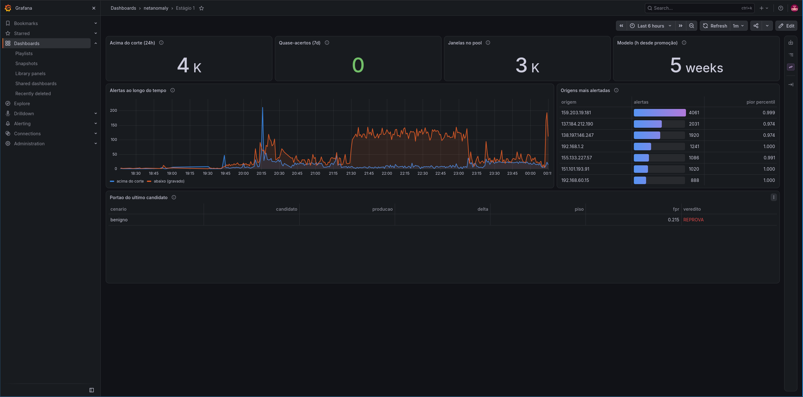
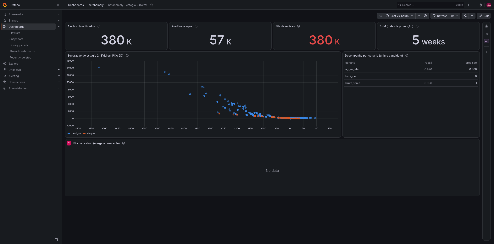
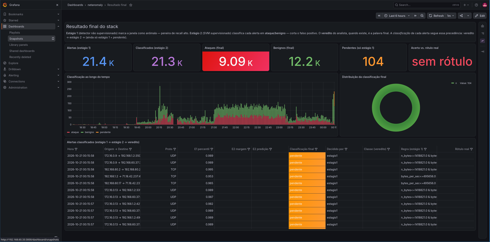
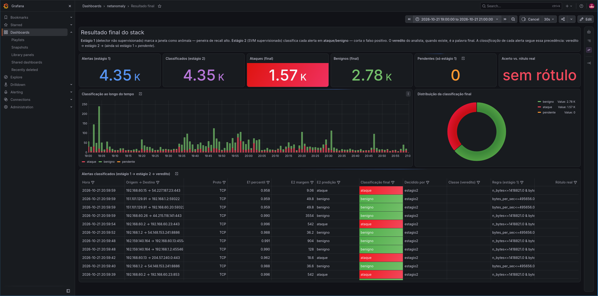

# Entrega 6 — Prototipação em papel

**Data:** 09/10/2026  
**Status:** 🟨 em andamento  
**Responsabilidade:** 1 solução integrada por equipe

## Objetivo da atividade

Externalizar rapidamente ideias de interação em baixa fidelidade para explorar alternativas antes de investir em detalhes visuais. O valor da atividade está no **ciclo construir → simular → observar → revisar**, não na beleza do desenho.

> **O que se ganha:** os painéis mostram volumes, distribuições e classificações **reais** do pipeline, e não números inventados. Isso deixa à vista problemas que o papel esconderia, como contagens que não batem entre telas e painéis vazios.
>
> **O que se perde, e como tratamos isso:** um painel com dados reais tem aparência de alta fidelidade, e o acabamento visual pode **mascarar problemas de fluxo**. Por isso a análise abaixo olha para **estrutura** (o que cada painel responde, a ordem e o caminho entre eles) e não para cor, tipografia ou estilo do gráfico. Além disso, o Grafana é uma ferramenta de **leitura**: ele não permite registrar uma decisão nem encaminhar um caso, e essas partes do fluxo continuam sem representação (seção 3.4). A troca do modelo também acontece fora dele, por uma ferramenta de **linha de comando** do pipeline — isso é decisão de escopo, e não lacuna: nos painéis, a administradora **verifica as métricas**; a execução da troca não é demonstrada.

## 1. Escopo do protótipo

**Personas:** P01 — Thiago Albuquerque (analista de SOC, fluxo de investigação) e P02 — Vanessa Toledo (administradora da plataforma, fluxo de configuração/validação)  
**Cenários/tarefas cobertos:** C01 (alerta de tráfego anômalo durante a operação) e C02 (configurar pipeline e validar desempenho). Atividades A01, A02 e A03 da Entrega 01. Os IDs de tarefa (T01…) serão vinculados quando a Entrega 05 for consolidada  
**Objetivos principais:**

- Mostrar, de forma navegável, **como um alerta atravessa o pipeline em dois estágios** (detector não supervisionado → SVM supervisionado → veredito do analista) e qual é o resultado final de cada alerta;
- Dar a Thiago um panorama de entrada que responda “há algo fora do padrão agora?” antes do detalhe (RC01), e uma lista de alertas em que ele veja **quem decidiu** a classificação (RC03);
- Dar a Vanessa o desempenho de cada estágio e o resultado do **portão de promoção** do modelo candidato, para comparar o modelo em produção com o candidato antes de trocar (C02);
- Tornar visível **há quanto tempo o modelo ativo foi promovido**, que é o ponto de contato entre os dois fluxos (Entrega 03, “Da coordenação entre os dois”).

## 1.1 Possíveis famílias de interface

Das famílias sugeridas, o protótipo explora apenas as que as tarefas pedem:

| Família | Usada? | Onde | Justificativa |
|---|---|---|---|
| Dashboard para monitoramento | **Sim** | D01, D02, D03 (indicadores do topo e séries temporais) | A01: perceber se há algo fora do padrão (RC01) |
| Alertas/ocorrências com ação de resposta | **Parcial** | D03, tabela “Alertas classificados” | A02: a tabela lista os alertas e quem decidiu, mas **não permite agir** (registrar veredito, encaminhar) |
| Relatório/resultados com explicação | **Sim** | D03, painel de texto “Resultado final do stack”; D02, separação SVM e desempenho por cenário | RC03: explicar de onde vem a classificação |
| Comparação entre versões | **Parcial** | D01, “Portão do último candidato”; D02, “Desempenho por cenário (último candidato)” | C02/A03: comparar candidato e produção antes de promover |
| Histórico com filtros | **Parcial** | D03, filtros por coluna da tabela | A02/RC04: recortar por origem, protocolo e classificação. Falta a contagem de resultados após o filtro |
| Configuração/parametrização | **Não** | — | A troca de modelo é feita por linha de comando, fora do painel; aqui só se **verificam as métricas** e se **observa** o efeito dela |
| Administração, login, CRUD | **Não** | — | Nenhuma tarefa priorizada depende disso |

## 2. Fluxos escolhidos

O fluxo principal é um **conjunto de três dashboards no Grafana**, na pasta `netanomaly`. Cada dashboard corresponde a uma etapa do pipeline. A navegação entre eles é feita pela lista de dashboards da pasta.

| Fluxo | Tarefa/objetivo | Por que foi priorizado |
|---|---|---|
| PF01 — Investigação a partir do resultado final | Thiago abre **D03 (Resultado final)**, vê os totais por classificação, percebe o pico na série temporal, filtra a tabela por origem/classificação e identifica quais alertas ainda estão **pendentes** (só estágio 1) e quais já têm decisão (C01, A01 → A02) | É o núcleo do recorte de IHC: A01 é a atividade mais frequente e A02 a mais crítica (Entrega 01, H11 e H12) |
| PF02 — Validação do modelo por estágio | Vanessa abre **D01 (Estágio 1)** para ver o volume acima do corte, quase-acertos, origens mais alertadas e o portão do último candidato. Em seguida abre **D02 (Estágio 2 — SVM)** para ver a separação entre benigno e ataque, a fila de revisão e o desempenho por cenário (C02, A03) | A troca de modelo muda o que Thiago vê; Vanessa precisa saber o efeito **antes** de promover (P02, “ver a consequência antes de confirmar”) |
| PF03 — Ponto de contato entre os fluxos | Em qualquer dashboard, o indicador “Modelo/SVM (h desde promoção)” mostra há quanto tempo o modelo ativo está em produção | Thiago precisa ver que o classificador mudou e desde quando (C01, Q4; H27) |

## 3. Telas e estados

Para não colidir com os IDs de persona (P01, P02), as telas são numeradas como **D01–D03** (dashboards) e os estados relevantes como **D0x-Ey**.

### Mapa de navegação

```text
Pasta "netanomaly" (lista de dashboards do Grafana)
 ├── D01  Estágio 1 — detector não supervisionado ──┐
 ├── D02  Estágio 2 — SVM supervisionado ───────────┤  (sem link direto entre eles:
 └── D03  Resultado final do stack ─────────────────┘   volta-se sempre à lista)

Controles comuns a todos: intervalo de tempo (ex.: "Last 6 hours"),
navegação ‹‹ ›› no tempo, zoom out, refresh automático (1m).
```

### D01 — Estágio 1 (detector não supervisionado)



| Região | Conteúdo | Pergunta que responde | Persona/tarefa |
|---|---|---|---|
| Indicadores do topo | **Acima do corte (24h)** 4K · **Quase-acertos (7d)** 0 · **Janelas no pool** 3K · **Modelo (h desde promoção)** 5 semanas | “Quanto o detector está sinalizando e há quanto tempo o modelo está ativo?” | P02 (C02); o último indicador também serve a P01 (PF03) |
| Alertas ao longo do tempo | Série temporal com duas linhas: **acima do corte** (azul) e **abaixo, gravado** (laranja) | “Quando o volume mudou?” | P01 (A01), P02 (C02) |
| Origens mais alertadas | Tabela com origem, barra de alertas e **pior percentil** | “Quem gera mais alertas?” | P01 (A02, recorte por origem — RC02) |
| Portão do último candidato | Tabela cenário × candidato × produção × delta × piso × fpr × **veredito** | “O candidato pode substituir o modelo em produção?” | P02 (A03) |

**Estados e controles:**

- **D01-E1 — candidato reprovado:** o portão mostra `benigno · fpr 0.215 · REPROVA` em vermelho.
- **D01-E2 — mudança de intervalo:** ao alterar o intervalo de tempo, a série e a tabela de origens são recalculadas. O indicador “Acima do corte” continua fixo em 24h e “Quase-acertos” em 7 dias, independentemente do intervalo escolhido.

### D02 — Estágio 2 (SVM supervisionado)



| Região | Conteúdo | Pergunta que responde | Persona/tarefa |
|---|---|---|---|
| Indicadores do topo | **Alertas classificados** 380K · **Preditos ataque** 57K · **Fila de revisão** 380K (vermelho) · **SVM (h desde promoção)** 5 semanas | “Quanto o SVM classificou e quanto espera revisão?” | P02 (C02), P01 (PF03) |
| Separação do estágio 2 (SVM em PCA 2D) | Dispersão dos alertas projetados em duas dimensões, coloridos como **benigno** (azul) e **ataque** (laranja) | “O SVM está separando bem as duas classes?” | P02 (C02) |
| Desempenho por cenário (último candidato) | Tabela cenário × recall × precisão: aggregate 0.996/0.308, benigno –/0, brute_force 0.996/1 | “Em quais cenários o candidato acerta?” | P02 (A03) |
| Fila de revisão (margem crescente) | Lista dos alertas mais próximos da fronteira do SVM, isto é, os mais incertos | “O que um humano deveria olhar primeiro?” | P01 (A02) |

**Estados e controles:**

- **D02-E1 — fila vazia:** o painel “Fila de revisão” mostra **No data**, enquanto o indicador “Fila de revisão” no topo mostra 380K em vermelho.
- **D02-E2 — mudança de intervalo:** este dashboard abre com “Last 24 hours”; D01 e D03 abrem com “Last 6 hours”.

### D03 — Resultado final do stack



| Região                                                   | Conteúdo                                                                                                                                                                                                                             | Pergunta que responde                                                   | Persona/tarefa              |
| -------------------------------------------------------- | ------------------------------------------------------------------------------------------------------------------------------------------------------------------------------------------------------------------------------------ | ----------------------------------------------------------------------- | --------------------------- |
| Texto explicativo                                        | Explica os dois estágios e a **precedência** da classificação: estágio 2 → estágio 1 (“pendente”)                                                                                                                                    | “De onde vem a classificação que estou vendo?”                          | P01 (RC03)                  |
| Indicadores do topo                                      | **Alertas (estágio 1)** 20.2K · **Classificados (estágio 2)** 20.2K · **Ataques (final)** 6.76K, em destaque vermelho · **Benignos (final)** 13.4K · **Pendentes (só estágio 1)** 0 · **Acerto vs. rótulo real** “sem rótulo”      | “Quanto do que foi sinalizado é ataque e quanto ainda não tem decisão?” | P01 (A01)                   |
| Classificação ao longo do tempo                          | Barras empilhadas por intervalo: ataque, benigno e pendente                                                                                                                                                                          | “Quando os ataques se concentraram?”                                    | P01 (A01)                   |
| Distribuição da classificação final                      | Rosca com as três classes e os valores na legenda (benigno 13.4K, ataque 6.76K, pendente 0), nas mesmas cores da série temporal                                                                                                                                                                                                                     | “Qual a proporção entre as classes?”                                    | P01 (A01)                   |
| Alertas classificados (estágio 1 → estágio 2 → veredito) | Tabela com hora, origem → destino, protocolo, **E1 percentil**, **E2 margem**, **E2 predição**, **classificação final** (com cor), **decidido por**, classe do veredito, **regra (estágio 1)** e rótulo real. Cada coluna tem filtro | “Qual conexão, por que foi sinalizada e quem decidiu?”                  | P01 (A02, RC02, RC03, RC04) |

**Estados e controles:**

- **D03-E1 — alerta pendente:** a linha apareceria com classificação final `pendente` em laranja e `decidido por: estagio1`, com as colunas do estágio 2 e do veredito vazias. *(Nas capturas atuais “Pendentes (só estágio 1)” está em 0 e o estado não ocorre: todo alerta do período foi classificado pelo estágio 2.)*
- **D03-E2 — alerta decidido pelo SVM / pelo analista:** a classificação final passa a `ataque` ou `benigno` e `decidido por` indica `estagio2` ou o veredito. *(Estado previsto pela precedência descrita no próprio painel; não aparece na captura.)*
- **D03-E3 — filtro aplicado:** os ícones de funil nos cabeçalhos filtram a tabela por valor (por exemplo, só `ataque`, só `TCP`, uma origem). Os indicadores do topo **não** acompanham o filtro.
- **D03-E4 — sem rótulo real:** o indicador “Acerto vs. rótulo real” mostra **sem rótulo** em vermelho quando não há verdade de referência para o período.
- **D03-E5 — recorte curto em torno do pico:** com o intervalo reduzido a duas horas (19h–21h de 21/10; captura na seção 4.1), os indicadores recalculam (4.35K alertas, 1.57K ataques, 2.78K benignos, contra 20.2K/6.76K/13.4K na janela de 6h) e a série revela a composição do pico. É o estado em que o painel mais responde — e é alcançado por um gesto do usuário, não oferecido pela interface.

### 3.4 Lacunas do fluxo (o que o protótipo não representa)

| Lacuna                                                                                                                                       | Tarefa afetada                                         | Por que ficou de fora                                                                                                        |
| -------------------------------------------------------------------------------------------------------------------------------------------- | ------------------------------------------------------ | ---------------------------------------------------------------------------------------------------------------------------- |
| Registrar o veredito (ataque, benigno ou **indefinido**) com a justificativa                                                                 | A02 — C01 (as três saídas da decisão)                  | O Grafana é somente leitura. A coluna “Classe (veredito)” existe, mas não há como preenchê-la pelo painel                    |
| Encaminhar o caso à infraestrutura e escrever a passagem de plantão                                                                          | A02 — C01 (Q5)                                         | Fora do que o Grafana oferece. Precisa de tela própria ou integração com o sistema de chamados                               |
| Detalhe de uma conexão (histórico da origem com aquele destino, volume habitual do ativo)                                                    | A02 — jornada de P01, etapa 4                          | Não há drill-down da linha da tabela para uma visão da conexão                                                               |
| Confirmar a promoção do candidato e desfazer a troca                                                                                         | A03 — P02 (“confirmação explícita e caminho de volta”) | Decisão de escopo: o portão só **mostra** o veredito e a promoção é executada pela **ferramenta de linha de comando** do pipeline, que não entra neste protótipo                                                        |
| Estimar o efeito da promoção antes de aplicá-la (quanto chegaria a mais ou a menos ao analista) e a carga do modelo no equipamento embarcado | A03 — P02 (“ver a consequência antes de confirmar”)    | Os painéis descrevem o que **já** aconteceu; não há previsão de efeito nem custo de processamento ao lado do veredito do portão                |
| Histórico do que mudou em cada promoção, quando e por quem                                                                                   | A03 — P02; C01, Q4                                     | O indicador “h desde promoção” dá a idade do modelo ativo, mas não há registro da mudança a que atribuir um efeito observado |
| Sinal de Thiago para Vanessa de que as ocorrências não estão se confirmando                                                                  | Coordenação C01 ↔ C02                                  | Nenhum painel registra nem agrega essa informação                                                                            |

## 4. Simulação / walkthrough

Duas demonstrações, uma por persona, sobre os painéis **como estão hoje**. Cada uma mostra **o que a pessoa precisa fazer**, **em que tela ela faz** e **o que os dados daquela tela querem dizer**. O recorte de cada fluxo é diferente:

- **Fluxo A — Thiago (P01):** investiga um possível ataque e precisa chegar a um julgamento. Usa D03 como painel principal e recorre a D01 pontualmente. O encaminhamento da decisão acontece fora dos painéis.
- **Fluxo B — Vanessa (P02):** **apenas verifica as métricas** do detector e do classificador, em D01 e D02. Se decidir trocar o modelo, a troca é feita por uma **ferramenta de linha de comando**, fora do Grafana — não faz parte desta demonstração.

As duas demonstrações foram executadas pela equipe sobre os painéis em operação; repeti-las com participantes de fora da construção continua pendente.

### 4.1 Fluxo A — investigação de um possível ataque (P01, PF01/PF03)

**Situação:** o portal interno do atendimento ficou lento no começo da noite de 21/10, a operação reclamou e o IDS vem sinalizando conexões de um mesmo segmento. Thiago precisa descobrir o que aconteceu e se alguma conexão exige ação.

| #   | O que ele precisa fazer                                         | Tela / painel                                                                                       | O que a tela mostra                                                                                                                                                                                                     | O que o dado significa                                                                                                                                                                                                                                                                                                                                   |
| --- | --------------------------------------------------------------- | --------------------------------------------------------------------------------------------------- | ----------------------------------------------------------------------------------------------------------------------------------------------------------------------------------------------------------------------- | -------------------------------------------------------------------------------------------------------------------------------------------------------------------------------------------------------------------------------------------------------------------------------------------------------------------------------------------------------- |
| A1  | Saber se há algo fora do padrão antes de abrir qualquer detalhe | **D03**, indicadores do topo                                                                        | Alertas (estágio 1) 20.2K · Classificados (estágio 2) 20.2K · Ataques (final) 6.76K · Benignos (final) 13.4K · Pendentes 0 · Acerto vs. rótulo real “sem rótulo”                                                        | Na janela de 18h às 00h, o detector marcou 20.2K janelas de tráfego como anômalas e o SVM classificou **todas** elas; cerca de um terço terminou como ataque. “Pendentes 0” significa que nenhum alerta parou no estágio 1. “Sem rótulo”                                                                                                                 |
| A2  | Situar o episódio no tempo                                      | **D03**, “Classificação ao longo do tempo”                                                          | Barras empilhadas por faixa de poucos minutos, com picos de ~450 alertas às 18h15, 18h45 e 22h30 sobre um fundo constante de 50–100                                                                                     | Cada barra é o volume de alertas daquela faixa, dividido por classificação final: vermelho = ataque, verde = benigno, laranja = pendente. A altura responde “quando houve mais movimento”; a composição responde “movimento de quê”                                                                                                                      |
| A3  | Ver a proporção entre as classes no período                     | **D03**, “Distribuição da classificação final”                                                      | Rosca com benigno 13.4K e ataque 6.76K (pendente 0), nas mesmas cores da série                                                                                                                                          | A proporção acumulada da janela inteira. Serve de referência para comparar com o que aparece nos recortes menores                                                                                                                                                                                                                                        |
| A4  | Verificar se o pico de volume é o ataque                        | **D03**, arrastando sobre a série para recortar **19h–21h de 21/10** (figura abaixo)                | Com o recorte: 4.35K alertas, 1.57K ataques, 2.78K benignos. A barra das 19h05 chega a ~240 alertas, quase cinco vezes as vizinhas, e é quase toda **verde**; as frações vermelhas aparecem espalhadas pelas duas horas | Os indicadores e os gráficos acompanham o intervalo selecionado. A leitura: **o pico de volume não é pico de ataque** — foi uma rajada de tráfego legítimo. O que sustenta a suspeita é o ataque difuso, distribuído pelo período                                                                                                                        |
| A5  | Descobrir de onde vem o tráfego sinalizado                      | **D03**, tabela “Alertas classificados”, filtro da coluna origem; **D01**, “Origens mais alertadas” | Na tabela, pares como `192.168.60.2 → 192.168.60.23:853` e `162.159.134.234 → 192.168.60.214`. Em D01: 159.203.19.181 com 4061 alertas e pior percentil 0.999; depois 137.184.212.190 (2031) e 138.197.146.247 (1920)   | A tabela dá a conexão individual; D01 dá o ranking de quem mais dispara o detector. “Pior percentil” é o caso mais extremo daquela origem: 0.999 significa que uma janela dela ficou entre as 0,1% mais anômalas                                                                                                                                         |
| A6  | Entender por que aquela conexão foi sinalizada                  | **D03**, colunas E1 percentil, Regra (estágio 1), E2 margem e E2 predição                           | Ex.: percentil 0.996 · regra `n_bytes<=1418821.0 & bytes_per_sec<=495656.0` · margem 271 · predição `ataque`                                                                                                            | **E1 percentil**: o quanto a janela se afasta do normal segundo o detector — quanto mais perto de 1, mais atípica. **Regra**: a combinação de atributos (volume em bytes, bytes por segundo) que enquadrou a janela. **E2 margem**: a distância até a fronteira de decisão do SVM — margem alta é classificação segura, margem baixa é caso de fronteira |
| A7  | Saber quem produziu aquela classificação                        | **D03**, colunas “Classificação final”, “Decidido por” e “Classe (veredito)”                        | Classificação final colorida (`ataque` vermelho, `benigno` verde); “Decidido por” com `estagio2` em todas as linhas; “Classe (veredito)” vazia                                                                          | A precedência está escrita no painel: **veredito do analista → estágio 2 → estágio 1**. “Decidido por: estagio2” quer dizer que a palavra final foi do SVM; coluna de veredito vazia quer dizer que nenhum analista revisou aquele alerta                                                                                                                |
| A8  | Confirmar que o classificador é o mesmo de antes                | **D01** ou **D02**, indicador “Modelo/SVM (h desde promoção)”                                       | 5 semanas                                                                                                                                                                                                               | O modelo ativo foi promovido há cinco semanas. Como não houve troca no período investigado, a mudança de comportamento do tráfego não pode ser atribuída a uma troca de classificador                                                                                                                                                                    |
| A9  | Registrar a decisão e encaminhar                                | **Fora dos painéis**                                                                                | —                                                                                                                                                                                                                       | Os dashboards são somente leitura. Registrar o veredito, abrir o chamado para a infraestrutura e escrever a passagem de plantão acontecem em outras ferramentas (seção 3.4)                                                                                                                                                                              |



*Figura — passo A4: o mesmo D03 recortado em duas horas em torno do pico. A barra das 19h05 é quase toda benigna (verde) e os ataques (vermelho) aparecem espalhados pelo período. Os indicadores acompanham o recorte: 4.35K alertas, contra 20.2K na janela de 6h.*

**Resumo do caminho:** D03 responde A1–A4, A6 e A7 sem sair do painel; D01 entra em A5 (ranking de origens) e A8 (idade do modelo); A9 acontece fora do sistema.

### 4.2 Fluxo B — verificação das métricas do modelo (P02, PF02)

**Situação:** os analistas relatam que vêm recebendo mais ocorrências do que o habitual. Vanessa precisa olhar as métricas dos dois estágios e do último modelo candidato para julgar se o classificador continua adequado ao tráfego. **Ela não altera nada pelos painéis:** a troca de modelo é feita por linha de comando, fora do Grafana.

| #   | O que ela precisa fazer                             | Tela / painel                                                                               | O que a tela mostra                                                                                                                                                                                                  | O que o dado significa                                                                                                                                                                                                                                                                                                                                                                                                                                   |
| --- | --------------------------------------------------- | ------------------------------------------------------------------------------------------- | -------------------------------------------------------------------------------------------------------------------------------------------------------------------------------------------------------------------- | -------------------------------------------------------------------------------------------------------------------------------------------------------------------------------------------------------------------------------------------------------------------------------------------------------------------------------------------------------------------------------------------------------------------------------------------------------- |
| B1  | Ver o quanto o estágio 1 está sinalizando           | **D01**, indicadores do topo                                                                | Acima do corte (24h) 4K · Quase-acertos (7d) 0 · Janelas no pool 3K · Modelo (h desde promoção) 5 semanas                                                                                                            | **Corte** é o limiar de anomalia do detector: 4K janelas o ultrapassaram em 24h. **Quase-acerto** é a janela que ficou logo abaixo do corte — zero significa que nada passou raspando no período. **Pool** são as janelas guardadas para reavaliação e treino                                                                                                                                                                                            |
| B2  | Comparar o que passa do corte com o que fica abaixo | **D01**, “Alertas ao longo do tempo”                                                        | Duas linhas: azul (acima do corte) baixa, com pico de ~210 às 20h15; laranja (abaixo, gravado) alta e sustentada entre 21h30 e 23h, na faixa de 100–150                                                              | A linha laranja é o tráfego que o detector observou e **não** considerou anômalo. Um platô laranja sem subida azul significa movimento intenso que o corte atual deixa passar — é o sinal de que o limiar pode estar alto demais para o perfil daquele período                                                                                                                                                                                           |
| B3  | Ver se os alertas se concentram em poucas origens   | **D01**, “Origens mais alertadas”                                                           | 159.203.19.181 com 4061 alertas e pior percentil 0.999; 192.168.1.2, 151.101.193.91 e 192.168.60.15 com pior percentil 1.000                                                                                         | Concentração em poucas origens indica um comportamento específico, não uma mudança geral do tráfego. Pior percentil 1.000 é o extremo da escala: aquela origem produziu a janela mais atípica do conjunto                                                                                                                                                                                                                                                |
| B4  | Ver o volume e a separação do estágio 2             | **D02**, indicadores e “Separação do estágio 2 (SVM em PCA 2D)”                             | Alertas classificados 380K · Preditos ataque 57K · Fila de revisão 380K · SVM 5 semanas. Na dispersão, pontos azuis (benigno) ocupando a região alta e laranja (ataque) concentrados na faixa baixa, próxima de zero | Em 24h o SVM classificou 380K alertas e chamou 57K de ataque (~15%). O **PCA 2D** comprime todos os atributos em duas dimensões só para inspeção visual: nuvens que se misturam indicam classes difíceis de separar; nuvens destacadas indicam fronteira clara. A **fila de revisão** são os alertas de menor margem, os que um humano deveria olhar primeiro                                                                                            |
| B5  | Avaliar o último modelo candidato                   | **D02**, “Desempenho por cenário (último candidato)”; **D01**, “Portão do último candidato” | Em D02: aggregate recall 0.996 / precisão 0.308; benigno precisão 0; brute_force 0.996 / 1. Em D01: cenário `benigno`, fpr 0.215, veredito **REPROVA** em vermelho                                                   | **Recall** é quanto do ataque real o modelo captura; **precisão** é quanto do que ele chama de ataque é mesmo ataque. O candidato pega quase tudo (0.996) mas erra muito ao acusar (0.308), e é perfeito no cenário `brute_force`. **fpr** é a taxa de falso positivo: 0.215 significa que 21,5% do tráfego benigno seria acusado. O **portão** compara esse número ao piso aceito e conclui: `REPROVA` — o candidato não substitui o modelo em produção |
| B6  | Decidir sobre a troca                               | **Fora dos painéis**                                                                        | —                                                                                                                                                                                                                    | Os dashboards são somente leitura; a promoção do modelo é executada pela **ferramenta de linha de comando** do pipeline, que não faz parte deste protótipo. Depois de uma troca, o indicador “h desde promoção” reinicia — é por ele que Thiago percebe, em D01 e D02, que o classificador mudou (PF03)                                                                                                                                                  |

**Resumo do caminho:** D01 responde B1–B3 e traz o veredito do portão; D02 responde B4 e o desempenho por cenário; a ação de B6 é externa, por CLI.

### 4.3 Glossário dos dados dos painéis

Os termos abaixo aparecem nos títulos, nas colunas e nos ícones ⓘ dos três dashboards. É o vocabulário que as duas personas precisam compartilhar para ler as mesmas telas.

| Termo                      | Onde aparece                                            | O que significa                                                                                           |
| -------------------------- | ------------------------------------------------------- | --------------------------------------------------------------------------------------------------------- |
| Corte                      | D01, “Acima do corte (24h)”                             | Limiar de anomalia do estágio 1. Acima dele, a janela vira alerta                                         |
| Percentil / pior percentil | D01, “Origens mais alertadas”; D03, coluna E1 percentil | Posição da janela na distribuição de anomalia. Perto de 1 = entre as mais atípicas                        |
| Quase-acerto               | D01, indicador (7d)                                     | Janela que ficou logo abaixo do corte, usada para avaliar se o limiar está bem posto                      |
| Pool                       | D01, “Janelas no pool”                                  | Janelas armazenadas para reavaliação e treino posterior                                                   |
| Regra (estágio 1)          | D03, coluna                                             | Combinação de atributos que enquadrou a janela, ex.: `n_bytes<=1418821.0 & bytes_per_sec<=495656.0`       |
| Margem                     | D02, “Fila de revisão”; D03, coluna E2 margem           | Distância até a fronteira de decisão do SVM. Margem baixa = caso de fronteira, candidato a revisão humana |
| PCA 2D                     | D02, “Separação do estágio 2”                           | Projeção dos atributos em duas dimensões, apenas para inspeção visual da separação entre as classes       |
| Recall                     | D02, “Desempenho por cenário”                           | Proporção dos ataques reais que o modelo captura                                                          |
| Precisão                   | D02, “Desempenho por cenário”                           | Proporção de acerto entre os alertas que o modelo chamou de ataque                                        |
| fpr / piso                 | D01, “Portão do último candidato”                       | Taxa de falso positivo do candidato e o limite máximo aceito para promovê-lo                              |
| Decidido por               | D03, coluna                                             | Qual etapa produziu a classificação final: `estagio1`, `estagio2` ou o veredito do analista               |
| Pendente                   | D03, indicador e classificação final                    | Alerta que passou pelo estágio 1 e ainda não tem classificação do estágio 2 nem veredito                  |

### 4.4 Pontos levantados pela equipe na inspeção dos painéis

Inventário do que a equipe anotou ao revisar os painéis atuais tela a tela, fora do fluxo das duas demonstrações. Enquanto a seção 4 mostra o que os painéis **respondem**, esta lista reúne o que eles **deixam em aberto** — e é dela que saem as alterações da seção 5.

| #   | Observação                                                                                                                                                                                          | Tela           | Relação com o projeto                                                                                                                            |
| --- | --------------------------------------------------------------------------------------------------------------------------------------------------------------------------------------------------- | -------------- | ------------------------------------------------------------------------------------------------------------------------------------------------ |
| I01 | O indicador “Fila de revisão” mostra 380K em vermelho, mas o painel da fila mostra **No data**. O valor também é igual ao de “Alertas classificados”, o que dá a entender que **tudo** está na fila | D02-E1         | Contradição entre indicador e detalhe: Thiago não sabe se há algo a revisar (RC01)                                                               |
| I02 | No portão do candidato só aparecem fpr e o veredito **REPROVA**. Candidato, produção, delta e piso estão vazios                                                                                     | D01-E1         | Vanessa vê que reprovou, mas não **contra o quê** nem **por quanto** (P02, comparar atual × candidato)                                           |
| I03 | Termos de ML sem explicação na tela: corte, percentil, quase-acerto, pool, margem, PCA 2D, fpr, piso, recall, precisão. A regra do estágio 1 aparece truncada (`n_bytes<=1418821.0 & byte…`)        | D01, D02, D03  | Contraria RC03: Thiago “não é especialista em ML”. Os ícones ⓘ existem, mas o conteúdo das descrições não foi revisado com essa persona em mente |
| I04 | “Acerto vs. rótulo real” mostra **sem rótulo** em vermelho, a mesma cor usada para “Ataques”, e parece erro                                                                                         | D03-E4         | Ausência de dado com cara de falha: ruído visual durante a ocorrência (H08)                                                                      |
| I05 | Os dashboards abrem com intervalos diferentes (6h, 24h, 6h) e alguns indicadores têm janela fixa (24h, 7d). As contagens de D01, D02 e D03 não podem ser comparadas entre si                        | D01-E2, D02-E2 | Quem passa de um painel para outro compara números que não medem o mesmo período                                                                 |
| I06 | Origem → destino e regra aparecem truncados na tabela                                                                                                                                               | D03            | Justamente os dados de contexto da conexão (RC02) ficam ilegíveis                                                                                |
| I07 | Os filtros da tabela não atualizam os indicadores e não mostram quantas linhas restaram                                                                                                             | D03-E3         | RC04: contagem de resultados após o filtro                                                                                                       |
| I08 | Não há link entre os dashboards: para ir do resultado final ao estágio que decidiu o alerta é preciso voltar à lista                                                                                | D01–D03        | O fluxo panorama → detalhe (RC04) atravessa telas sem ligação                                                                                    |
| I09 | **Positivo:** o painel de texto de D03 explica a precedência veredito → estágio 2 → estágio 1, e a coluna “Decidido por” mostra a origem de cada classificação                                      | D03            | Atende diretamente RC03 e a decisão de P01 de saber **qual classificador** produziu o resultado                                                  |
| I10 | **Positivo:** “h desde promoção” aparece no topo de D01 e D02. O título diz “h”, mas o valor está em semanas                                                                                        | D01, D02       | Atende PF03; a inconsistência de unidade deve ser corrigida                                                                                      |
| I11 | **Positivo:** a classificação final usa cor e texto ao mesmo tempo (`ataque` em vermelho, `benigno` em verde, `pendente` em laranja), e a rosca repete as mesmas cores                              | D03            | Não depende só de cor. O tema escuro é o padrão do Grafana e continua sendo **alternativa a testar** (H17), não decisão                          |

## 5. Alterações após a simulação

> As linhas abaixo saem da inspeção (4.4) e das lacunas (3.4). São **alterações candidatas**: a sessão com participantes externos sobre os fluxos da seção 4 ainda deve confirmar, reordenar ou descartar cada uma.

| Antes                                                     | Problema                                                                                                                           | Depois                                                                                                                                                                                                                                  | Justificativa                                                                  |
| --------------------------------------------------------- | ---------------------------------------------------------------------------------------------------------------------------------- | --------------------------------------------------------------------------------------------------------------------------------------------------------------------------------------------------------------------------------------- | ------------------------------------------------------------------------------ |
| Indicador “Fila de revisão” = 380K com painel vazio (I01) | Indicador e detalhe se contradizem                                                                                                 | Indicador e painel usam a **mesma consulta**; quando a fila estiver vazia, o indicador mostra 0 em cor neutra                                                                                                                           | RC01: o topo precisa responder “há algo a fazer?” sem ambiguidade              |
| Portão com colunas vazias (I02)                           | Não se vê contra o quê o candidato foi reprovado                                                                                   | Preencher candidato, produção, delta e piso por cenário, destacar a linha que motivou a reprovação e trazer o desempenho do modelo **em produção** lado a lado com o do candidato, num mesmo painel de comparação                       | P02: comparar atual × candidato antes de promover — é o núcleo de A03          |
| Termos de ML sem apoio (I03)                              | Thiago não interpreta percentil, margem e fpr; Vanessa não sabe o que conta como quase-acerto nem o que o PCA 2D mostra            | Reescrever as descrições ⓘ servindo às duas leituras — operação para quem investiga (ex.: “margem: quão perto o SVM ficou de mudar de ideia”), critério de decisão para quem configura — e mostrar a regra completa no detalhe da linha | RC03; P01 não domina ML e P02 precisa justificar a troca                       |
| Pico da série sem número por classe                       | Saber quanto do pico é ataque depende de ler proporção de cor em barras estreitas                                                  | Total por classe no cursor da série e atalho para recortar em torno do pico                                                                                                                                                             | É o recorte do pico que separa rajada legítima de ataque (passo A4)            |
| “sem rótulo” em vermelho (I04)                            | Ausência de dado parece falha                                                                                                      | Exibir em cor neutra com o texto “sem rótulo no período”                                                                                                                                                                                | H08: reservar o vermelho para o que exige ação                                 |
| Intervalos diferentes por dashboard (I05)                 | Contagens não comparáveis                                                                                                          | Mesmo intervalo padrão nos três e indicação explícita da janela em cada indicador                                                                                                                                                       | Consistência entre telas do mesmo fluxo                                        |
| Filtro da tabela sem contagem (I07)                       | O analista não quantifica o recorte que acabou de criar                                                                            | Indicadores do topo acompanham o filtro, ou a tabela exibe “N de M linhas”                                                                                                                                                              | RC04: o recorte por origem é o passo central da investigação                   |
| Origem → destino e regra truncados (I06)                  | O contexto da conexão fica ilegível justamente na coluna que o justifica                                                           | Largura/quebra nas colunas de contexto e regra completa no detalhe da linha                                                                                                                                                             | RC02 e RC03                                                                    |
| Indicadores sem referência do que é normal                | “6.76K ataques” não diz se o volume destoa                                                                                         | Comparação com o período anterior e janela explícita em cada indicador                                                                                                                                                                  | A01: a primeira pergunta é “há algo fora do padrão?”, não “quantos há”         |
| “h desde promoção” ausente em D03 (I10)                   | A pergunta sobre a troca do classificador nasce em D03 e só é respondida em D01/D02                                                | Repetir o indicador em D03, com a unidade coerente com o título                                                                                                                                                                         | C01, Q4; PF03                                                                  |
| Idade do modelo sem histórico da mudança                  | “Há 5 semanas” não diz **o que** mudou, então nenhum efeito pode ser atribuído a uma causa                                         | Histórico de promoções (o quê, quando, quem) e marcação na série temporal no instante da troca                                                                                                                                          | P02: “uma mudança por vez, para saber a qual atribuir o efeito”; H31           |
| Totais de D01, D02 e D03 que não se encaixam (I05)        | O funil do pipeline não fecha entre os painéis: 4K, 380K e 20.2K para o mesmo fluxo                                                | Painel de funil (entrou → classificado → veredito final) sobre a mesma janela, com a janela declarada                                                                                                                                   | P02 precisa dizer quanto entrou, quanto passou e quanto sobrou em cada estágio |
| Retorno dos analistas sem registro                        | O sinal que inicia o trabalho de Vanessa não existe dentro do sistema: “Acerto vs. rótulo real” é a única aproximação e está vazio | Agregar as ocorrências que os analistas marcaram como não confirmadas, ao lado do rótulo real (depende da tela de registro do veredito)                                                                                                 | Coordenação C01 ↔ C02                                                          |
| Promoção sem efeito previsto nem aviso                    | A troca é feita por CLI e os painéis não estimam o que ela muda para quem investiga                                                | Mostrar nos painéis, antes e depois da troca, o efeito sobre o volume que chega ao analista e o custo de processamento; registrar a promoção de forma visível à equipe                                                                  | P02: “ver a consequência antes de confirmar”; a execução continua na CLI       |
| Dashboards sem ligação (I08)                              | Fluxo quebrado entre panorama e detalhe                                                                                            | Links de dashboard no topo (D01 ↔ D02 ↔ D03) e *data links* da tabela de D03 para o estágio que decidiu, mantendo origem e intervalo                                                                                                    | RC04                                                                           |
| Sem registro de veredito (3.4)                            | A02 não se completa no protótipo                                                                                                   | Prototipar à parte, em baixa fidelidade, a tela de registro do veredito (incluindo **indefinido**) e de encaminhamento                                                                                                                  | C01: as três saídas da decisão                                                 |
## Checklist

- [ ] O protótipo cobre tarefas relevantes da Entrega 5.
- [ ] Cada tela/estado pode ser justificado por uma tarefa, decisão ou informação necessária.
- [ ] O projeto não criou dashboard/CRUD/login apenas para parecer “completo”.
- [ ] Telas/estados estão numerados e navegáveis na documentação.
- [ ] Há pelo menos uma simulação/walkthrough documentado.
- [ ] Críticas não foram apenas listadas: geraram decisão de revisão.
- [ ] O protótipo continua em baixa fidelidade; detalhes visuais não mascaram problemas de fluxo.

