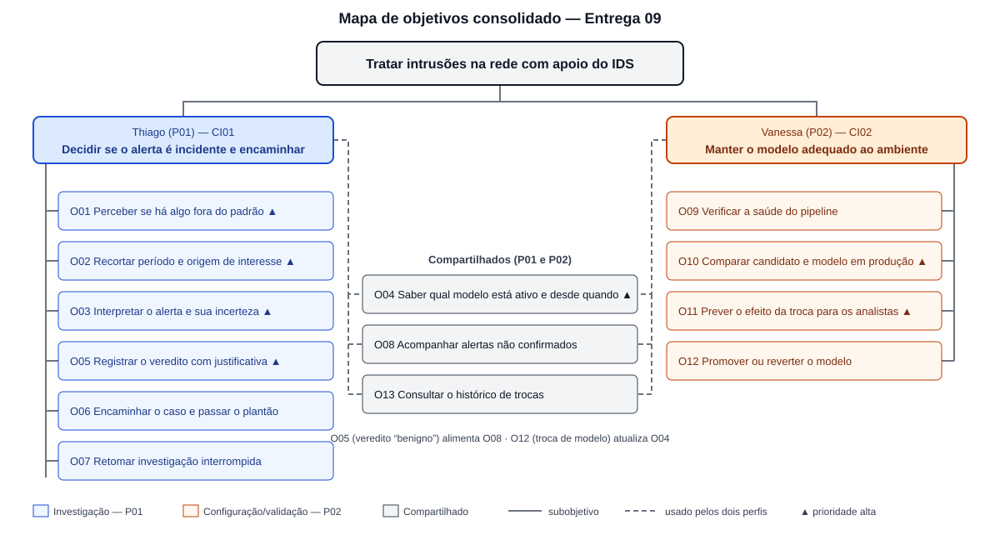

# Entrega 9 — Modelo conceitual e design centrado na comunicação

**Data:** 30/10/2026  
**Status:** `🟨 em andamento`  
**Responsabilidade:** soluções individuais, com consolidação da equipe para mapa de objetivos e esquema de signos.

## Objetivo da atividade

Passar do cenário de problema para uma concepção da interação, explicitando objetivos, tópicos de conversa, falas e signos que a interface deverá comunicar/manipular.

## Transformando resultados técnicos em conceitos compreensíveis

Em TCCs algorítmicos ou orientados a dados, esta entrega deve evitar que a interface exponha apenas estruturas internas do código. Identifique os **conceitos e signos que fazem sentido para o usuário**.

Exemplos:

- `query plan`, custo estimado, recomendação e impacto para um DBA;
- modelo, dataset, versão, execução e métrica para engenheiro de IA;
- período, indicador, grupo, tendência e filtro para gestor/analista;
- alerta, severidade, evidência, responsável e status para analista de segurança.

Se um termo técnico for necessário, modele como será comunicado, explicado e relacionado à tarefa.

Dashboards, relatórios, filtros e CRUDs devem aparecer no modelo conceitual por meio dos **objetivos, signos e conversas** que justificam sua existência.

**Tradução aplicada neste projeto.** Os termos internos do pipeline que aparecem hoje nos dashboards (Entrega 06, I03) passam a ser comunicados como os signos abaixo, que são os usados nos cenários, nas conversas e no esquema da seção 4:

| Termo interno (pipeline/Grafana)                        | Signo comunicado ao usuário                                                                                                                                                                                                                    | Para quem        | Por quê                                                                                                   |
| ------------------------------------------------------- | ---------------------------------------------------------------------------------------------------------------------------------------------------------------------------------------------------------------------------------------------- | ---------------- | --------------------------------------------------------------------------------------------------------- |
| `E2 margem` (distância à fronteira do SVM)              | **incerteza da classificação** — baixa / média / alta, com o valor numérico disponível no detalhe                                                                                                                                              | Thiago           | O que importa para T02 é “posso confiar nesta classificação?”, não a geometria do SVM (MQ02)              |
| `E1 percentil`                                          | **quão incomum é o volume** — “mais incomum que 99% do tráfego habitual deste destino”                                                                                                                                                         | Thiago           | Traduz a anomalia em comparação com o normal, que é a pergunta de A01                                     |
| `regra (estágio 1)` truncada (`n_bytes<=1418821.0 & …`) | **motivo do sinal** em linguagem de rede (“volume de bytes muito acima do habitual para este destino”), com a regra completa sob demanda                                                                                                       | Thiago           | RC03; o critério precisa ser legível, não só auditável                                                    |
| `decidido por: estagio1 / estagio2 / veredito`          | **quem decidiu**: detector, modelo supervisionado ou analista (com nome)                                                                                                                                                                       | Thiago e Vanessa | Separa resultado de máquina de decisão humana (MQ02)                                                      |
| `h desde promoção`                                      | **modelo ativo** e **ativo desde** — “SVM v7, em produção há 3 dias (27/10)”                                                                                                                                                                   | Thiago e Vanessa | Liga os dois fluxos (PF03, MQ04); corrige a unidade (I10)                                                 |
| `fpr`, `piso`, `delta`, `recall`, `precisão`            | Mantidos para Vanessa, cada um com explicação de uma frase (“fpr: fração do tráfego benigno marcada como ataque”), com **mínimo exigido** no lugar de “piso” e **diferença** no lugar de “delta”, e com o **efeito para os analistas** ao lado | Vanessa          | Vanessa domina o vocabulário de ML; o que falta é a consequência operacional (MQ06)                       |
| `Acerto vs. rótulo real` / “sem rótulo”                 | **alertas não confirmados pelos analistas** (agregado dos vereditos)                                                                                                                                                                           | Vanessa          | Em operação não há rótulo real; o retorno dos analistas é o sinal disponível (I04, coordenação C01 ↔ C02) |
| `PCA 2D`                                                | Retirado da conversa principal; continua disponível como informação técnica de apoio                                                                                                                                                           | Vanessa          | Não responde a nenhuma pergunta de T01 que outro signo não responda melhor                                |

---

## 1. Cenários de interação

Para cada cenário de problema, produza uma versão em que a solução já pode ser descrita. **Destaque claramente o texto alterado** em relação ao cenário original.

**Convenções de marcação.**

- **Cenário de interação inicial** (comparado ao cenário-problema refinado da Entrega 04): ~~texto riscado~~ = trecho do cenário-problema que deixa de valer; **[ALTERADO: …]** = trecho que o substitui. O texto sem marcação é mantido.
- **Cenário de interação refinado** (comparado ao cenário de interação inicial): **[NOVO: …]** = conteúdo acrescentado pelas respostas às perguntas do cenário; `[n]` = número da pergunta do cenário que o trecho responde.

---

### CI01 — Investigação de um pico de alertas durante o plantão

**Autor(a):** Lucas Kerr do Amaral — 22.123.032-9  
**Origem:** cenário problema C01 (cenário refinado, Entrega 04)  
**Persona/tarefa:** P01 — Thiago / T02 (fluxos PF01 e PF03)  
**Atores:** Thiago Albuquerque (P01, analista de SOC nível 2, plantão noturno); colega de turno; equipe de infraestrutura (recebe o encaminhamento e executa a contenção); analista do próximo turno; Vanessa Toledo (P02, recebe indiretamente o resultado das decisões de Thiago)  
**Metas da Entrega 08 exercitadas:** MQ01–MQ05, MQ08; MU01–MU06, MU10

#### 1. Cenário de interação inicial

Thiago, analista de SOC nível 2, está no plantão noturno escrevendo a análise de uma ocorrência anterior quando ~~o IDS registra uma sequência de conexões classificadas como suspeitas a partir de um mesmo segmento de rede~~ **[ALTERADO: o sistema o avisa de que o volume de conexões classificadas como ataque nas últimas horas está bem acima do período anterior, concentrado em um mesmo segmento de rede]**. O que Thiago precisa decidir não é como resolver o problema na rede, e sim se aquelas conexões correspondem a um incidente real.

~~Thiago abre o console e encontra milhares de linhas de log, misturando as classificações do modelo com o restante do tráfego. Ele não sabe se está diante de um pico legítimo de acessos ou de uma varredura/DoS.~~ **[ALTERADO: Thiago restringe a investigação ao período do pico e às conexões vindas daquele segmento, e o sistema informa quantos alertas restaram.]** ~~Para descobrir, alterna entre o console, consultas manuais e seus próprios scripts para reunir origem, destino, serviço e volume de cada conexão.~~ **[ALTERADO: Ao examinar um alerta, o sistema apresenta origem, destino, serviço e volume da conexão, quem a classificou e o quanto aquele volume foge do habitual.]**

~~Enquanto não consegue decidir, a lentidão continua e ele não sabe dizer à operação se alguém deve agir.~~ **[ALTERADO: Thiago conclui que se trata de um ataque, registra sua decisão com uma justificativa e encaminha o caso à equipe de infraestrutura, que fará o bloqueio.]**

#### 2. Perguntas do cenário

Conjunto de perguntas exploradas no cenário:

1. O que leva Thiago a interromper a tarefa em andamento, e como ele decide se vale interromper?
2. Que informação o sistema precisa dar para que ele saiba se há algo fora do padrão sem abrir nenhum alerta?
3. Como ele delimita o conjunto de conexões a investigar, e como sabe o tamanho desse conjunto?
4. Como ele evita que os dados mudem enquanto os analisa?
5. Que contexto da conexão ele precisa conhecer para julgar a classificação?
6. Como ele sabe quem classificou a conexão e quão confiável é essa classificação?
7. Como ele sabe qual modelo está ativo e desde quando?
8. Como o resultado do trabalho de Thiago chega a Vanessa?
9. Como ele retoma a investigação depois de uma interrupção?
10. Como ele registra a decisão, e o que acontece se a decisão abranger alertas incertos?
11. Como o caso chega a quem vai agir e ao próximo turno?
12. Como o sistema comunica que os dados podem estar desatualizados?

#### 3. Cenário de interação refinado

Thiago, analista de SOC nível 2, está no plantão noturno escrevendo a análise de uma ocorrência anterior quando o sistema o avisa de que o volume de conexões classificadas como ataque nas últimas duas horas é cerca de quatro vezes o do período anterior, concentrado em um mesmo segmento de rede [1, 2]. **[NOVO: o sistema informa também que os dados estão atualizados e que a coleta está funcionando [12]. Sem abrir nenhum alerta, Thiago vê que o aumento começou por volta das 19h e que cerca de um terço do tráfego sinalizado no período é ataque; decide interromper o que fazia [1, 2].]** O que Thiago precisa decidir não é como resolver o problema na rede, e sim se aquelas conexões correspondem a um incidente real.

Thiago restringe a investigação ao período do pico e às conexões vindas daquele segmento; o sistema informa que restaram 312 dos 4.350 alertas do período [3]. **[NOVO: como os dados continuam chegando, ele pede ao sistema que suspenda a atualização enquanto analisa; o sistema confirma e, a partir daí, lembra-o de que os dados estão congelados desde as 20h47 [4].]**

Ao examinar um alerta, o sistema apresenta a origem, o destino — o portal interno usado pelo atendimento —, o serviço e o volume da conexão [5]. **[NOVO: informa ainda que aquela origem nunca havia se comunicado com esse destino na última semana, que o volume é mais incomum que 99% do tráfego habitual daquele destino e, em linguagem de rede, por que a conexão foi sinalizada [5]. Informa também que a classificação como ataque foi feita pelo modelo supervisionado e que a incerteza dessa classificação é baixa [6]. Thiago percebe que dois dos 312 alertas têm incerteza alta e os separa para tratar à parte [6].]**

**[NOVO: Thiago lembra que, nos últimos dias, o IDS tem sinalizado conexões que antes passavam como normais. O sistema informa qual modelo está ativo e que ele entrou em produção há três dias; o aumento coincide com essa troca [7]. Thiago passa a olhar com mais cuidado os alertas parecidos com os que antes eram considerados normais, sabendo que os casos que ele descartar como benignos chegarão a Vanessa como sinal de que o modelo pode não estar adequado [8].]**

**[NOVO: um colega o chama para ajudar em outro caso. Quando volta, o sistema mostra o período e o segmento em que ele estava trabalhando, lembra que a atualização continua suspensa e indica quais alertas ele já havia examinado; ele continua de onde parou [9].]**

O segmento de onde partem as conexões atende o portal do atendimento, que já está lento, e o erro custa nos dois sentidos: descartar uma varredura real deixa a atividade evoluir sem resposta; pedir um bloqueio indevido interrompe o tráfego legítimo do portal. Thiago conclui que os 310 alertas de incerteza baixa correspondem a um ataque e registra essa decisão com uma justificativa curta. **[NOVO: o sistema já traz a origem, o destino, o período e os dados que ele consultou, e pede apenas que diga com base em quê decidiu [10]. Antes de registrar, o sistema resume o que será gravado — quantos alertas, qual decisão, qual origem e qual destino. Quando Thiago tenta incluir os dois alertas incertos na mesma decisão, o sistema o avisa da incerteza e pergunta se prefere marcá-los como indefinidos [10]. Ele aceita. O sistema confirma o registro com o nome de Thiago e o horário, e informa que a decisão pode ser desfeita [10].]**

Em seguida, Thiago encaminha o caso à equipe de infraestrutura, que fará o bloqueio fora do sistema [11]. **[NOVO: o sistema prepara o encaminhamento com o que foi observado, a conclusão e a base da conclusão, e Thiago apenas revisa o texto [11]. Ao fim do turno, o sistema organiza a passagem de plantão com o caso confirmado e encaminhado e com os dois alertas indefinidos que ficaram em aberto [11].]**

### Diferenças relevantes

Diferenças entre o cenário-problema C01 e o cenário de interação refinado CI01:

| Alteração                                                                                                                        | Por que foi necessária                                                                                                                                                    | Evidência/artefato que justifica                                                                      |
| -------------------------------------------------------------------------------------------------------------------------------- | ------------------------------------------------------------------------------------------------------------------------------------------------------------------------- | ----------------------------------------------------------------------------------------------------- |
| O indício chega como volume comparado ao período anterior, com aviso de que os dados estão atualizados, e não como linhas de log | Thiago precisa decidir **se** interrompe antes de abrir qualquer alerta; uma contagem sem referência não responde, e ausência de dado não pode parecer ausência de alerta | RC01; H11; Entrega 06, seção 5 (“indicadores sem referência do que é normal”) e I01; MQ01, MQ05, MU04 |
| Restringir a investigação ao período e à origem, com o sistema informando quantos alertas restaram                               | O recorte é o passo central da investigação; sem a contagem ele não sabe se restringiu demais                                                                             | RC04; Entrega 06, I07 e D03-E5; mantra de Shneiderman (Entrega 08, seção 2)                           |
| Suspender a atualização durante a análise, com lembrete permanente                                                               | Dados que mudam durante a leitura impedem a análise; a suspensão não pode ser esquecida                                                                                   | WCAG 2.2.2; Entrega 08, seção 1 (capacidade C4)                                                       |
| O contexto da conexão (destino, histórico da origem, volume habitual, motivo do sinal) é apresentado junto ao alerta             | O contexto estava espalhado em quatro ferramentas e na memória                                                                                                            | Entrega 04, C01 (Q3); H13; RC02, RC03; Entrega 06, lacuna “detalhe de uma conexão”                    |
| A confiança do modelo é comunicada como **incerteza**, e alertas incertos não são tratados como confirmados                      | Thiago não é especialista em ML; a confiança do modelo não comprova incidente                                                                                             | Entrega 03 (P01); I03; MQ02, MU02, MU03                                                               |
| O sistema informa o modelo ativo e desde quando                                                                                  | A mudança de comportamento do IDS não podia ser atribuída a uma causa                                                                                                     | Entrega 04, C01 (Q4); PF03; I10; H27; MQ04, MU06                                                      |
| Os vereditos “benigno” passam a chegar a Vanessa                                                                                 | O sinal de Thiago para Vanessa não existia no sistema                                                                                                                     | Entrega 06, lacuna “sinal de Thiago para Vanessa”; coordenação C01 ↔ C02                              |
| Ao retomar, o sistema mostra onde ele estava e o que já examinou                                                                 | Interrupção é parte normal do turno                                                                                                                                       | Entrega 03, contexto de uso; Entrega 04, C01 (Q1); MQ03, MU10                                         |
| Decisão com três saídas, justificativa, resumo antes de registrar, autoria e possibilidade de desfazer                           | A02 não se completava; a decisão precisa ser legível por outra pessoa                                                                                                     | Entrega 06, lacuna “registrar o veredito”; NIST SP 800-61 (Entrega 08); MQ08, MU01                    |
| Encaminhamento e passagem de plantão preparados a partir da decisão; contenção fora do sistema                                   | Mantém o limite do recorte e transforma a decisão em algo que serve a quem age                                                                                            | Entrega 01, quadro “limite entre detectar, interpretar e conter”; Entrega 04, C01 (Q5)                |

---

### CI02 — Avaliação e troca do modelo ativo

**Autor(a):** Marcela Nalesso — 22.222.011-3  
**Origem:** cenário problema C02 (cenário refinado, Entrega 04)  
**Persona/tarefa:** P02 — Vanessa / T01 (fluxos PF02 e PF03)  
**Atores:** Vanessa Toledo (P02, administradora da plataforma, horário comercial); coordenador do SOC (autoriza a janela de troca); analistas de SOC, entre eles Thiago (P01), cujas decisões formam o sinal que Vanessa consulta e que são afetados pela troca  
**Metas da Entrega 08 exercitadas:** MQ04–MQ07; MU06–MU08

#### 1. Cenário de interação inicial

Vanessa é responsável por manter a plataforma de detecção funcionando com estabilidade. ~~Em determinado momento, o ambiente começa a mostrar sinais de que a parametrização atual pode estar desbalanceada: há aumento de alertas, mudança na identificação de anomalias e variação no tempo de resposta do sistema.~~ **[ALTERADO: ao consultar o sistema, ela vê que aumentou a proporção de alertas que os analistas não confirmaram como ataque desde a última troca de modelo.]**

Ela então precisa verificar a integridade do pipeline, avaliar se o algoritmo ativo está sendo executado com os parâmetros adequados e analisar se o aumento de alertas é um reflexo de uma mudança real no ambiente ou apenas um efeito de calibração inadequada. ~~Esse processo exige comparação entre indicadores de desempenho, histórico operacional, carga do equipamento e dados recentes do tráfego, de modo que a decisão tenha suporte e não dependa de suposições.~~ **[ALTERADO: O sistema mostra o estado da coleta e a carga do equipamento, o que mudou na última troca de modelo e a comparação entre o modelo em produção e um modelo candidato.]**

O desafio central não é apenas alterar uma configuração, mas decidir com segurança se a plataforma continua confiável e se a operação da rede não será prejudicada. ~~Por isso, a atividade exige uma visão de operação e estabilidade, com indicadores que apoiem a avaliação da qualidade do modelo e a confiança na mudança.~~ **[ALTERADO: Vanessa decide trocar o modelo, confirma a troca no sistema, e os analistas são avisados.]**

#### 2. Perguntas do cenário

Conjunto de perguntas exploradas no cenário:

1. Como Vanessa percebe que o modelo ativo pode não estar adequado?
2. Como ela distingue um problema do modelo de um problema de coleta ou de capacidade do equipamento?
3. Como ela sabe o que mudou na configuração, quando, por quem e por quê?
4. Contra o quê o modelo candidato é comparado, e como ela sabe por que ele foi aprovado ou reprovado?
5. O que muda para os analistas se ela trocar o modelo?
6. Quem autoriza a troca, e quando ela pode ocorrer?
7. Como ela confirma a troca, e o que fica registrado?
8. Como os analistas ficam sabendo da troca?
9. Como ela verifica se a troca teve o efeito esperado, e como volta atrás se não teve?
10. O que acontece se ela tentar promover um candidato reprovado ou que sobrecarregue o equipamento?

#### 3. Cenário de interação refinado

Vanessa é responsável por manter a plataforma de detecção funcionando com estabilidade. Na manhã de 30/10, ao consultar o sistema, ela vê que 41% dos alertas avaliados pelos analistas na última semana não foram confirmados como ataque, contra 12% antes da troca de modelo feita em 27/10 [1]. **[NOVO: esse número é formado pelas decisões que Thiago e os demais analistas registram durante os turnos (CI01); Vanessa não precisa esperar que alguém a avise para saber que algo mudou [1].]**

Ela então precisa verificar a integridade do pipeline e analisar se o aumento é reflexo de uma mudança real no ambiente ou de calibração inadequada. **[NOVO: o sistema informa que a coleta está ativa, com atraso de cerca de 40 segundos, e que o equipamento embarcado está com 62% da capacidade em uso; o problema não é de coleta nem de capacidade [2]. Vanessa consulta o que mudou em 27/10: o sistema informa que o modelo v6 foi substituído pelo v7, que foi ela quem fez a troca e que o motivo registrado foi o retreino com o tráfego de setembro [3]. Como foi a única mudança no período, o efeito pode ser atribuído a ela [3].]**

Vanessa compara o modelo em produção com o último candidato, retreinado com o tráfego recente. **[NOVO: o sistema apresenta, para cada cenário de teste, as métricas dos dois modelos, o mínimo exigido para a aprovação e a diferença entre eles, e indica qual cenário decidiu o resultado: no tráfego benigno, a fração marcada como ataque cai de 0,21 para 0,04, abaixo do máximo de 0,05, e o candidato é aprovado [4]. Para cada métrica, o sistema explica em uma frase o que ela significa para os analistas [4].]**

**[NOVO: junto do resultado, o sistema estima o que a troca muda para quem investiga: cerca de 35% menos alertas por dia chegando aos analistas e, em contrapartida, dois ataques de força bruta do conjunto de teste que deixariam de ser sinalizados; a carga prevista do equipamento é de 58% [5].]**

O desafio central não é apenas alterar uma configuração, mas decidir com segurança se a plataforma continua confiável e se a operação da rede não será prejudicada. Vanessa aceita a pequena perda de detecção em troca da redução de alertas falsos e decide promover o candidato **[NOVO: na janela combinada com o coordenador do SOC, às 14h [6]]**. **[NOVO: ao pedir a troca, o sistema resume o que vai mudar e o efeito previsto, informa que os analistas serão avisados e pede o motivo da troca, que ela registra em uma frase [7]. Após a confirmação, o sistema informa que o novo modelo está em produção desde as 14h10, registra quem fez a troca e informa que é possível voltar ao modelo anterior [7].]**

**[NOVO: a partir desse momento, quem investiga passa a ser informado de que o modelo ativo mudou e desde quando; Thiago, no turno seguinte, sabe que as classificações a partir das 14h10 vêm de outro modelo [8].]**

**[NOVO: no dia seguinte, Vanessa consulta de novo a proporção de alertas não confirmados, agora contada a partir da troca, para saber se o efeito previsto se confirmou [9]. Se não tivesse se confirmado — ou se os analistas registrassem ataques que o novo modelo deixou passar —, ela voltaria ao modelo anterior; o sistema pediria confirmação, registraria a reversão e avisaria a equipe da mesma forma [9].]**

**[NOVO: se o candidato tivesse sido reprovado, o sistema não permitiria promovê-lo e indicaria qual cenário e qual métrica impediram a aprovação; se a carga prevista ultrapassasse o limite do equipamento, o sistema avisaria, antes da confirmação, que a classificação poderia atrasar [10].]**

### Diferenças relevantes

Diferenças entre o cenário-problema C02 e o cenário de interação refinado CI02:

| Alteração                                                                                                                                  | Por que foi necessária                                                                       | Evidência/artefato que justifica                                                                                                                                                                                       |
| ------------------------------------------------------------------------------------------------------------------------------------------ | -------------------------------------------------------------------------------------------- | ---------------------------------------------------------------------------------------------------------------------------------------------------------------------------------------------------------------------- |
| O sinal de que algo mudou deixa de ser genérico e passa a ser a proporção de alertas não confirmados, formada pelas decisões dos analistas | O cenário-problema não dizia de onde vinha o sinal; na Entrega 06 ele não existia no sistema | Coordenação C01 ↔ C02 (Entrega 03); Entrega 06, lacunas e seção 5 (“retorno dos analistas sem registro”); I04                                                                                                          |
| O sistema informa o estado da coleta, o atraso e a carga do equipamento                                                                    | Separar problema de coleta/infraestrutura de problema do modelo                              | Entrega 04, C02 (Q2, recursos “carga do equipamento”); Entrega 08, seção 1 (latência, R8); MQ05                                                                                                                        |
| O sistema informa o que mudou em cada troca de modelo, quando, por quem e por quê                                                          | “Há 5 semanas” não permitia atribuir um efeito a uma causa                                   | Entrega 06, I10 e seção 5 (“idade do modelo sem histórico”); P02 (“uma mudança por vez”); H31                                                                                                                          |
| Comparação produção × candidato por cenário, com mínimo exigido, diferença e indicação do cenário que decidiu                              | O resultado da comparação aparecia sem dizer contra o quê nem por quanto                     | Entrega 04, C02 (Q4); Entrega 06, I02; MQ06, MU07                                                                                                                                                                      |
| O efeito previsto para os analistas e a carga prevista acompanham o resultado da comparação                                                | Vanessa precisa ver a consequência **antes** de confirmar                                    | Entrega 03 (P02); Entrega 06, lacuna “estimar o efeito da promoção”; MQ06                                                                                                                                              |
| Troca com resumo, motivo, confirmação e possibilidade de voltar atrás                                                                      | Ação com efeito sobre outras pessoas e difícil de perceber depois                            | Shneiderman (reversão fácil) e ISO 9241-110 (tolerância a erro), Entrega 08; MQ07. **No protótipo**, esta conversa é simulada e a execução real continua pela ferramenta de linha de comando (Entrega 08, delimitação) |
| Os analistas são informados da troca                                                                                                       | Quando Vanessa troca o modelo, muda o que Thiago vê                                          | PF03; Entrega 03 (coordenação, sentido b); MQ04                                                                                                                                                                        |
| Verificação do efeito no dia seguinte, com possibilidade de reversão                                                                       | Validar a alteração é parte da tarefa, não um passo opcional                                 | Entrega 04, C02 (implicação “comparação antes e depois”)                                                                                                                                                               |
| O sistema impede promover candidato reprovado e avisa sobre carga excessiva                                                                | Prevenção do erro de maior consequência de T01                                               | Entrega 06, D01-E1; Entrega 04, C02 (Q3)                                                                                                                                                                               |

---

## 2. Design centrado na comunicação

**Convenção:** `U` = usuário; `D` = preposto do designer/sistema, conforme a abordagem de Engenharia Semiótica adotada na disciplina. A indentação `>` indica subtópico (diálogo). Os signos usados em cada fala estão em *itálico* e correspondem ao esquema da seção 4. As falas expressam **o conteúdo** da conversa, não o texto final da interface. Quando a fala trata uma ruptura, a coluna de intenção indica o mecanismo (PP, PA, AL, RA, CE — ver seção 4).

### 2.1 Solução do Lucas Kerr do Amaral

**Autor(a):** Lucas Kerr do Amaral — 22.123.032-9  
**Nome do cenário:** CI01 — Investigação de um pico de alertas durante o plantão

| Tópico > subtópico                               | Falas e signos envolvidos                                                                                                                                                                                                                                                                                                                                 | Intenção/efeito esperado                                                                            |
| ------------------------------------------------ | --------------------------------------------------------------------------------------------------------------------------------------------------------------------------------------------------------------------------------------------------------------------------------------------------------------------------------------------------------- | --------------------------------------------------------------------------------------------------- |
| **perceber se há algo fora do padrão** (O01)     | `D: Nas últimas 2 horas houve 1,6 mil ataques, cerca de quatro vezes o período anterior, a maior parte de um mesmo segmento. Os dados são de 20h47 e a coleta está funcionando.` Signos: *janela de tempo*, *volume de alertas por classificação*, *variação em relação ao período anterior*, *origens mais alertadas*, *último dado*, *estado da coleta* | Thiago decide interromper ou não **sem abrir nenhum alerta** (MQ01)                                 |
| > localizar quando começou                       | `U: Desde quando isso está acontecendo?` `D: O aumento começou por volta das 19h; desde então, cerca de um terço do tráfego sinalizado é ataque.` Signos: *janela de tempo*, *volume de alertas por classificação*                                                                                                                                        | A pergunta “quando?” é respondida antes de “quais?”                                                 |
| **restringir a investigação** (O02)              | `U: Quero ver só o período do pico e só o que vem do segmento 10.0.4.0/24.` `D: Restaram 312 dos 4.350 alertas do período.` Signos: *janela de tempo*, *critérios de restrição*, *contagem da restrição*                                                                                                                                                  | Thiago sabe sobre qual conjunto está trabalhando e se restringiu demais (RC04)                      |
| > congelar os dados                              | `U: Pare de atualizar enquanto eu analiso.` `D: Os dados estão congelados desde 20h47. Avise quando quiser voltar a atualizar.` Signo: *estado da atualização*                                                                                                                                                                                            | Os dados não mudam durante a leitura; o congelamento não é esquecido (PP)                           |
| **interpretar o alerta** (O03)                   | `U: O que é esta conexão?` `D: A origem 10.0.4.17 acessou o portal interno do atendimento pelo serviço web. Essa origem não tinha falado com esse destino na última semana, e o volume é mais incomum que 99% do tráfego habitual desse destino.` Signos: *origem*, *destino*, *serviço*, *histórico origem–destino*, *quão incomum é o volume*           | Reúne o contexto que estava em quatro ferramentas (H13)                                             |
| > entender por que foi sinalizada                | `U: Por que isso virou alerta?` `D: Porque o volume de bytes ficou muito acima do habitual para esse destino. Quer ver a regra completa?` Signo: *motivo do sinal*                                                                                                                                                                                        | O critério é compreensível sem conhecer o detector (RC03)                                           |
| > avaliar a confiança na classificação           | `U: Quem disse que é ataque, e com que segurança?` `D: Quem classificou foi o modelo supervisionado, com incerteza baixa.` Em outro alerta: `D: Este também foi classificado como ataque, mas a incerteza é alta: a classificação está perto de mudar.` Signos: *classificação*, *quem decidiu*, *incerteza da classificação*                             | Separa resultado de máquina de decisão humana; alerta incerto não parece confirmado (MQ02, MU03)    |
| **saber qual modelo produziu o resultado** (O04) | `U: Algo mudou no IDS nos últimos dias?` `D: O modelo ativo é o SVM v7, em produção desde 27/10, há três dias. Antes era o v6.` Signos: *modelo ativo*, *ativo desde*, *troca de modelo*                                                                                                                                                                  | Thiago atribui a mudança de comportamento a uma causa (MQ04)                                        |
| **retomar após interrupção** (O07)               | `U: Onde eu estava?` `D: Você investigava o segmento 10.0.4.0/24 entre 19h e 21h, com os dados congelados desde 20h47. Já examinou 6 dos 312 alertas.` Signos: *janela de tempo*, *critérios de restrição*, *estado da atualização*, *alerta examinado*                                                                                                   | O estado da investigação está com o sistema, não na memória de Thiago (MQ03, MU10)                  |
| **registrar o veredito** (O05)                   | `U: Estes alertas são um ataque.` `D: Vou registrar como ataque os 310 alertas do segmento 10.0.4.0/24 para o portal interno, entre 19h e 21h. Com base em quê você decidiu?` `U: Varredura seguida de volume anormal contra o portal, origem sem histórico com esse destino.` Signos: *decisão*, *alertas abrangidos*, *justificativa*                   | A decisão é do analista e fica registrada com seu fundamento                                        |
| > conferir antes de registrar                    | `D: Confirma o registro de 310 alertas como ataque?` `U: Confirmo.` `D: Registrado por Thiago às 21h04. Se precisar, você pode desfazer.` Signos: *alertas abrangidos*, *autor*, *data/hora do registro*                                                                                                                                                  | Fechamento do diálogo; erro de alcance percebido antes de registrar (AL); recuperação possível (RA) |
| > ruptura: justificativa ausente                 | `U:` pede para registrar sem justificativa. `D: A justificativa é o que o próximo turno vai ler. Diga em uma frase com base em quê decidiu.`                                                                                                                                                                                                              | O registro precisa ser compreensível por outra pessoa (PP + PA; MQ08)                               |
| > ruptura: alertas incertos na mesma decisão     | `U:` inclui os dois alertas de incerteza alta. `D: Dois destes alertas têm incerteza alta. Quer incluí-los como ataque mesmo assim ou marcá-los como indefinidos?` `U: Marque como indefinidos.`                                                                                                                                                          | Evita o erro crítico de MU03 sem tirar a decisão do analista (AL)                                   |
| **encaminhar o caso** (O06)                      | `U: Encaminhe para a infraestrutura.` `D: Preparei o encaminhamento com o que foi observado, a conclusão e a base. Quer revisar antes de enviar?` `U: Pode enviar.` `D: Encaminhado à infraestrutura às 21h06. O bloqueio fica com a equipe responsável.` Signos: *destinatário*, *conteúdo do encaminhamento*                                            | Produz algo útil a quem age; reafirma que o sistema não executa contenção                           |
| > passar o plantão                               | `U: O que fica para o próximo turno?` `D: Um caso confirmado e encaminhado, e dois alertas indefinidos do segmento 10.0.4.0/24 em aberto.` Signos: *casos do turno*, *itens em aberto*                                                                                                                                                                    | O que ficou aberto não depende da memória de Thiago                                                 |
| > ruptura: dados não chegam                      | `D: Não recebo dados desde 20h31. A coleta pode ter parado; isso não significa que não há alertas. Verifique o coletor ou acione o responsável pela plataforma.` Signo: *estado da coleta*                                                                                                                                                                | Distinguir “sem dados” de “sem alertas”; a solução está fora do sistema (CE; MQ05, I01)             |


---

## 3. Mapa de objetivos

Cada integrante apresenta seu mapa e a equipe cria um **mapa consolidado**, eliminando duplicidades e resolvendo conflitos de nomenclatura.

### 3.1 Mapa individual — Lucas Kerr do Amaral (P01, CI01)

```text
Decidir se o alerta é incidente e encaminhar
├── Perceber se há algo fora do padrão
│   └── Localizar quando o pico começou
├── Recortar os alertas de interesse
│   └── Congelar os dados para análise
├── Interpretar o alerta
│   ├── Ver o contexto da conexão
│   ├── Entender por que foi sinalizado
│   └── Avaliar a confiança na classificação
├── Saber qual classificador está ativo e desde quando
├── Retomar uma investigação interrompida
├── Registrar a decisão (ataque / falso positivo / indefinido)
└── Encaminhar o caso
    └── Passar o plantão
```

### 3.3 Conflitos resolvidos na consolidação

| Conflito                          | Mapa de Lucas                                          | Mapa de Marcela                                   | Nome consolidado                                                                              | Critério                                                                                                                                                              |
| --------------------------------- | ------------------------------------------------------ | ------------------------------------------------- | --------------------------------------------------------------------------------------------- | --------------------------------------------------------------------------------------------------------------------------------------------------------------------- |
| Nome do componente que classifica | “classificador”                                        | “algoritmo”                                       | **modelo** (ex.: “SVM v7”)                                                                    | “Algoritmo” é o método; o que muda em produção é uma versão treinada. “Modelo” é o termo que já aparece nos dashboards                                                |
| Mudança do modelo                 | —                                                      | “trocar o algoritmo”, “alteração de configuração” | **promover** / **reverter** (registradas como **troca de modelo**)                            | Termos já usados pelo pipeline (Entrega 06); “configuração” fica reservada a limites e parâmetros, fora do núcleo                                                     |
| Mesmo objetivo em dois mapas      | “Saber qual classificador está ativo e desde quando”   | “Saber o que mudou na configuração”               | **O04 Saber qual modelo está ativo e desde quando** + **O13 Consultar o histórico de trocas** | O04 responde “o que vale agora” (os dois perfis); O13 responde “o que mudou e por quê” (sobretudo Vanessa). Separados para não obrigar Thiago a consultar o histórico |
| Sinal entre os dois perfis        | “Registrar a decisão” (efeito não nomeado)             | “Ver o retorno dos analistas”                     | **O08 Acompanhar alertas não confirmados**                                                    | O mesmo dado é produzido por um perfil e consultado pelo outro; vira objetivo compartilhado                                                                           |
| Saída “falso positivo”            | “ataque / falso positivo / indefinido”                 | —                                                 | **ataque / benigno / indefinido**                                                             | “Benigno” é o valor da classificação do sistema; usar o mesmo nome na decisão do analista evita dois nomes para um conceito                                           |
| Granularidade                     | “Congelar os dados”, “Localizar quando o pico começou” | “Ver a carga do equipamento”                      | Mantidos como **subobjetivos** de O01, O02 e O09                                              | Não são objetivos do usuário por si; existem para servir ao objetivo de cima                                                                                          |
| “Integridade do pipeline”         | —                                                      | “Verificar a integridade do pipeline”             | **O09 Verificar a saúde do pipeline**                                                         | “Integridade” sugere corrupção de dados; o que se verifica é se coleta, atraso e carga estão normais                                                                  |

### 3.4 Mapa consolidado



### Dicionário de objetivos

| ID  | Objetivo                                                                                                       | Persona(s) | Cenário(s) | Prioridade                                                                   |
| --- | -------------------------------------------------------------------------------------------------------------- | ---------- | ---------- | ---------------------------------------------------------------------------- |
| O01 | Perceber se há algo fora do padrão (inclui localizar quando começou e distinguir “sem dados” de “sem alertas”) | P01        | CI01       | Alta — A01, atividade mais frequente (H11); MQ01, MU04                       |
| O02 | Recortar período e origem de interesse (inclui congelar os dados)                                              | P01        | CI01       | Alta — passo central de A02 (RC04)                                           |
| O03 | Interpretar o alerta e sua incerteza (contexto da conexão, motivo do sinal, quem decidiu)                      | P01        | CI01       | Alta — A02, atividade mais crítica (H12); MQ02, MU02, MU03                   |
| O05 | Registrar o veredito com justificativa                                                                         | P01        | CI01       | Alta — completa A02; MQ08, MU01                                              |
| O06 | Encaminhar o caso e passar o plantão                                                                           | P01        | CI01       | Média — produto lido por outra pessoa; execução da contenção fora do recorte |
| O07 | Retomar uma investigação interrompida                                                                          | P01        | CI01       | Média — condição real do contexto; MQ03, MU10                                |

## 4. Esquema conceitual de signos

Consolide as informações em **uma tabela única**.

**Legenda (conforme o material de aula *Esquema Conceitual de Signos*).**

- **Grupo:** entidade à qual o signo pertence, com abreviação entre parênteses. `+` marca os signos que identificam a entidade; `+ Entidade (X)` indica referência a outra entidade.
- **Origem:** **domínio** = conceito do trabalho do usuário (rede, SOC, administração da plataforma), existe independentemente do sistema; **aplicação** = conceito criado pelo sistema para apoiar a conversa (inclui as traduções de termos internos do pipeline listadas no início do documento).
- **Quem fornece** (indicado no início de Observações): *usuário*, *sistema*, ou *sistema propõe / usuário ajusta*.
- **Prevenção:** **PP** = prevenção passiva (o preposto explica a linguagem da interface: dica, instrução, explicação); **PA** = prevenção ativa (o preposto impede falas inválidas, p. ex. aceita só valores possíveis ou torna uma ação indisponível); **AL** = prevenção apoiada / alerta (o preposto descreve a situação de risco e pede uma decisão informada).
- **Recuperação:** **RA** = recuperação apoiada (o preposto descreve a ruptura e oferece meio de retomar a conversa no próprio sistema — corrigir, desfazer, voltar atrás); **CE** = captura de erro (o preposto descreve a ruptura que não pode ser resolvida pelo sistema e indica o que fazer fora dele).

| Grupo                         | Signo                                   | Origem    | Observações/semântica                                                                                                                | Tipo de conteúdo                   | Restrição                                                            | Valor padrão                     | Prevenção                                                                                      | Recuperação                                                        |
| ----------------------------- | --------------------------------------- | --------- | ------------------------------------------------------------------------------------------------------------------------------------ | ---------------------------------- | -------------------------------------------------------------------- | -------------------------------- | ---------------------------------------------------------------------------------------------- | ------------------------------------------------------------------ |
| Estado do monitoramento (M)   | + janela de tempo                       | domínio   | *Sistema propõe / usuário ajusta.* Período ao qual todos os números se referem; mesmo padrão em todas as conversas (I05)             | intervalo de data/hora             | início anterior ao fim; não futuro                                   | últimas 6 h                      | PP: período sempre informado junto dos números; PA: só períodos válidos                        | RA: período sem alertas → sugere ampliar                           |
| Estado do monitoramento (M)   | volume de alertas por classificação     | domínio   | *Sistema.* Quantos alertas ataque / benigno / pendente na janela                                                                     | número                             | ≥ 0                                                                  | —                                | —                                                                                              | —                                                                  |
| Estado do monitoramento (M)   | variação em relação ao período anterior | aplicação | *Sistema.* Compara o volume com a janela anterior de mesmo tamanho; responde “há algo fora do padrão?” (O01)                         | número (razão)                     | ≥ 0                                                                  | —                                | PP: explicita com qual período compara                                                         | —                                                                  |
| Estado do monitoramento (M)   | origens mais alertadas                  | domínio   | *Sistema.* Origens ordenadas por número de alertas na janela                                                                         | lista de endereços IP              | —                                                                    | 10 primeiras                     | —                                                                                              | —                                                                  |
| Estado do monitoramento (M)   | último dado                             | aplicação | *Sistema.* Horário do dado mais recente; responde “quão atual é o que vejo?”                                                         | data/hora                          | não futuro                                                           | —                                | PP                                                                                             | —                                                                  |
| Estado do monitoramento (M)   | estado da coleta                        | aplicação | *Sistema.* Distingue “sem dados” de “sem alertas” (MQ05, I01)                                                                        | seleção simples                    | {ativa, atrasada, parada}                                            | —                                | PP                                                                                             | CE: coleta parada → verificar o coletor ou acionar o responsável   |
| Estado do monitoramento (M)   | atraso                                  | aplicação | *Sistema.* Tempo entre o fato na rede e sua chegada ao sistema (H02)                                                                 | número (segundos)                  | ≥ 0                                                                  | —                                | PP                                                                                             | CE: atraso acima do limite → acionar o responsável pela plataforma |
| Estado do monitoramento (M)   | carga do equipamento                    | domínio   | *Sistema.* Uso da capacidade do equipamento embarcado que classifica o tráfego                                                       | número (percentual)                | [0, 100]                                                             | —                                | PP                                                                                             | CE: acima do limite → tratar no equipamento                        |
| Estado do monitoramento (M)   | estado da atualização                   | aplicação | *Usuário.* Se os dados continuam chegando ou estão congelados para análise                                                           | sim/não                            | {atualizando, congelado}                                             | atualizando                      | PP: lembrete permanente quando congelado                                                       | RA: voltar a atualizar                                             |
| Restrição da investigação (R) | critérios de restrição                  | aplicação | *Usuário.* Classificação, origem, destino, serviço e incerteza usados para restringir os alertas; sempre informados por extenso      | seleção múltipla                   | apenas valores presentes nos alertas da janela                       | nenhum                           | PA: só valores existentes                                                                      | RA: remover um critério ou todos                                   |
| Restrição da investigação (R) | contagem da restrição                   | aplicação | *Sistema.* “N de M alertas” após a restrição (RC04)                                                                                  | número / número                    | N ≤ M                                                                | —                                | —                                                                                              | RA: nenhum alerta restante → sugere remover um critério            |
| Restrição da investigação (R) | alerta examinado                        | aplicação | *Sistema.* Indica os alertas já abertos nesta investigação (O07)                                                                     | sim/não                            | —                                                                    | não                              | —                                                                                              | RA: desmarcar                                                      |
| Alerta (A)                    | + data/hora                             | domínio   | *Sistema.* Momento da conexão sinalizada                                                                                             | data/hora                          | —                                                                    | —                                | —                                                                                              | —                                                                  |
| Alerta (A)                    | + origem                                | domínio   | *Sistema.* Endereço que iniciou a conexão; dado pessoal em potencial (LGPD, Entrega 08)                                              | endereço IP                        | formato válido                                                       | —                                | —                                                                                              | —                                                                  |
| Alerta (A)                    | + destino                               | domínio   | *Sistema.* Endereço e, quando conhecido, nome do ativo (ex.: portal interno)                                                         | endereço IP + texto                | formato válido                                                       | —                                | —                                                                                              | —                                                                  |
| Alerta (A)                    | serviço                                 | domínio   | *Sistema.* Protocolo e porta (ex.: web, TCP/443)                                                                                     | texto                              | —                                                                    | —                                | —                                                                                              | —                                                                  |
| Alerta (A)                    | histórico origem–destino                | aplicação | *Sistema.* Se a origem já se comunicou com o destino e quantas vezes                                                                 | texto + número                     | —                                                                    | últimos 7 dias                   | PP: período do histórico informado                                                             | —                                                                  |
| Alerta (A)                    | quão incomum é o volume                 | aplicação | *Sistema.* Tradução de `E1 percentil`: posição do volume em relação ao habitual do destino                                           | número (percentil)                 | [0, 100]                                                             | —                                | PP: explicação em linguagem de rede                                                            | —                                                                  |
| Alerta (A)                    | motivo do sinal                         | aplicação | *Sistema.* Tradução da regra do estágio 1; regra completa sob demanda                                                                | texto                              | —                                                                    | —                                | PP                                                                                             | —                                                                  |
| Alerta (A)                    | classificação                           | domínio   | *Sistema.* Resultado do pipeline; sempre comunicada por texto, não só por cor (WCAG 1.4.1)                                           | seleção simples                    | {ataque, benigno, pendente}                                          | pendente                         | PP                                                                                             | —                                                                  |
| Alerta (A)                    | incerteza da classificação              | aplicação | *Sistema.* Tradução de `E2 margem`; alta = “a classificação está perto de mudar”                                                     | seleção simples (+ valor numérico) | {baixa, média, alta}                                                 | —                                | PP: explicação do significado                                                                  | —                                                                  |
| Alerta (A)                    | quem decidiu                            | aplicação | *Sistema.* Precedência: analista → modelo supervisionado → detector                                                                  | seleção simples                    | {detector, modelo supervisionado, analista}                          | detector                         | PP: precedência explicada                                                                      | —                                                                  |
| Alerta (A)                    | + Modelo (Mo)                           | domínio   | *Sistema.* Modelo que produziu a classificação                                                                                       | referência                         | —                                                                    | modelo ativo no momento          | —                                                                                              | —                                                                  |
| Veredito (V)                  | + Alertas (A) abrangidos                | domínio   | *Sistema propõe / usuário ajusta.* Um alerta ou o conjunto restringido                                                               | lista de alertas                   | ≥ 1 alerta                                                           | alerta em exame                  | AL: resumo de quantos e quais antes de registrar; AL: aviso se houver alerta de incerteza alta | RA: desfazer o registro                                            |
| Veredito (V)                  | decisão                                 | domínio   | *Usuário.* Mesmos nomes da classificação, mais “indefinido” (3.3)                                                                    | seleção simples                    | {ataque, benigno, indefinido}                                        | nenhum (escolha deliberada)      | PP: campo obrigatório                                                                          | RA: alterar a decisão, mantendo o histórico                        |
| Veredito (V)                  | justificativa                           | domínio   | *Sistema propõe / usuário ajusta.* Base da decisão; lida na passagem de plantão e pela infraestrutura                                | texto                              | não pode ser nulo; sem dados pessoais além do necessário             | dados consultados já preenchidos | PP: explicação de para quem serve; PA: não registra sem justificativa                          | RA                                                                 |
| Veredito (V)                  | + autor                                 | aplicação | *Sistema.* Quem registrou, obtido da sessão                                                                                          | texto                              | —                                                                    | usuário da sessão                | —                                                                                              | —                                                                  |
| Veredito (V)                  | + data/hora do registro                 | aplicação | *Sistema.*                                                                                                                           | data/hora                          | —                                                                    | momento do registro              | —                                                                                              | —                                                                  |
| Encaminhamento (E)            | + Veredito (V)                          | domínio   | *Sistema.* Decisão que origina o encaminhamento                                                                                      | referência                         | decisão = ataque ou indefinido                                       | —                                | PA: só há encaminhamento para essas decisões                                                   | —                                                                  |
| Encaminhamento (E)            | destinatário                            | domínio   | *Usuário.* Equipe que vai agir; a contenção ocorre fora do sistema                                                                   | seleção simples                    | conjunto flexível: inicialmente {Infraestrutura, Coordenação do SOC} | Infraestrutura                   | PA: ao menos um destinatário                                                                   | RA                                                                 |
| Encaminhamento (E)            | conteúdo do encaminhamento              | domínio   | *Sistema propõe / usuário ajusta.* O que foi observado, a conclusão e a base                                                         | texto                              | não pode ser nulo                                                    | gerado a partir do veredito      | AL: revisão antes de enviar                                                                    | RA                                                                 |
| Passagem de plantão (T)       | + turno                                 | domínio   | *Sistema.* Período do turno que se encerra                                                                                           | intervalo de data/hora             | —                                                                    | turno atual                      | —                                                                                              | —                                                                  |
| Passagem de plantão (T)       | casos do turno                          | domínio   | *Sistema.* Vereditos e encaminhamentos registrados no turno                                                                          | lista                              | —                                                                    | —                                | —                                                                                              | —                                                                  |
| Passagem de plantão (T)       | itens em aberto                         | domínio   | *Sistema propõe / usuário ajusta.* Alertas indefinidos e investigações não concluídas                                                | lista + texto                      | —                                                                    | alertas indefinidos do turno     | PP                                                                                             | RA                                                                 |
| Modelo (Mo)                   | + versão                                | domínio   | *Sistema.* Nome e versão do modelo (ex.: SVM v7)                                                                                     | texto                              | —                                                                    | —                                | —                                                                                              | —                                                                  |
| Modelo (Mo)                   | modelo ativo                            | domínio   | *Sistema.* Modelo que classifica agora; informado em todas as conversas sobre alertas                                                | sim/não                            | exatamente um modelo ativo                                           | —                                | PP                                                                                             | —                                                                  |
| Modelo (Mo)                   | ativo desde                             | aplicação | *Sistema.* Data/hora da última troca e tempo decorrido, com unidade coerente (I10)                                                   | data/hora + duração                | —                                                                    | —                                | PP                                                                                             | —                                                                  |
| Modelo (Mo)                   | alertas não confirmados                 | aplicação | *Sistema.* Proporção de alertas com decisão “benigno” entre os que receberam decisão; substitui “acerto vs. rótulo real” em operação | número (percentual)                | [0, 100]                                                             | últimos 7 dias                   | PP: “sem decisões no período” quando não houver                                                | —                                                                  |
| Troca de modelo (P)           | + data/hora                             | domínio   | *Sistema.* Instante da troca; comunicado também a quem investiga (PF03)                                                              | data/hora                          | —                                                                    | momento da confirmação           | —                                                                                              | —                                                                  |
| Troca de modelo (P)           | + Modelo (Mo) anterior                  | domínio   | *Sistema.*                                                                                                                           | referência                         | —                                                                    | modelo ativo                     | —                                                                                              | —                                                                  |
| Troca de modelo (P)           | + Modelo (Mo) novo                      | domínio   | *Usuário.*                                                                                                                           | referência                         | candidato aprovado ou modelo anterior (reversão)                     | —                                | PA: candidato reprovado não pode ser escolhido; AL: carga prevista acima do limite             | RA: reverter para o modelo anterior                                |
| Troca de modelo (P)           | tipo de troca                           | aplicação | *Sistema.*                                                                                                                           | seleção simples                    | {promoção, reversão}                                                 | —                                | —                                                                                              | —                                                                  |
| Troca de modelo (P)           | autor                                   | aplicação | *Sistema.* Quem fez a troca, obtido da sessão                                                                                        | texto                              | —                                                                    | usuário da sessão                | —                                                                                              | —                                                                  |
| Troca de modelo (P)           | motivo da troca                         | domínio   | *Usuário.* Por que a troca foi feita                                                                                                 | texto                              | não pode ser nulo                                                    | —                                | PP + PA: não confirma sem motivo                                                               | RA                                                                 |
| Troca de modelo (P)           | confirmação da troca                    | aplicação | *Usuário.* Resumo do que muda, efeito previsto e aviso aos analistas                                                                 | sim/não                            | —                                                                    | não                              | AL: resumo e pedido de confirmação                                                             | RA: reverter                                                       |
| Comparação de modelos (C)     | + Modelo (Mo) candidato                 | domínio   | *Sistema.* Versão retreinada aguardando aprovação                                                                                    | referência                         | —                                                                    | último candidato                 | —                                                                                              | —                                                                  |
| Comparação de modelos (C)     | + Modelo (Mo) em produção               | domínio   | *Sistema.*                                                                                                                           | referência                         | —                                                                    | modelo ativo                     | —                                                                                              | —                                                                  |
| Comparação de modelos (C)     | + cenário                               | domínio   | *Sistema.* Conjunto de teste da comparação (ex.: benigno, força bruta)                                                               | texto                              | conjunto flexível: inicialmente {benigno, brute_force, agregado}     | —                                | PP: descrição do cenário                                                                       | —                                                                  |
| Comparação de modelos (C)     | recall / precisão / fpr                 | domínio   | *Sistema.* Por cenário e por modelo, cada um com explicação de uma frase e efeito operacional                                        | número real                        | [0, 1]                                                               | —                                | PP                                                                                             | —                                                                  |
| Comparação de modelos (C)     | mínimo exigido                          | domínio   | *Sistema.* Tradução de “piso”: limite que a métrica precisa respeitar para aprovação                                                 | número real                        | [0, 1]                                                               | —                                | PP                                                                                             | —                                                                  |
| Comparação de modelos (C)     | diferença                               | aplicação | *Sistema.* Candidato − produção, com sentido (melhor/pior) explícito                                                                 | número real com sinal              | [−1, 1]                                                              | —                                | PP                                                                                             | —                                                                  |
| Comparação de modelos (C)     | resultado da comparação                 | domínio   | *Sistema.* Resultado do portão de promoção                                                                                           | seleção simples                    | {aprovado, reprovado}                                                | —                                | PA: reprovado torna a promoção indisponível                                                    | RA: indica qual cenário e métrica reprovaram                       |
| Comparação de modelos (C)     | cenário decisivo                        | aplicação | *Sistema.* Cenário e métrica que determinaram o resultado                                                                            | texto                              | —                                                                    | —                                | PP                                                                                             | —                                                                  |
| Comparação de modelos (C)     | efeito previsto para os analistas       | aplicação | *Sistema.* Variação estimada de alertas por dia e ataques do teste que deixariam de ser sinalizados                                  | texto + números                    | —                                                                    | —                                | PP                                                                                             | —                                                                  |
| Comparação de modelos (C)     | carga prevista                          | aplicação | *Sistema.* Uso estimado do equipamento com o candidato                                                                               | número (percentual)                | [0, 100]                                                             | —                                | AL: aviso acima do limite de operação                                                          | —                                                                  |

### Regras para os signos

- Use o vocabulário do domínio do usuário.
- Evite duplicar o mesmo conceito com nomes diferentes.
- Diferencie informação fornecida pelo usuário, produzida pelo sistema e derivada do domínio.
- Registre prevenção e recuperação apenas quando fizer sentido; explique as siglas usadas.

> **Aplicação das regras:** “benigno” nomeia tanto a classificação quanto a decisão do analista (antes: “benigno” × “falso positivo”); “modelo” substitui “classificador” e “algoritmo”; “troca de modelo” (promoção ou reversão) substitui “trocar/alterar configuração”; “mínimo exigido” e “diferença” substituem “piso” e “delta” (3.3). Não há grupo de credenciais: gestão de usuários está fora do recorte (H23), e a identidade do usuário aparece apenas como **autor** de vereditos e trocas.

## Síntese

**Objetivos que precisam virar cenas/diálogos na MoLIC (Entrega 10):**

- **Fluxo de investigação (P01, CI01):** O01 → O02 → O03 → O05 → O06, com O04 acessível de qualquer ponto e O07 como retorno a partir de qualquer cena após interrupção.
- **Fluxo de configuração (P02, CI02):** O08 → O09 → O13 → O10 → O11 → O12, com retorno de O12 a O08 para verificar o efeito.
- **Ponto de contato:** a troca de modelo em O12 produz a fala do preposto que aparece no fluxo de Thiago (O04); o veredito registrado em O05 alimenta o signo *alertas não confirmados* de O08 no fluxo de Vanessa.

**Tópicos e signos obrigatórios nos diagramas:** *janela de tempo*, *estado da coleta*, *critérios de restrição* e *contagem da restrição*; *classificação*, *incerteza da classificação* e *quem decidiu*; *decisão*, *justificativa* e *autor*; *modelo ativo* e *ativo desde*; *resultado da comparação* com o *cenário decisivo*; *efeito previsto para os analistas*; *confirmação da troca*.

**Rupturas e mecanismos que a MoLIC precisa representar:**

| Ruptura                                         | Prevenção                              | Recuperação                                   |
| ----------------------------------------------- | -------------------------------------- | --------------------------------------------- |
| Justificativa ausente no veredito               | PP + PA                                | RA                                            |
| Veredito que inclui alertas de incerteza alta   | AL                                     | RA (desfazer/alterar a decisão)               |
| Alcance errado do veredito (alertas abrangidos) | AL (resumo antes de registrar)         | RA (desfazer)                                 |
| Dados não chegam / coleta parada                | PP (estado da coleta sempre informado) | CE (verificar coletor ou acionar responsável) |
| Restrição que não deixa nenhum alerta           | PA (só valores existentes)             | RA (remover critério)                         |
| Promover candidato reprovado                    | PA (ação indisponível)                 | RA (informa cenário e métrica que reprovaram) |
| Carga prevista acima do limite                  | AL                                     | —                                             |
| Troca de modelo com efeito indesejado           | AL (resumo e confirmação)              | RA (reverter)                                 |

**O que permanece hipótese:** a utilidade de “incerteza” em três níveis, de “alertas não confirmados” como sinal para Vanessa e do “efeito previsto” depende de verificação com usuários (H07, H27; Entregas 12–14). Os números dos cenários de interação são ilustrativos, não medições.

## Checklist

- [ ] Cenários de interação mostram alterações em relação aos cenários de problema.
- [ ] Cada solução individual identifica autor e cenário de origem.
- [ ] Tópicos/falas/signos são coerentes com objetivos do usuário.
- [ ] Mapas individuais foram consolidados.
- [ ] O esquema de signos está em uma tabela única e sem duplicações conceituais.
- [ ] Nomes de objetivos/signos serão reutilizados na Entrega 10.
- [ ] Em TCC técnico, signos representam conceitos do domínio compreensíveis ao usuário, não apenas variáveis/estruturas internas.
- [ ] Padrões como dashboard, relatório, filtros, administração e CRUD possuem objetivos e signos correspondentes.
- [ ] A interface comunica não só o resultado técnico, mas também seu significado para a tarefa.
