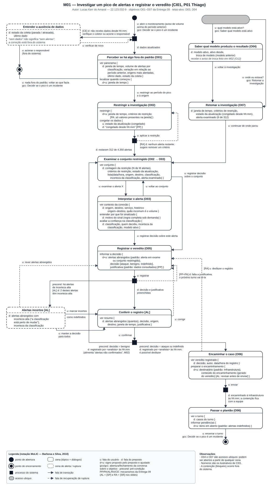

# Entrega 10 — MoLIC

**Data:** 30/10/2026  
**Status:** `🟩 concluída`  
**Responsabilidade:** 1 solução completa por integrante

## Objetivo da atividade

Modelar a interação como uma **conversa entre usuário e preposto do designer**, oferecendo visão global dos caminhos que permitem ao usuário atingir seus objetivos — incluindo alternativas e rupturas relevantes. MoLIC não deve ser reduzida a um fluxograma de telas.

## Atenção a TCCs sem interface original

O MoLIC não modela o algoritmo por dentro. Ele modela a **conversa de interação necessária para que uma pessoa use a contribuição**.

Exemplos de conversas:

- usuário escolhe dados/parâmetros → sistema valida → usuário inicia análise → sistema comunica processamento → usuário interpreta resultado;
- usuário consulta histórico → refina filtros → abre execução → compara com outra;
- administrador seleciona perfil → altera permissão → sistema comunica consequências → administrador confirma/cancela;
- analista recebe alerta → examina evidências → classifica ocorrência → registra decisão.

Modele também rupturas plausíveis: entrada inválida, falha de processamento, ausência de resultado, permissão insuficiente, filtro sem resultados, conflito de alteração, cancelamento ou necessidade de recuperação.

## M01 — Investigar um pico de alertas e registrar o veredito

**Autor(a):** Lucas Kerr do Amaral — 22.123.032-9  
**Cenário de interação de origem:** CI01 — Investigação de um pico de alertas durante o plantão (P01 Thiago)  
**Objetivo(s):** O01, O02, O03, O05, O06 (caminho principal); O04 e O07 (acessos ubíquos); O08 (efeito indireto: o veredito “benigno” alimenta *alertas não confirmados*, consultado em M02)  
**Tarefa(s) relacionada(s):** T02 (fluxos PF01 e PF03); metas MQ01–MQ05, MQ08, MU01–MU06, MU10  
**Signos relevantes:** *janela de tempo*, *volume de alertas por classificação*, *variação em relação ao período anterior*, *origens mais alertadas*, *último dado*, *estado da coleta*, *estado da atualização*, *critérios de restrição*, *contagem da restrição*, *alerta examinado*, *origem*, *destino*, *serviço*, *histórico origem–destino*, *quão incomum é o volume*, *motivo do sinal*, *classificação*, *incerteza da classificação*, *quem decidiu*, *modelo ativo*, *ativo desde*, *troca de modelo*, *alertas abrangidos*, *decisão*, *justificativa*, *autor*, *data/hora do registro*, *destinatário*, *conteúdo do encaminhamento*, *casos do turno*, *itens em aberto*

### Diagrama

**Fonte editável:** [`../assets/10_molic/molic_m01.svg`](../assets/10_molic/molic_m01.svg) — SVG escrito em texto, editável em qualquer editor de texto ou no Inkscape/draw.io. O diagrama tem 1240 px de largura; no GitHub, clique na imagem para vê-lo em tamanho original.

### Leitura do diagrama

Explique em texto o caminho principal e pelo menos os caminhos alternativos/rupturas mais importantes.

#### Caminho principal

1. **Ponto de abertura** → `u: abrir o monitoramento` (motivado pelo aviso de que o volume de ataques está acima do período anterior), com `gco: Decidir se o pico é um incidente`. Antes de qualquer cena, um **processo do sistema** verifica se os dados estão chegando; com a coleta ativa, `d: dados atualizados` leva à cena **Perceber se há algo fora do padrão (O01)**: o preposto informa que, nas últimas 2 horas, houve cerca de quatro vezes os ataques do período anterior, concentrados em um segmento, e que os dados são de 20h47. No diálogo *localizar quando começou*, Thiago ajusta a *janela de tempo* e vê que o aumento começou por volta das 19h — sem abrir nenhum alerta (MQ01).
2. `u: restringir ao período do pico e à origem` → **Restringir a investigação (O02)**: Thiago ajusta *janela de tempo* e *critérios de restrição* (segmento 10.0.4.0/24) e congela os dados (*estado da atualização*; `d: congelado desde 20h47`). `u: aplicar a restrição` → processo → `d: restaram 312 de 4.350 alertas` → **Examinar o conjunto restringido**, onde a lista traz *classificação*, *incerteza da classificação* e *alerta examinado* de cada linha.
3. `u: examinar o alerta X` → **Interpretar o alerta (O03)**: contexto da conexão (origem 10.0.4.17, portal interno do atendimento, serviço web, sem histórico com esse destino na última semana, volume mais incomum que 99% do habitual), *motivo do sinal* em linguagem de rede e confiança na classificação (*quem decidiu* = modelo supervisionado, *incerteza* baixa). `u: voltar ao conjunto` permite repetir o exame para outros alertas.
4. `u: registrar decisão sobre o conjunto` (ou `sobre este alerta`, a partir de O03) → **Registrar o veredito (O05)**: o preposto já propõe os *alertas abrangidos* e a *justificativa* com os dados consultados; Thiago escolhe a *decisão* (ataque) e completa a justificativa. `u: registrar` → processo → `d: decisão e justificativa preenchidas` → **Conferir o registro**: resumo com quantos alertas, decisão, origem, destino e período (AL).
5. `u: confirmar` → processo → com `precond: decisão = ataque ou indefinido`, `d: registrado por Thiago às 21h04; é possível desfazer` → **Encaminhar o caso (O06)**: o preposto gera o *conteúdo do encaminhamento* (observado, conclusão e base) para o *destinatário* padrão (Infraestrutura); Thiago revisa. `u: enviar` → processo → `d: encaminhado à Infraestrutura às 21h06; a contenção fica com a equipe`.
6. → **Passar o plantão (O06)**: *casos do turno* (um caso confirmado e encaminhado) e *itens em aberto* (os dois alertas indefinidos). `u: encerrar o turno` → `gcc: Decidir se o pico é um incidente` → **ponto de encerramento**.

Em qualquer cena, dois **acessos ubíquos** mudam o tópico: `u: qual modelo está ativo?` abre **Saber qual modelo produziu o resultado (O04)** (`d: SVM v7, em produção desde 27/10; antes era o v6`), de onde `u: voltar à investigação` leva a O07; `u: onde eu estava?` abre **Retomar a investigação (O07)** (período, segmento, congelado desde 20h47, 6 de 312 alertas examinados), e `u: continuar de onde parou` volta ao conjunto restringido.

#### Alternativas e rupturas

| Situação                                      | Onde ocorre                                                                             | Como o usuário percebe                                                                                                                                                      | Caminho de recuperação/saída                                                                                                                                                                                 |
| --------------------------------------------- | --------------------------------------------------------------------------------------- | --------------------------------------------------------------------------------------------------------------------------------------------------------------------------- | ------------------------------------------------------------------------------------------------------------------------------------------------------------------------------------------------------------ |
| Coleta parada / dados não chegam              | Processo do sistema na abertura (o *estado da coleta* é mantido em todas as cenas — PP) | Cena de alerta **Entender a ausência de dados**: `[CE] d: não recebo dados desde 20h31; isso não significa que não há alertas; verifique o coletor ou acione o responsável` | `u: verificar de novo` (volta ao processo) ou `u: acionar o responsável (fora do sistema)` → encerramento. A correção está fora do sistema (CE; MQ05)                                                        |
| Nada fora do padrão                           | **Perceber se há algo fora do padrão (O01)**                                            | *Variação em relação ao período anterior* próxima do habitual                                                                                                               | `u: nada fora do padrão; voltar ao que fazia` → `gcc` → encerramento (abandono legítimo do objetivo, sem abrir alerta)                                                                                       |
| Restrição que não deixa nenhum alerta         | Processo após **Restringir a investigação (O02)**                                       | `[RA] d: nenhum alerta restante; sugere remover um critério`                                                                                                                | Volta a O02 com os critérios preservados para remover um deles. Prevenção: PA — só valores presentes na janela podem ser escolhidos                                                                          |
| Justificativa ausente                         | Processo após **Registrar o veredito (O05)**                                            | `[PP+PA] d: falta a justificativa; o próximo turno vai lê-la`                                                                                                               | Volta a O05; o registro não acontece sem justificativa (MQ08)                                                                                                                                                |
| Veredito que inclui alertas de incerteza alta | Processo após O05 (`precond: há alertas de incerteza alta`)                             | Cena de alerta **Alertas incertos**: `[AL] d: 2 destes alertas têm incerteza alta — a classificação está perto de mudar`                                                    | `u: marcar incertos como indefinidos` ou `u: manter a decisão para todos` → **Conferir o registro**; `u: rever alertas abrangidos` volta a O05. Evita o erro crítico de MU03 sem tirar a decisão do analista |
| Alcance errado do veredito                    | **Conferir o registro**                                                                 | Resumo com quantos e quais alertas, origem, destino e período (AL)                                                                                                          | `u: corrigir` → O05                                                                                                                                                                                          |
| Registro já gravado, mas equivocado           | **Encaminhar o caso (O06)**                                                             | `d: registrado por Thiago às 21h04; é possível desfazer`                                                                                                                    | `[RA] u: desfazer o registro` → O05                                                                                                                                                                          |
| Decisão “benigno”                             | Processo após confirmar (`precond: decisão = benigno`)                                  | `d: registrado por Thiago às hh:mm`                                                                                                                                         | Volta ao conjunto restringido: não há encaminhamento para “benigno” (PA da Entrega 09). O registro alimenta *alertas não confirmados*, que abre M02                                                          |
| Interrupção durante a investigação            | Qualquer cena                                                                           | —                                                                                                                                                                           | Acesso ubíquo **Retomar a investigação (O07)** → `u: continuar de onde parou` → conjunto restringido (MQ03, MU10)                                                                                            |
| Comportamento do IDS mudou nos últimos dias   | Qualquer cena                                                                           | —                                                                                                                                                                           | Acesso ubíquo **Saber qual modelo produziu o resultado (O04)**; a fala de troca de modelo de M02 aparece aqui (PF03, MQ04)                                                                                   |

### Checklist específico de modelagem

- [ ] Existe **ponto de abertura** coerente com o início do objetivo.
- [ ] As **cenas de conversa** representam tópicos/assuntos, não nomes de páginas apenas.
- [ ] As transições/falas deixam claro o que o usuário ou o sistema comunica.
- [ ] Há **ponto(s) de encerramento** para objetivos concluídos/abandonados quando aplicável.
- [ ] Processamentos do sistema estão representados conforme a notação adotada em aula, sem “inventar” fala do usuário.
- [ ] Rupturas (breakdowns) relevantes têm feedback e caminho de recuperação, não becos sem saída.
- [ ] Acessos ubíquos/atalhos só aparecem quando semanticamente justificáveis.
- [ ] O diagrama cobre caminhos alternativos importantes, e não apenas o “happy path”.
- [ ] Nomes de objetivos, tópicos e signos são coerentes com a Entrega 9.
- [ ] O diagrama é legível em tamanho normal no GitHub.
- [ ] O MoLIC representa a conversa usuário–sistema, não o fluxo interno do algoritmo.
- [ ] Processamento, filtros, administração, relatórios e históricos incluem retornos/rupturas quando relevantes.

## Consolidação da equipe

### Cobertura dos objetivos

| Objetivo | MoLIC que cobre                                                          | Lacunas/duplicidades                                                      | Decisão                                                                                                                                                                                                |
| -------- | ------------------------------------------------------------------------ | ------------------------------------------------------------------------- | ------------------------------------------------------------------------------------------------------------------------------------------------------------------------------------------------------ |
| O01      | M01 (cena O01 + ruptura “ausência de dados”)                             | A ruptura de coleta aparece também em M02 (O09), com outro tópico         | Mantidas as duas: para Thiago a pergunta é “sem dados ou sem alertas?”; para Vanessa, “o problema é do modelo ou da infraestrutura?”. Mesmo signo (*estado da coleta*) e mesmo mecanismo (CE) nos dois |
| O02      | M01 (Restringir a investigação + Examinar o conjunto restringido)        | —                                                                         | Conjunto restringido é o ponto de retorno de O03, O07 e do veredito “benigno”                                                                                                                          |
| O03      | M01 (Interpretar o alerta)                                               | —                                                                         | Uma cena com três diálogos (contexto, motivo do sinal, confiança), não três cenas, porque Thiago os lê juntos                                                                                          |
| O04      | M01 e M02 (acesso ubíquo nos dois)                                       | **Duplicidade intencional**: mesma cena, mesmos signos                    | Uma única cena no protótipo, acessível de qualquer tela; em M02 ela é também o ponto de partida da reversão                                                                                            |
| O05      | M01 (Registrar o veredito, Alertas incertos, Conferir o registro)        | —                                                                         | Três cenas porque há duas rupturas (justificativa ausente e incerteza alta) e uma confirmação com resumo                                                                                               |
| O06      | M01 (Encaminhar o caso, Passar o plantão)                                | —                                                                         | A contenção fica fora do sistema; o encaminhamento só existe para “ataque” ou “indefinido”                                                                                                             |
| O07      | M01 (acesso ubíquo)                                                      | Não tem tela própria                                                      | O estado da investigação (período, critérios, congelamento, alertas examinados) fica visível no conjunto restringido; o acesso ubíquo apenas o resume                                                  |
| O08      | M02 (Perceber que o modelo pode estar inadequado)                        | Produzido em M01 (veredito “benigno”) e consumido em M02, sem cena em M01 | Mantido como ponto de contato: em M01 aparece como efeito do registro, não como tópico de conversa de Thiago                                                                                           |
| O09      | M02 (processo + Verificar a saúde do pipeline + Problema fora do modelo) | —                                                                         | —                                                                                                                                                                                                      |
| O10      | M02 (Comparar candidato e modelo em produção)                            | —                                                                         | Candidato reprovado volta a esta cena, que já mostra o cenário e a métrica que reprovaram                                                                                                              |
| O11      | M02 (Prever o efeito da troca)                                           | —                                                                         | Cena separada de O10 para que o efeito seja visto **antes** da confirmação, como pede P02                                                                                                              |
| O12      | M02 (Confirmar a troca, Carga acima do limite, Reverter o modelo)        | Promoção e reversão em cenas diferentes                                   | Mesma estrutura de conversa (resumo → motivo → confirmação → registro → aviso) nas duas, para consistência entre caminhos análogos                                                                     |
| O13      | M02 (cena no caminho principal e acesso ubíquo)                          | Não desenhado em M01, embora a Entrega 09 o atribua também a P01          | Thiago chega ao histórico pelo mesmo acesso ubíquo; em M01 basta a *troca de modelo* (modelo anterior) mostrada em O04                                                                                 |

### Preparação para o Figma

Liste os estados/telas que serão necessários **a partir das conversas modeladas**, incluindo feedback, confirmação, erro e recuperação.

Seguindo o material de aula (parte C), cada cena tende a virar uma unidade de apresentação (ou parte de uma), os acessos ubíquos viram itens de navegação presentes em todas as telas e as falas do preposto viram mensagens de status ou de erro. Telas existentes: D01, D02, D03 (Grafana). Telas novas: **D04 — Registro do veredito e encaminhamento**, **D05 — Comparação de modelos e troca**, **D06 — Histórico de trocas de modelo**.

| Tela/estado                                                                                                                              | Origem no MoLIC (cena ou fala)                                                | Tipo                               | Protótipo |
| ---------------------------------------------------------------------------------------------------------------------------------------- | ----------------------------------------------------------------------------- | ---------------------------------- | --------- |
| Navegação comum: “modelo ativo / ativo desde”, “histórico de trocas”, “onde eu estava” e estado da coleta/último dado no topo de D01–D06 | Acessos ubíquos O04, O07, O13; signo *estado da coleta*                       | normal / status                    | F01, F02  |
| D03 — panorama com variação em relação ao período anterior e janela declarada                                                            | M01, Perceber se há algo fora do padrão (O01)                                 | normal                             | F01       |
| D03 — sem dados (coleta parada), distinto de “nenhum alerta”                                                                             | M01, Entender a ausência de dados `[CE]`                                      | erro / captura de erro             | F01       |
| D03 — recorte aplicado com “312 de 4.350 alertas” e aviso “congelado desde 20h47”                                                        | M01, Restringir a investigação; Examinar o conjunto restringido               | feedback                           | F01       |
| D03 — recorte sem nenhum alerta, com sugestão de remover um critério                                                                     | M01, `[RA] d: nenhum alerta restante`                                         | filtro sem resultado / recuperação | F01       |
| D03 — detalhe do alerta (contexto, motivo do sinal, quem decidiu, incerteza)                                                             | M01, Interpretar o alerta (O03)                                               | normal                             | F01       |
| D03 — retomada após interrupção (período, critérios, alertas examinados)                                                                 | M01, Retomar a investigação (O07)                                             | status                             | F01       |
| D04 — formulário do veredito com alertas abrangidos e justificativa preenchidos                                                          | M01, Registrar o veredito (O05)                                               | entrada de dados                   | F01       |
| D04 — justificativa ausente                                                                                                              | M01, `[PP+PA] d: falta a justificativa`                                       | erro de entrada                    | F01       |
| D04 — aviso de alertas com incerteza alta (marcar como indefinidos / manter / rever)                                                     | M01, Alertas incertos `[AL]`                                                  | alerta / confirmação               | F01       |
| D04 — resumo antes de registrar                                                                                                          | M01, Conferir o registro `[AL]`                                               | confirmação                        | F01       |
| D04 — registrado (autor, horário) com opção de desfazer                                                                                  | M01, `d: registrado por…; é possível desfazer`                                | sucesso / desfazer                 | F01       |
| D04 — encaminhamento gerado para revisão e confirmação de envio                                                                          | M01, Encaminhar o caso (O06)                                                  | entrada de dados / sucesso         | F01       |
| D04 — passagem de plantão (casos do turno, itens em aberto)                                                                              | M01, Passar o plantão (O06)                                                   | relatório                          | F01       |
| D05 — alertas não confirmados (antes × depois da troca; “sem decisões no período”)                                                       | M02, Perceber que o modelo pode estar inadequado (O08)                        | normal / vazio                     | F02       |
| D05 — saúde do pipeline e estado “problema fora do modelo”                                                                               | M02, Verificar a saúde do pipeline (O09); Problema fora do modelo `[CE]`      | status / captura de erro           | F02       |
| D05 — comparação por cenário com mínimo exigido, diferença, resultado e cenário decisivo; explicação de cada métrica                     | M02, Comparar candidato e modelo em produção (O10)                            | normal                             | F02       |
| D05 — candidato reprovado (promoção indisponível, com cenário e métrica)                                                                 | M02, `[PA] d: candidato reprovado…`                                           | erro / prevenção ativa             | F02       |
| D05 — efeito previsto para os analistas e carga prevista                                                                                 | M02, Prever o efeito da troca (O11)                                           | normal                             | F02       |
| D05 — aviso de carga acima do limite                                                                                                     | M02, Carga acima do limite `[AL]`                                             | alerta / confirmação               | F02       |
| D05 — confirmação da troca com resumo e motivo obrigatório; motivo ausente                                                               | M02, Confirmar a troca (O12); `[PA] d: informe o motivo da troca`             | confirmação / erro de entrada      | F02       |
| D05 — troca realizada (modelo ativo, desde quando, por quem) e aviso enviado aos analistas                                               | M02, `d: SVM v8 em produção desde 14h10…`; Saber qual modelo está ativo (O04) | sucesso                            | F02       |
| D03 — aviso “o modelo ativo mudou” para quem investiga                                                                                   | M02 → M01, cena O04                                                           | status                             | F01       |
| D06 — histórico de trocas (data/hora, modelos, tipo, autor, motivo)                                                                      | M02, Consultar o histórico de trocas (O13)                                    | normal                             | F02       |
| D06 — reversão com resumo, motivo e confirmação; reversão registrada                                                                     | M02, Reverter o modelo (O12) `[RA]`                                           | confirmação / recuperação          | F02       |

Fluxos que **não** estão nos MoLIC e, por isso, não devem aparecer no Figma: execução da contenção (fora do sistema), treino de candidatos (offline, pela CLI) e gestão de usuários (H23). No protótipo, registro do veredito, encaminhamento e troca de modelo são simulados (Entrega 08, delimitação).

## Erros frequentes a evitar

- desenhar apenas caixas com nomes de telas e setas de navegação;
- não modelar falhas, cancelamento, volta ou recuperação;
- usar rótulos genéricos (“Tela 1”, “Processo 2”) sem tópico de conversa;
- criar no Figma fluxos que não existem no MoLIC;
- diagrama sem legenda/fonte editável e com texto ilegível.
