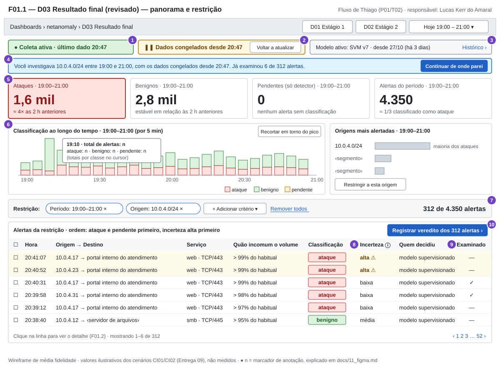
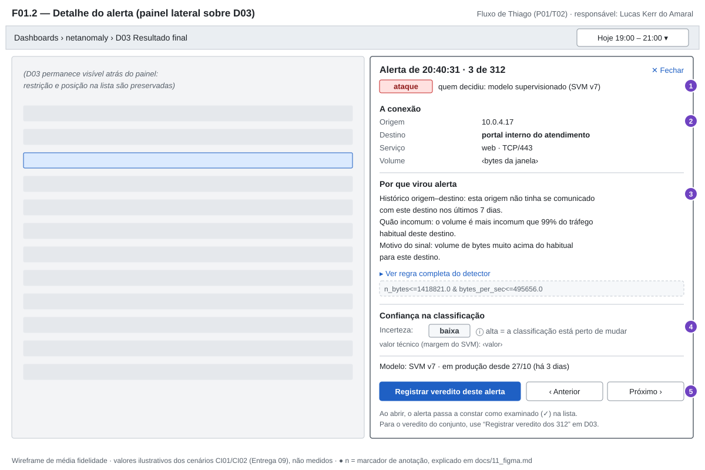
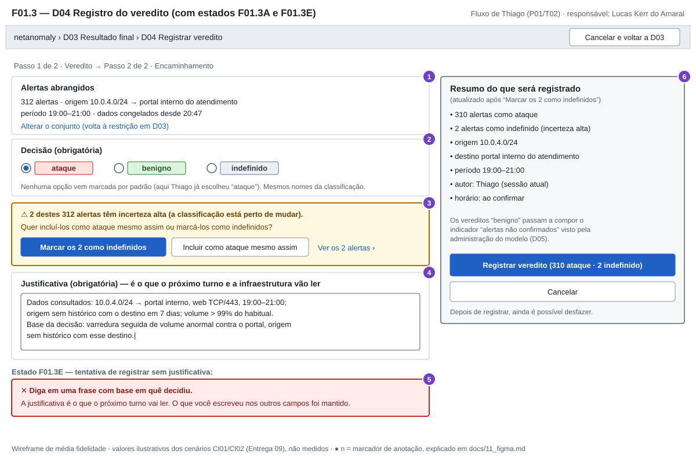
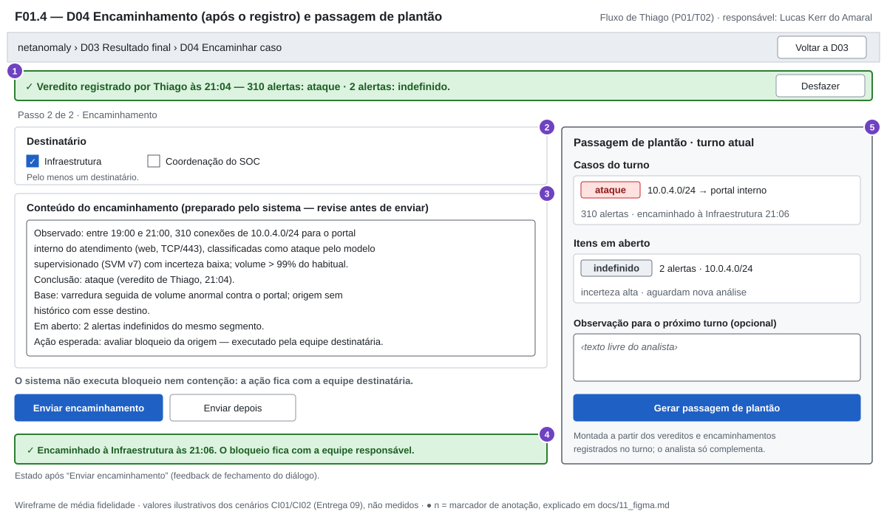
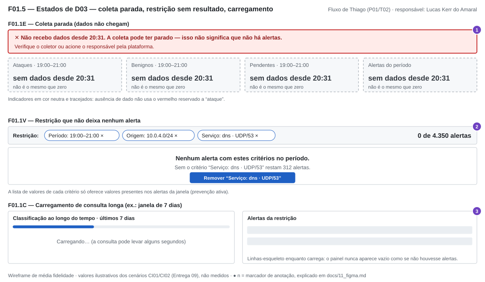
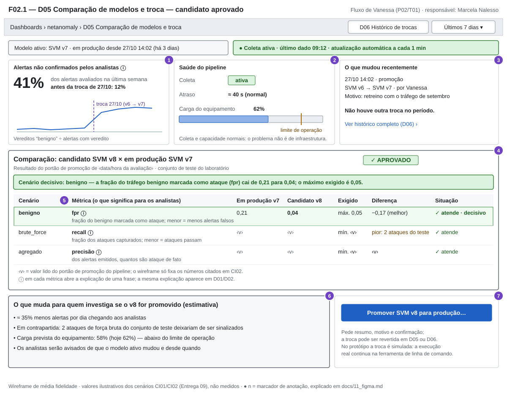
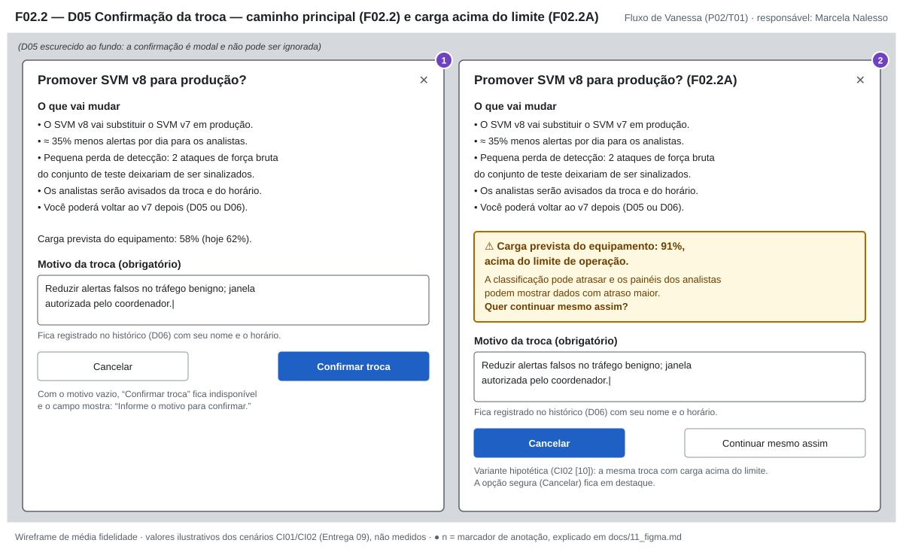
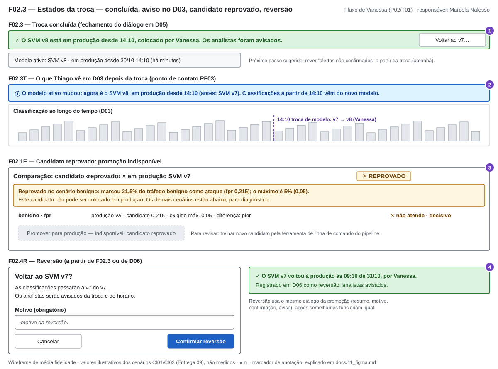
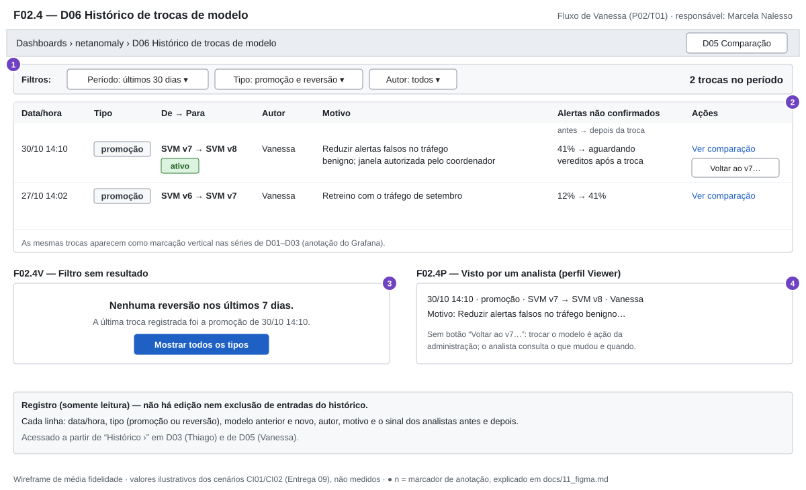

# Entrega 11 — Protótipo no Figma

**Data:** 30/10/2026  
**Status:** `🟩 concluída`  
**Responsabilidade:** 1 protótipo integrado por equipe cobrindo os fluxos MoLIC. Se a turma exigir divisão individual, identifique o responsável por cada fluxo/tela.

## Objetivo da atividade

Materializar o modelo de interação em um protótipo navegável, preservando a lógica dos objetivos, tópicos, signos, feedbacks, alternativas e recuperações definidos anteriormente.

## Biblioteca de possibilidades para projetos técnicos

O protótipo deve materializar os fluxos definidos nas entregas anteriores. Dependendo do escopo, podem fazer sentido:

1. **Dashboard:** indicadores, alertas, estado, tendências e atalhos para tarefas frequentes.
2. **Configuração/parametrização:** escolhas, presets, validação e explicação de opções técnicas.
3. **Entrada de dados:** upload, conexão, seleção, pré-visualização e validação.
4. **Processamento:** fila, status, progresso, cancelamento, falha e reexecução.
5. **Relatório/resultados:** síntese, métricas, gráficos, explicação, exportação e compartilhamento.
6. **Histórico:** busca, filtros, ordenação, paginação, detalhes e repetição de execução.
7. **Comparação:** antes/depois, modelo A/B, execução A/B, baseline ou períodos.
8. **Explicabilidade:** confiança, fatores, evidências, limitações e correção/contestação.
9. **Administração:** usuários, grupos, perfis, permissões, integrações e políticas.
10. **CRUDs de domínio:** somente quando criar/consultar/editar/excluir representa tarefa real.
11. **Auditoria/logs:** histórico de alterações e eventos em linguagem adequada.
12. **Alertas/ocorrências:** severidade, impacto, ação, responsável e resolução.
13. **Ajuda/documentação:** apoio contextual a tarefas complexas.

**Uso neste protótipo** (cada família só entra se houver objetivo da Entrega 09 que a justifique):

| Família                 | Onde                                                                 | Objetivo/signo que justifica                                                                                                                                |
| ----------------------- | -------------------------------------------------------------------- | ----------------------------------------------------------------------------------------------------------------------------------------------------------- |
| 1. Dashboard            | F01.1 (D03 revisado), topo de F02.1                                  | O01 (*variação em relação ao período anterior*, *estado da coleta*); O08, O09                                                                               |
| 6. Histórico            | F02.4 (D06)                                                          | O13 (*troca de modelo*, *motivo da troca*, *autor*)                                                                                                         |
| 7. Comparação           | F02.1 (D05)                                                          | O10 (*mínimo exigido*, *diferença*, *cenário decisivo*)                                                                                                     |
| 8. Explicabilidade      | F01.2 (detalhe do alerta), métricas de F02.1                         | O03 (*motivo do sinal*, *incerteza da classificação*, *quem decidiu*); O10 (explicação de cada métrica)                                                     |
| 11. Auditoria           | D06 em modo somente leitura; autoria e horário em vereditos e trocas | O05, O12, O13 (*autor*, *data/hora do registro*)                                                                                                            |
| 12. Alertas/ocorrências | F01.1–F01.4 (veredito, encaminhamento, passagem de plantão)          | O02, O05, O06                                                                                                                                               |
| 13. Ajuda contextual    | ⓘ de incerteza e de cada métrica                                     | RC03, I03; MQ02, MQ06                                                                                                                                       |
| 2. Configuração         | **parcial**: só a troca de modelo (F02.2), sem parâmetros            | O12; limites e parâmetros ficam fora do recorte (Entrega 09, 3.3)                                                                                           |
| 3, 4, 9, 10             | **não usadas**                                                       | Não há envio de dados, nem execução que o usuário acompanhe (o treino é *offline*, Entrega 08), nem gestão de usuários (H23), nem CRUD que seja tarefa real |

### Estados que não podem ser esquecidos

Quando aplicável, considere: vazio/sem dados; carregamento/processamento; sucesso; erro de entrada; erro de processamento; filtro sem resultados; permissão insuficiente; confirmação de ação destrutiva; cancelamento/desfazer/recuperação; dados desatualizados/conflito.

| Estado                                        | Onde foi prototipado                                                                                                                                                        |
| --------------------------------------------- | --------------------------------------------------------------------------------------------------------------------------------------------------------------------------- |
| vazio/sem dados                               | F01.1E (coleta parada: indicadores “sem dados desde 20:31”, não “0”); F02.4V                                                                                                |
| carregamento/processamento                    | F01.1C (consulta longa com barra e linhas-esqueleto). Não há processamento acompanhado pelo usuário: treino e avaliação do candidato ocorrem pela CLI (Entrega 08, seção 1) |
| sucesso                                       | F01.4 (veredito registrado; encaminhado); F02.3 (troca concluída); F02.4R (reversão concluída)                                                                              |
| erro de entrada                               | F01.3E (justificativa ausente); F02.2 (motivo vazio deixa “Confirmar troca” indisponível)                                                                                   |
| erro de processamento                         | F01.1E (coleta parada — captura de erro, a solução está fora do sistema)                                                                                                    |
| filtro sem resultados                         | F01.1V (restrição com 0 alertas); F02.4V (histórico sem trocas do tipo filtrado)                                                                                            |
| permissão insuficiente                        | F02.4P (analista vê o histórico sem a ação de trocar o modelo)                                                                                                              |
| confirmação de ação destrutiva/de alto efeito | F01.3 (resumo antes de registrar); F02.2 e F02.2A (troca de modelo); F02.4R (reversão)                                                                                      |
| cancelamento/desfazer/recuperação             | “Desfazer” do veredito (F01.4); “Voltar ao v7…” (F02.3, D06); “Remover critério” (F01.1V); “Cancelar” em todo diálogo                                                       |
| dados desatualizados/conflito                 | F01.1 (dados congelados com lembrete permanente); F01.1E; F01.3A (alertas incertos dentro do mesmo veredito)                                                                |

## Link do Figma

**Protótipo:** [Link do Protótipo](https://www.figma.com/proto/SACmJtybT3PVGyJNpHuoY5/netanomaly-%E2%80%94-Prot%C3%B3tipo-IHC--Entrega-11-?node-id=0-1&t=2nwcwVOph2wJkgR2-1)  
**Arquivo editável:** [Link do Arquivo Completo](https://www.figma.com/design/SACmJtybT3PVGyJNpHuoY5/netanomaly-%E2%80%94-Prot%C3%B3tipo-IHC--Entrega-11-?node-id=0-1&t=2nwcwVOph2wJkgR2-1)  
**Última verificação de permissão:** 05/11/2026

> Teste o link em janela anônima. O avaliador deve conseguir abrir o protótipo sem solicitar permissão.

### Especificação de navegação para o protótipo clicável

| Origem | Elemento clicável                                            | Destino                           | Observação                                     |
| ------ | ------------------------------------------------------------ | --------------------------------- | ---------------------------------------------- |
| F01.1  | linha da tabela                                              | F01.2                             | Painel lateral sobre D03; restrição preservada |
| F01.1  | “Registrar veredito dos 312 alertas ›”                       | F01.3                             | Conjunto = restrição atual                     |
| F01.1  | “Histórico ›” no indicador de modelo ativo                   | F02.4P                            | Visão de analista (somente leitura)            |
| F01.1  | “Voltar a atualizar”                                         | F01.1 sem a faixa de congelamento |                                                |
| F01.1  | “+ Adicionar critério ▾” → “Serviço: dns”                    | F01.1V                            | Filtro sem resultado                           |
| F01.1V | “Remover ‘Serviço: dns · UDP/53’”                            | F01.1                             |                                                |
| F01.2  | “Registrar veredito deste alerta”                            | F01.3 (com 1 alerta)              |                                                |
| F01.2  | “✕ Fechar” / “Próximo ›”                                     | F01.1 / F01.2 seguinte            |                                                |
| F01.3  | “Marcar os 2 como indefinidos”                               | F01.3 com resumo atualizado       | Estado F01.3A resolvido                        |
| F01.3  | “Registrar veredito” com justificativa vazia                 | F01.3E                            |                                                |
| F01.3  | “Registrar veredito”                                         | F01.4                             |                                                |
| F01.4  | “Desfazer”                                                   | F01.3 preenchido                  |                                                |
| F01.4  | “Enviar encaminhamento”                                      | F01.4 com faixa “Encaminhado…”    |                                                |
| F02.1  | “Ver histórico completo (D06) ›” / “D06 Histórico de trocas” | F02.4                             |                                                |
| F02.1  | “Promover SVM v8 para produção…”                             | F02.2                             |                                                |
| F02.2  | “Confirmar troca”                                            | F02.3                             |                                                |
| F02.2  | “Cancelar” / “✕”                                             | F02.1                             |                                                |
| F02.3  | “Voltar ao v7…”                                              | F02.4R                            |                                                |
| F02.4  | “Ver comparação”                                             | F02.1                             |                                                |
| F02.4  | “Voltar ao v7…”                                              | F02.4R                            |                                                |

Estados alcançados por condição de dados, e não por clique (F01.1E, F01.1C, F01.1R, F02.1E, F02.2A), entram no Figma como *frames* separados que o facilitador apresenta durante o teste.

## Cobertura MoLIC → Figma

> Cenas e falas conforme os diagramas M01 e M02 da [Entrega 10](10_molic.md) e sua tabela “Preparação para o Figma”. Todos os estados listados naquela tabela têm tela correspondente aqui, exceto o vazio “sem decisões no período” de O08, que fica como pendência (ver fim do documento). Fluxos fora dos MoLIC — contenção, treino de candidatos, gestão de usuários — não aparecem no protótipo.

| MoLIC | Objetivo                                        | Fluxo/telas no Figma                                           | Estados de erro/recuperação                                                     | Responsável          |
| ----- | ----------------------------------------------- | -------------------------------------------------------------- | ------------------------------------------------------------------------------- | -------------------- |
| M01   | O01 Perceber se há algo fora do padrão          | `F01.1` (faixa de estado, indicadores, série)                  | `F01.1E` (coleta parada — CE), `F01.1C`                                         | Lucas Kerr do Amaral |
| M01   | O02 Recortar período e origem                   | `F01.1` (barra de restrição, “N de M alertas”, congelar dados) | `F01.1V` (restrição vazia — RA: remover critério)                               | Lucas Kerr do Amaral |
| M01   | O03 Interpretar o alerta e sua incerteza        | `F01.1 → F01.2`                                                | Incerteza alta destacada na tabela (AL em F01.3A)                               | Lucas Kerr do Amaral |
| M01   | O04 Saber qual modelo está ativo e desde quando | Indicador em `F01.1`, `F01.2`; aviso `F02.3T`                  | —                                                                               | Lucas Kerr do Amaral |
| M01   | O07 Retomar investigação interrompida           | `F01.1R` (faixa “Você investigava…”), coluna “Examinado”       | —                                                                               | Lucas Kerr do Amaral |
| M01   | O05 Registrar o veredito com justificativa      | `F01.1 → F01.3 → F01.4`                                        | `F01.3A` (incertos — AL), `F01.3E` (sem justificativa — PP+PA), “Desfazer” (RA) | Lucas Kerr do Amaral |
| M01   | O06 Encaminhar o caso e passar o plantão        | `F01.4`                                                        | “Enviar depois”; destinatário obrigatório (PA)                                  | Lucas Kerr do Amaral |
| M02   | O08 Acompanhar alertas não confirmados          | `F02.1` (painel 1); retorno em `F02.4` (antes → depois)        | —                                                                               | Marcela Nalesso      |
| M02   | O09 Verificar a saúde do pipeline               | `F02.1` (painel 2)                                             | Coleta parada usa o mesmo aviso de `F01.1E`                                     | Marcela Nalesso      |
| M02   | O13 Consultar o histórico de trocas             | `F02.1` (painel 3) `→ F02.4`                                   | `F02.4V` (filtro vazio), `F02.4P` (permissão)                                   | Marcela Nalesso      |
| M02   | O10 Comparar candidato e modelo em produção     | `F02.1`                                                        | `F02.1E` (reprovado — PA + RA)                                                  | Marcela Nalesso      |
| M02   | O11 Prever o efeito da troca                    | `F02.1` (efeito previsto), `F02.2` (resumo)                    | `F02.2A` (carga acima do limite — AL)                                           | Marcela Nalesso      |
| M02   | O12 Promover ou reverter o modelo               | `F02.1 → F02.2 → F02.3`; `F02.3 / F02.4 → F02.4R`              | Motivo obrigatório (PA), “Cancelar”, reversão (RA)                              | Marcela Nalesso      |

## Catálogo de telas/estados

**Numeração.** `F01.n` = telas do fluxo de Thiago; `F02.n` = telas do fluxo de Vanessa. Sufixos de estado: `E` erro, `A` alerta/prevenção apoiada, `V` vazio, `C` carregamento, `R` retomada/reversão, `T` ponto de contato com o outro fluxo, `P` permissão. Os números roxos (●) nos wireframes são **marcadores de anotação**, não elementos da interface; cada um é explicado no item “Signos principais”. As siglas PP, PA, AL, RA e CE são as da Entrega 09, seção 4.

**Telas novas e existentes.** F01.1 e F01.2 são **D03 revisado** com as alterações candidatas da Entrega 06 (seção 5) — devem ser feitas no próprio Grafana. **D04 — Registro do veredito e encaminhamento**, **D05 — Comparação de modelos e troca** e **D06 — Histórico de trocas de modelo** são telas fora do Grafana (restrições R1 e R2 da Entrega 08), desenhadas imitando suas convenções (barra superior com trilha, controles à direita, painéis com título).

### F01 — Fluxo de investigação (Thiago) · responsável: Lucas Kerr do Amaral — 22.123.032-9

#### F01.1 — D03 Resultado final (revisado): panorama e restrição

**Objetivo do usuário:** saber, sem abrir alerta, se há algo fora do padrão e desde quando; restringir os alertas ao pico e ao segmento e saber quantos restaram; retomar de onde parou (O01, O02, O04, O07).  
**Signos principais:** ① *estado da coleta* e *último dado* (PP; CD4); ② *estado da atualização* “congelado desde 20:47”, com lembrete permanente e “Voltar a atualizar” (PP, RA; WCAG 2.2.2); ③ *modelo ativo* e *ativo desde*, com acesso ao histórico (PF03, I10 corrigido); ④ faixa de retomada com *janela de tempo*, *critérios de restrição* e *alertas examinados* (estado F01.1R; RE26); ⑤ *volume de alertas por classificação* com *variação em relação ao período anterior* e janela declarada em cada indicador (I05); ⑥ série com total por classe no cursor e atalho “Recortar em torno do pico” (Entrega 06, passo A4); ⑦ *critérios de restrição* por extenso e *contagem da restrição* “312 de 4.350” (RC04, I07); ⑧ *classificação* (cor + texto), *incerteza da classificação* e *quem decidiu* em linguagem do usuário (I03, MQ02); ⑨ *alerta examinado*; ⑩ ação principal de registrar o veredito do conjunto.  
**Origem no MoLIC:** M01 / cenas **Perceber se há algo fora do padrão (O01)**, **Restringir a investigação (O02)** e **Examinar o conjunto restringido**; acessos ubíquos **Retomar a investigação (O07)** e **Saber qual modelo produziu o resultado (O04)**.  
**Princípios e diretrizes aplicados:** **[PD: visibilidade e reconhecimento]** estado da coleta, congelamento, modelo ativo e restrição sempre visíveis — o usuário não precisa lembrar o que fez antes da interrupção; **[PD: antecipação]** o indicador já traz a comparação com o período anterior, e não só a contagem; **[PD: consistência]** a mesma janela em todos os indicadores; **AP7** a ordem panorama → recorte → detalhe faz da navegação uma escolha, não uma leitura minuciosa da tabela; tabela ordenada com ataque e incerteza alta primeiro (Entrega 08, volume de dados). A cor vermelha aparece só no indicador de ataques (guia de estilo, Entrega 08).

#### F01.2 — Detalhe do alerta (painel lateral sobre D03)

**Objetivo do usuário:** entender o que é a conexão, por que virou alerta e quanto confiar na classificação (O03).  
**Signos principais:** ① *classificação* e *quem decidiu* (modelo supervisionado, com versão); ② *origem*, *destino* (com nome do ativo), *serviço*; ③ *histórico origem–destino* (7 dias), *quão incomum é o volume* e *motivo do sinal* em linguagem de rede, com a regra completa do detector sob demanda (I06, RC03); ④ *incerteza da classificação* com explicação de uma frase no ⓘ e o valor técnico (margem) só como informação secundária (PP); ⑤ ações: registrar veredito deste alerta, navegar para o anterior/próximo sem voltar à lista.  
**Origem no MoLIC:** M01 / cena **Interpretar o alerta (O03)** (diálogos de contexto, motivo do sinal e confiança).  
**Princípios e diretrizes aplicados:** **[PD: conteúdo relevante e expressão adequada]** primeiro o significado, depois o termo técnico; **RE3/RE4** termos de ML explicados na própria tela; **[PD: simplicidade na estrutura das tarefas]** o contexto que estava em quatro ferramentas (H13) fica em um só painel; o painel lateral mantém D03 e a restrição atrás (**[PD: visibilidade]** — não se perde o lugar na lista).

#### F01.3 — D04 Registro do veredito (com estados F01.3A e F01.3E)

**Objetivo do usuário:** registrar a decisão sobre o conjunto, com justificativa que outra pessoa entenda, sem incluir por engano alertas incertos (O05).  
**Signos principais:** ① *alertas abrangidos*, já preenchidos a partir da restrição, com caminho para alterá-los; ② *decisão* com três saídas (ataque / benigno / indefinido), **sem valor padrão** e com os mesmos nomes da classificação (Entrega 09, 3.3); ③ **F01.3A** — aviso de *incerteza alta* em 2 dos 312 alertas, oferecendo marcá-los como indefinidos (AL; MU03); ④ *justificativa* pré-preenchida com os dados consultados, pedindo só a base da decisão (PP, PA); ⑤ **F01.3E** — justificativa ausente: mensagem diz o que falta e por quê, mantendo o que foi preenchido (PA, RA; AP20); ⑥ resumo do que será gravado — quantos, qual decisão, origem, destino, período, *autor* — antes do botão, cujo rótulo repete a decisão (AL).  
**Origem no MoLIC:** M01 / cenas **Registrar o veredito (O05)**, **Alertas incertos** `[AL]` e **Conferir o registro** `[AL]`; ruptura “justificativa ausente” `[PP+PA]`.  
**Princípios e diretrizes aplicados:** **[PD: projeto para erros]** a ação de maior consequência (benigno para ataque real) é precedida de resumo e aviso; **[PD: equilíbrio entre controle e liberdade]** o sistema avisa mas não decide — Thiago pode incluir os incertos “mesmo assim”; **[PD: bons valores padrão]** justificativa e alertas pré-preenchidos, decisão deliberadamente sem padrão; **AP18** “Passo 1 de 2 · Veredito → Passo 2 de 2 · Encaminhamento”; **[PD: promovendo a eficiência — proteja o trabalho]** o erro não apaga o que já foi escrito.

#### F01.4 — D04 Encaminhamento e passagem de plantão

**Objetivo do usuário:** transformar a decisão em algo útil para quem vai agir e para o próximo turno (O06).  
**Signos principais:** ① fechamento do registro com *autor*, *data/hora do registro* e “Desfazer” (RA; regra de ouro “diálogos que indicam fechamento”); ② *destinatário* (Infraestrutura por padrão; ao menos um — PA); ③ *conteúdo do encaminhamento* gerado a partir do veredito (observado, conclusão, base, em aberto), revisável antes de enviar (AL); ④ confirmação “Encaminhado à Infraestrutura às 21:06”, reafirmando que a contenção é da equipe destinatária; ⑤ passagem de plantão com *casos do turno* e *itens em aberto* (os 2 indefinidos).  
**Origem no MoLIC:** M01 / fala `d: registrado por Thiago às 21h04; é possível desfazer` `[RA]`, cenas **Encaminhar o caso (O06)** e **Passar o plantão (O06)**. Com `decisão = benigno` o passo 2 não aparece: não há encaminhamento para “benigno” (PA) e o analista volta ao conjunto restringido.  
**Princípios e diretrizes aplicados:** **CT6** orientar o que acontece depois da transação (“o bloqueio fica com a equipe responsável”); **[PD: visibilidade — feedback proporcional]** ações infrequentes e de grande consequência (veredito, encaminhamento) recebem resposta destacada; **[PD: antecipação]** o texto vem pronto e o analista só revisa; limite do recorte mantido: a interface **não** executa bloqueio (Entrega 01; NIST SP 800-61).

#### F01.5 — Estados de D03: coleta parada, restrição sem resultado, carregamento

**Objetivo do usuário:** distinguir “sem dados” de “sem alertas”; sair de uma restrição que não deixou nada; esperar uma consulta longa sem achar que não há alertas (O01, O02; MQ05).  
**Signos principais:** ① **F01.1E** — *estado da coleta* parada: mensagem diz o que houve, que isso não significa ausência de alertas e o que fazer fora do sistema (CE; RE24); indicadores tracejados em cor neutra “sem dados desde 20:31” em vez de “0” (I01, I04); ② **F01.1V** — “0 de 4.350 alertas”, indicando qual critério removido devolve resultados e oferecendo removê-lo (RA); valores de critério limitados aos presentes na janela (PA); ③ **F01.1C** — indicador de carregamento por painel e linhas-esqueleto (Entrega 08, tempo de processamento).  
**Origem no MoLIC:** M01 / cena de alerta **Entender a ausência de dados** `[CE]`; ruptura `[RA] d: nenhum alerta restante` após **Restringir a investigação (O02)**.  
**Princípios e diretrizes aplicados:** **[PD: projeto para erros]** informar o que ocorreu, a consequência e como sair; **[PD: consistência — inconsistência deliberada]** ausência de dado tem aparência diferente de “zero alertas”; vermelho só na faixa de coleta parada, que exige ação.

### F02 — Fluxo de avaliação e troca do modelo (Vanessa) · responsável: Marcela Nalesso — 22.222.011-3

#### F02.1 — D05 Comparação de modelos e troca (candidato aprovado)

**Objetivo do usuário:** perceber que o modelo pode estar inadequado, descartar problema de coleta ou de capacidade, saber o que mudou e comparar o candidato com o modelo em produção, vendo o efeito para os analistas antes de decidir (O08, O09, O13, O10, O11).  
**Signos principais:** ① *alertas não confirmados* (41% contra 12% antes da troca de 27/10), com a troca marcada na série e a fórmula explicada (O08; coordenação C01 ↔ C02); ② *estado da coleta*, *atraso* e *carga do equipamento* com a marca do limite de operação (O09; o valor do limite ainda não está definido nas entregas anteriores e aparece só como marca); ③ última *troca de modelo* com data, modelos, *autor* e *motivo*, e acesso a D06 (O13); ④ *resultado da comparação* em texto e cor, de quando é o resultado do portão, e o *cenário decisivo* em uma frase (I02); ⑤ tabela por *cenário* com produção, candidato, *mínimo exigido*, *diferença* com sentido (melhor/pior) e situação, cada métrica com explicação de uma frase voltada à consequência para os analistas (MQ06); ⑥ *efeito previsto para os analistas* e *carga prevista*, incluindo o custo (2 ataques de força bruta do teste deixariam de ser sinalizados); ⑦ ação de promover, com a declaração de que a troca é simulada no protótipo.  
**Origem no MoLIC:** M02 / cenas **Perceber que o modelo pode estar inadequado (O08)**, **Verificar a saúde do pipeline (O09)**, **Consultar o histórico de trocas (O13)**, **Comparar candidato e modelo em produção (O10)** (diálogo *entender uma métrica*) e **Prever o efeito da troca (O11)**. A cena de alerta **Problema fora do modelo** `[CE]` usa a mesma faixa de F01.1E no topo de D05.  
**Princípios e diretrizes aplicados:** **[PD: correspondência com as expectativas — ordem natural]** a tela segue a ordem do raciocínio de CI02: sinal → infraestrutura → o que mudou → comparação → efeito → ação; **[PD: antecipação]** o efeito para os analistas aparece sem ser pedido; **RE3** métricas explicadas na linha; **AP11** o único botão que faz avançar (promover) é visualmente distinto dos links que só esclarecem (ⓘ, “Ver histórico”); **CD4** o resultado do portão diz de quando é.

#### F02.2 — D05 Confirmação da troca (F02.2) e carga acima do limite (F02.2A)

**Objetivo do usuário:** confirmar a troca sabendo o que muda, para quem, e registrar o motivo (O12).  
**Signos principais:** ① **F02.2** — *confirmação da troca*: resumo do que muda (modelo novo, efeito previsto, perda de detecção, aviso aos analistas, caminho de volta), *carga prevista* e *motivo da troca* obrigatório; sem motivo, “Confirmar troca” fica indisponível com a mensagem “Informe o motivo para confirmar” (AL, PP + PA); ② **F02.2A** — *carga prevista* acima do limite (91%), com a consequência (classificação pode atrasar) e a pergunta explícita; a opção segura (Cancelar) é a destacada (AL).  
**Origem no MoLIC:** M02 / cenas **Confirmar a troca (O12)** e **Carga acima do limite** `[AL]`; ruptura `[PA] d: informe o motivo da troca`; “Cancelar” volta a O11.  
**Princípios e diretrizes aplicados:** **[PD: equilíbrio entre controle e liberdade — medidas de segurança contra acionamento incidental]** diálogo modal, resumo e motivo antes de uma ação que afeta outras pessoas; **[PD: projeto para erros]** “Confirmar” e “Cancelar” separados nos extremos do diálogo, não adjacentes; **[PD: consistência — inconsistência deliberada]** em F02.2A o botão destacado muda para “Cancelar”, para que a confirmação não seja automática; **CD6** os analistas são avisados da mudança.

#### F02.3 — Estados da troca: concluída, aviso no D03, candidato reprovado, reversão

**Objetivo do usuário:** ter certeza de que a troca ocorreu e de como voltar atrás; não promover candidato reprovado sem entender por quê; reverter com o mesmo cuidado (O12, O04).  
**Signos principais:** ① **F02.3** — fechamento: *modelo ativo*, *ativo desde* 14:10, *autor*, aviso feito, “Voltar ao v7…” (RA; MQ07) e sugestão do próximo passo (verificar o efeito no dia seguinte — CT6); ② **F02.3T** — o que Thiago vê em D03: aviso “O modelo ativo mudou…” e marcação vertical da troca na série (PF03; anotação nativa do Grafana, capacidade C7); ③ **F02.1E** — *resultado da comparação* reprovado: diz o cenário e a métrica que reprovaram (21,5% do benigno marcado como ataque; máximo 5%) e torna a promoção indisponível, com o motivo escrito no próprio botão (PA + RA); ④ **F02.4R** — reversão com o mesmo diálogo da promoção (resumo, motivo, confirmação, aviso) e confirmação registrada como *tipo de troca* “reversão”.  
**Origem no MoLIC:** M02 / fala `d: SVM v8 em produção desde 14h10…` e cena **Saber qual modelo está ativo e desde quando (O04)**; ruptura “promover candidato reprovado” `[PA]`, que volta a O10; cena **Reverter o modelo (O12)** `[RA]`; em M01, o aviso aparece no acesso ubíquo O04.  
**Princípios e diretrizes aplicados:** **[PD: projeto para erros — fácil reverter, difícil fazer o irreversível]**; **CD7** manter a memória da versão anterior; **[PD: consistência]** ações semelhantes (promover/reverter) funcionam de modo semelhante. O estado reprovado usa âmbar e “✕ REPROVADO” em texto, não vermelho: vermelho fica para o que exige ação imediata (Entrega 08, 4.2).

#### F02.4 — D06 Histórico de trocas de modelo

**Objetivo do usuário:** saber o que mudou, quando, por quem e por quê, e se a troca teve o efeito esperado (O13, O08; O04 para Thiago).  
**Signos principais:** ① filtros de período, *tipo de troca* e *autor*, com contagem “2 trocas no período”; ② cada *troca de modelo* com data/hora, tipo, *modelo anterior* → *modelo novo*, *autor*, *motivo* e *alertas não confirmados* antes → depois (o sinal que motivou a troca serve para validá-la); “Voltar ao v7…” só na troca vigente; ③ **F02.4V** — filtro sem resultado, com a última troca registrada e o caminho para limpar o filtro (RA); ④ **F02.4P** — visto por um analista (*Viewer*): mesma informação, sem a ação de trocar (permissão; Entrega 08, papéis).  
**Origem no MoLIC:** M02 / cena **Consultar o histórico de trocas (O13)** (caminho principal e acesso ubíquo, também usado por Thiago em M01) e retorno a **O08** para verificar o efeito da troca.  
**Princípios e diretrizes aplicados:** **CD7** memória das versões anteriores; **[PD: visibilidade]** registro visível a quem investiga; registro somente leitura, sem edição nem exclusão (auditoria; H31 continua hipótese quanto à retenção).

## Sistema visual e consistência

| Elemento           | Regra adotada                                                                                                                                                                                                                                                                                                                                                                                                                                                                                | Justificativa                                                                                                                                                                                                        |
| ------------------ | -------------------------------------------------------------------------------------------------------------------------------------------------------------------------------------------------------------------------------------------------------------------------------------------------------------------------------------------------------------------------------------------------------------------------------------------------------------------------------------------- | -------------------------------------------------------------------------------------------------------------------------------------------------------------------------------------------------------------------- |
| Tipografia         | Fonte sem serifa da plataforma (Arial/Helvetica nos wireframes; Inter no Grafana); corpo 13–14 px, rótulos auxiliares 12 px no mínimo, títulos de painel 13 px em negrito, números de indicador 32 px; números com separador brasileiro (4.350; 0,21)                                                                                                                                                                                                                                        | Legibilidade em sala com pouca luz e em monitor de notebook 1366×768 (Entrega 08, seção 1); nenhum texto essencial abaixo de 12 px (WCAG 1.4.4, Entrega 08)                                                          |
| Cores              | Vermelho só para **ataque** e **coleta parada** (o que exige ação); verde para benigno e sucesso; âmbar para pendente, incerteza alta, avisos e candidato reprovado; cinza para indefinido e “sem dados”; azul para ação principal e links; roxo apenas para os marcadores de anotação (não fazem parte da interface). Toda classificação tem **cor + texto**                                                                                                                                | Hierarquia e semântica do guia de estilo (Entrega 08, 4.2); I04 (ausência de dado não pode parecer falha); WCAG 1.4.1; “os dez mandamentos sobre o uso de cores” do guia de estilo (slides, Guias de Estilo)         |
| Componentes        | Barra superior no padrão Grafana (trilha + controles à direita) em todas as telas, inclusive D04–D06; *badge* único para classificação/decisão (ataque, benigno, pendente, indefinido) em tabela, detalhe, veredito e passagem de plantão; *chips* de critério removíveis; um botão primário por área; diálogos de alto efeito (veredito, promoção, reversão) sempre com resumo → campo de motivo/justificativa → Cancelar à esquerda e confirmação à direita, com o rótulo repetindo a ação | [PD: consistência e padronização] — mesmo componente, mesmo comportamento; telas fora do Grafana não podem parecer outro sistema (Entrega 08, seção 1); [PD: projeto para erros] — confirmação longe do cancelamento |
| Feedback           | Estado sempre visível em faixa no topo (coleta/último dado, congelamento, modelo ativo); resposta sutil para ações frequentes (marca “✓ examinado”, contagem da restrição); resposta destacada com autor e horário para ações raras e de grande consequência (veredito, encaminhamento, troca, reversão), sempre com o caminho de volta; erros dizem o que houve, a consequência e o que fazer                                                                                               | [PD: visibilidade e reconhecimento — feedback proporcional à consequência]; regra de ouro “diálogos que indicam fechamento” (Entrega 08); AP20, RE24                                                                 |
| Terminologia       | Somente os signos da Entrega 09: “incerteza”, “quem decidiu”, “quão incomum”, “modelo ativo / ativo desde”, “mínimo exigido”, “diferença”, “troca de modelo (promoção/reversão)”, “benigno” (nunca “falso positivo”), “modelo” (nunca “classificador”/“algoritmo”). Termo técnico (margem, regra, fpr) só como informação secundária ou com explicação de uma frase                                                                                                                          | [PD: consistência] — mesmo termo em perguntas, menus e ajuda; RE3/RE4; ISO 9241-110 (autodescrição)                                                                                                                  |
| Layout e navegação | Panorama → recorte → detalhe; ação que avança no fluxo sempre no canto superior direito da área ou no fim do formulário; passos numerados em D04; links D01 ↔ D02 ↔ D03 e D05 ↔ D06 no topo                                                                                                                                                                                                                                                                                                  | Mantra de Shneiderman; I08; AP11, AP18                                                                                                                                                                               |

## Verificação de acessibilidade básica

Para produto Web, considere critérios pertinentes da WCAG vigente (por exemplo, contraste, foco, tamanho de alvo, texto alternativo e navegação por teclado quando aplicáveis). Para outras plataformas, use as recomendações adequadas ao contexto.

Verificação **de projeto** (cálculo sobre as cores definidas nos wireframes, pela fórmula de luminância relativa da WCAG). Não substitui a inspeção da Entrega 13 (MU09) nem o teste com usuários.

| Critério WCAG 2.2                       | Decisão no protótipo                                                                                                                                                                                                                                                                            | Situação                                                                         |
| --------------------------------------- | ----------------------------------------------------------------------------------------------------------------------------------------------------------------------------------------------------------------------------------------------------------------------------------------------- | -------------------------------------------------------------------------------- |
| 1.4.1 Uso de cor                        | Classificação, decisão, resultado do portão e estados sempre com texto (“ataque”, “✓ APROVADO”, “✕ REPROVADO”, “sem dados”) além da cor; incerteza alta com texto e ⚠                                                                                                                           | atendido no projeto                                                              |
| 1.4.3 Contraste mínimo (texto ≥ 4,5:1)  | Texto principal #1f2328/branco 15,8:1; texto secundário #57606a/branco 6,4:1 e /painel 6,0:1; *badges* ataque 7,3:1, benigno 6,7:1, pendente 7,9:1, indefinido 10,3:1; avisos 8,3:1; erro 7,9:1; informação 8,8:1; botão primário (branco/#1f60c4) 6,0:1; links 6,0:1; botão indisponível 5,5:1 | atendido no projeto; conferir no tema escuro do Grafana (H17)                    |
| 1.4.11 Contraste não textual (≥ 3:1)    | Bordas de campos de entrada 6,4:1; bordas dos *badges* 4,2–5,6:1. A borda dos painéis (#c4cad1, 1,7:1) é decorativa — os painéis são identificados pelo título                                                                                                                                  | atendido para componentes interativos                                            |
| 2.2.2 Pausar, parar, ocultar            | “Congelar dados” com lembrete permanente e “Voltar a atualizar” (F01.1)                                                                                                                                                                                                                         | atendido no projeto                                                              |
| 1.4.4 Redimensionar texto               | Nenhum texto essencial abaixo de 12 px                                                                                                                                                                                                                                                          | a verificar com zoom de 200% no Figma/Grafana                                    |
| 2.4.7 Foco visível / 2.1.1 Teclado      | Ordem de foco prevista: faixa de estado → indicadores → restrição → tabela → ações; em diálogos, foco inicial no primeiro campo e “Esc” = Cancelar                                                                                                                                              | a especificar no Figma e verificar na Entrega 13                                 |
| 2.5.8 Tamanho do alvo (mínimo 24×24 px) | Botões com 26–40 px de altura; *chips* com 26 px                                                                                                                                                                                                                                                | atendido no projeto; o “×” dos *chips* precisa de área de toque própria no Figma |
| 1.1.1 Texto alternativo                 | Cada wireframe tem `<title>` e `aria-label`; no Figma, gráficos precisam de resumo textual (ex.: total por classe no cursor)                                                                                                                                                                    | parcial                                                                          |

## Checklist

- [ ] Link do Figma está acessível.
- [ ] Há screenshots representativos no repositório.
- [ ] Todos os MoLIC relevantes estão cobertos.
- [ ] Estados de erro, feedback e recuperação foram prototipados.
- [ ] Terminologia/signos são consistentes com Entrega 9.
- [ ] Componentes equivalentes se comportam de forma consistente.
- [ ] Fluxos críticos são clicáveis do início ao fim.
- [ ] O protótipo está pronto para inspeção e testes, sem “links mortos” nas tarefas avaliadas.
- [ ] Dashboards, relatórios, históricos, filtros, administração e CRUDs presentes possuem justificativa rastreável.
- [ ] Estados de vazio, processamento, erro e recuperação foram considerados quando pertinentes.
- [ ] Resultados técnicos são apresentados de forma interpretável para o perfil de usuário.
- [ ] A equipe distingue no protótipo o que é interação simulada e o que é funcionalidade técnica realmente integrada, quando necessário.

