# Entrega 13 — Avaliação de IHC por inspeção heurística

**Data:** 30/10/2026  
**Status:** `🟨 em andamento`  
**Responsabilidade:** 1 avaliação completa por integrante, sobre todas as telas/estados relevantes do projeto.

## Objetivo da atividade

Encontrar problemas de usabilidade por inspeção sistemática da interface com as **10 heurísticas de Nielsen**. Cada avaliador trabalha individualmente primeiro; depois a equipe consolida problemas duplicados e prioridades.

## 1. Heurísticas adotadas

1. Visibilidade do status do sistema
2. Compatibilidade entre o sistema e o mundo real
3. Controle e liberdade do usuário
4. Consistência e padrões
5. Prevenção de erros
6. Reconhecimento em vez de memorização
7. Flexibilidade e eficiência de uso
8. Estética e design minimalista
9. Ajudar usuários a reconhecer, diagnosticar e recuperar-se de erros
10. Ajuda e documentação

## Cobertura especial para interfaces administrativas e analíticas

Quando existirem, não limite a avaliação às “telas principais”. Inspecione também:

- dashboard em estados normal, vazio e erro;
- filtros sem resultado e filtros combinados;
- relatórios e exportação;
- histórico/listas longas;
- formulários CRUD (criação, edição, exclusão, validação);
- alteração de perfil/permissão;
- confirmações de ações destrutivas;
- processamento/loading/progresso;
- falha e recuperação;
- comparação de resultados;
- mensagens de termos técnicos, métricas e recomendações;
- ajuda/documentação contextual.

Em TCCs técnicos, observe especialmente se a interface comunica o estado do processamento e traduz informações técnicas para o vocabulário do usuário escolhido.

**Aplicação ao projeto.** Dos itens acima, existem nos dashboards atuais e foram inspecionados: dashboard em estado normal (D01–D03), **vazio/erro** (D02-E1, fila “No data”), **ausência de dado** (D03-E4, “sem rótulo”), **filtros** (D03-E3), **lista longa** (tabela “Alertas classificados”), **comparação de resultados** (portão do candidato em D01-E1 e desempenho por cenário em D02), **termos técnicos e métricas** (D01–D03) e **ajuda contextual** (ícones ⓘ e painel de texto de D03). Não existem nos dashboards e, portanto, não foram inspecionados como tela: CRUD, login, alteração de perfil/permissão, exportação e confirmação de ação destrutiva — o Grafana é somente leitura e a troca de modelo é feita pela linha de comando (Entrega 06, seção 3.4; Entrega 08, R1 e R2). As ações com efeito sobre outros (registrar veredito, promover e reverter modelo) ganham tela própria em **D04–D06**, inspecionadas na próxima iteração (seção 2).

## 2. Escopo da inspeção

| Item                 | Definição                                                                                                                                                                                                                                                                                                                                                                                                                                                                                                                                                                                                                                                                                                                                    |
| -------------------- | -------------------------------------------------------------------------------------------------------------------------------------------------------------------------------------------------------------------------------------------------------------------------------------------------------------------------------------------------------------------------------------------------------------------------------------------------------------------------------------------------------------------------------------------------------------------------------------------------------------------------------------------------------------------------------------------------------------------------------------------- |
| Versão avaliada      | Dashboards do Grafana da pasta `netanomaly` como registrados na Entrega 06 (capturas de 21–22/10/2026 em [`../assets/06_prototipos/`](../assets/06_prototipos/): `estagio1.png`, `estagio2.png`, `estagio_final.png`, `resultado_final-20h.png`), repositório no commit `5bd2a5f`; inspeção em 30/10/2026                                                                                                                                                                                                                                                                                                                                                                                                                                    |
| Telas/estados        | **D01** — Estágio 1 (detector não supervisionado): normal, D01-E1 (candidato reprovado), D01-E2 (mudança de intervalo). **D02** — Estágio 2 (SVM): normal, D02-E1 (fila vazia/“No data”), D02-E2 (intervalo de 24h). **D03** — Resultado final: normal (janela 18h–00h), D03-E1 (alerta pendente, previsto), D03-E2 (decidido pelo SVM/analista), D03-E3 (filtro aplicado), D03-E4 (sem rótulo real), D03-E5 (recorte 19h–21h). **Fora desta rodada:** D04 — Registro do veredito e encaminhamento, D05 — Comparação de modelos e troca, D06 — Histórico de trocas, ainda em protótipo Figma (F01/F02, Entrega 11); serão inspecionadas com o mesmo procedimento na próxima iteração, respondendo QA17 e QA19 da Entrega 12 para essas telas |
| Fluxos               | PF01 — Investigação a partir do resultado final (P01, T02); PF02 — Validação do modelo por estágio (P02, T01); PF03 — Ponto de contato entre os fluxos (“h desde promoção”), conforme Entrega 06, seções 2 e 4                                                                                                                                                                                                                                                                                                                                                                                                                                                                                                                               |
| Dispositivo/viewport | Desktop, capturas a 2559 × 1268 px, Grafana com tema escuro (padrão), navegador; a inspeção foi feita sobre as capturas e as descrições de estado da Entrega 06                                                                                                                                                                                                                                                                                                                                                                                                                                                                                                                                                                              |
| Avaliadores          | A01 — Lucas Kerr do Amaral (22.123.032-9), foco em PF01/PF03 e na persona P01 (Thiago); A02 — Marcela Nalesso (22.222.011-3), foco em PF02/PF03 e na persona P02 (Vanessa). Os dois inspecionaram D01–D03 por inteiro                                                                                                                                                                                                                                                                                                                                                                                                                                                                                                                        |

**Ligação com a Entrega 12.** Esta inspeção responde às perguntas encaminhadas pelo plano DECIDE: **QA15** (MU09 — contraste e uso de cor), **QA16** (H1), **QA17** (H3/H5/H9), **QA18** (H2/H10) e **QA19** (H4/H6/H7/H8 e matriz de cobertura H1–H10). O critério do plano é: **nenhuma violação de severidade ≥ 3 sem tratamento antes da Entrega 14**.

## 3. Procedimento individual

Cada avaliador deve:

1. percorrer os fluxos/telas ao menos uma vez para familiarização;
2. inspecionar novamente aplicando sistematicamente H1–H10;
3. registrar cada problema com evidência e contexto;
4. atribuir severidade **depois de compreender bem o problema**, justificando a decisão;
5. não discutir achados com os demais antes de terminar a inspeção individual, quando o objetivo for preservar independência.

### Escala de severidade (0–4)

| Grau | Interpretação                                                          |
| ---: | ---------------------------------------------------------------------- |
|    0 | não é considerado problema de usabilidade                              |
|    1 | problema cosmético; corrigir se houver tempo                           |
|    2 | problema menor; baixa prioridade                                       |
|    3 | problema maior; alta prioridade                                        |
|    4 | catástrofe de usabilidade; correção imperativa antes de disponibilizar |

Ao justificar, considere **frequência, impacto e persistência** do problema no contexto real de uso.

---

## Avaliador A01 — Lucas Kerr do Amaral

**Foco:** PF01 e PF03 com o olhar de Thiago (P01, analista de SOC L2, tarefa T02); D01–D03 percorridos por inteiro.  
**Estados especiais examinados:** vazio/erro (D02-E1), ausência de dado (D03-E4), filtro (D03-E3, sem captura), recorte de intervalo (D03-E5), lista longa (tabela de D03).

### 4. Matriz de cobertura das 10 heurísticas

| Heurística | Telas/fluxos examinados                                                | Houve violação? | IDs dos achados | Exemplo de boa prática se não violada                                                                                                                                                                                     |
| ---------- | ---------------------------------------------------------------------- | --------------- | --------------- | ------------------------------------------------------------------------------------------------------------------------------------------------------------------------------------------------------------------------- |
| H1         | D02 indicadores e fila (D02-E1); D03 tabela com filtro (D03-E3); PF01  | sim             | V01, V08        | —                                                                                                                                                                                                                         |
| H2         | D03 cabeçalhos e valores da tabela; D01 indicadores; PF01              | sim             | V03             | —                                                                                                                                                                                                                         |
| H3         | D03 tabela, passo A9 (registrar e encaminhar); controles de tempo      | sim             | V10             | —                                                                                                                                                                                                                         |
| H4         | D01/D02 indicador de promoção; controles de intervalo de D01–D03; PF03 | sim             | V04, V05        | —                                                                                                                                                                                                                         |
| H5         | D03 painel de texto, colunas “Classificação final” e “Decidido por”    | não             | —               | O painel de texto de D03 declara a precedência *veredito → estágio 2 → estágio 1* e a coluna “Decidido por” mostra `estagio2` em cada linha: previne o erro de tratar a classificação do modelo como decisão humana (I09) |
| H6         | D03 tabela (colunas de contexto e regra)                               | sim             | V07             | —                                                                                                                                                                                                                         |
| H7         | Navegação D01 ↔ D02 ↔ D03; série de D03 (D03-E5)                       | sim             | V09, V12        | —                                                                                                                                                                                                                         |
| H8         | D03 indicadores (D03-E4); D03 células de classificação                 | sim             | V06, V13        | —                                                                                                                                                                                                                         |
| H9         | D02 painel “Fila de revisão” (D02-E1)                                  | sim             | V02             | —                                                                                                                                                                                                                         |
| H10        | D03 títulos de painéis e cabeçalhos; ícones ⓘ de D01/D02               | sim             | V11             | —                                                                                                                                                                                                                         |

### 5. Declaração de violações

| ID  | Heurística      | Tela/estado                                                                       | Problema observado                                                                                                                                                                                                                                                                          | Evidência                                                                                                                                | Severidade | Justificativa da severidade                                                                                                                                                                        | Recomendação                                                                                                                                                                                             |
| --- | --------------- | --------------------------------------------------------------------------------- | ------------------------------------------------------------------------------------------------------------------------------------------------------------------------------------------------------------------------------------------------------------------------------------------- | ---------------------------------------------------------------------------------------------------------------------------------------- | ---------: | -------------------------------------------------------------------------------------------------------------------------------------------------------------------------------------------------- | -------------------------------------------------------------------------------------------------------------------------------------------------------------------------------------------------------- |
| V01 | H1              | D02-E1, indicador “Fila de revisao” e painel “Fila de revisao (margem crescente)” | Ao abrir D02 para saber o que revisar primeiro, o indicador mostra **380K em vermelho** — o mesmo valor de “Alertas classificados” — enquanto o painel da fila mostra **No data**. Thiago não sabe se há 380 mil alertas aguardando revisão ou nenhum (I01)                                 | 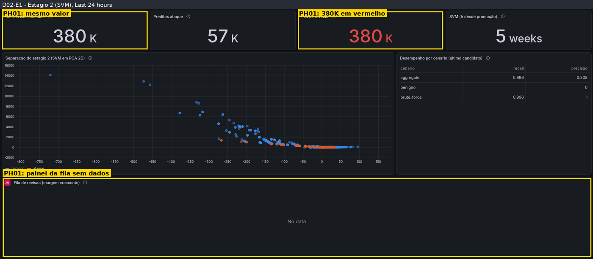                                                                           |          3 | Frequência: em toda abertura de D02 no estado atual. Impacto: o topo deveria responder “há algo a fazer?” (RC01) e responde as duas coisas ao mesmo tempo. Persistência: o estado não muda sozinho | Indicador e painel sobre a **mesma consulta**; fila vazia exibida como “0 — nenhum alerta aguardando revisão” em cor neutra; vermelho só quando houver itens                                             |
| V02 | H9              | D02-E1, painel “Fila de revisao”                                                  | O título do painel exibe um **ícone triangular vermelho** e o corpo só diz **No data**. A tela não diz se a consulta falhou ou se a fila está vazia, nem o que fazer                                                                                                                        | 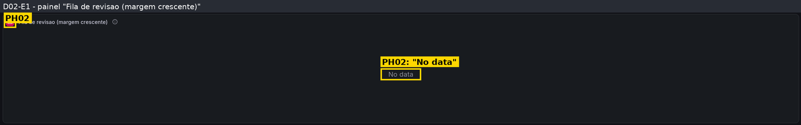                                                                                  |          3 | O analista não consegue diagnosticar nem se recuperar sem conhecer o Grafana; ocorre sempre que o estado aparece; confunde “sem dados” com “sem alertas” (MQ05)                                    | Mensagem em linguagem natural no próprio painel, nos termos da fala de ruptura da Entrega 09 (“Não recebo dados desde hh:mm… isso não significa que não há alertas”), distinta da mensagem de fila vazia |
| V03 | H2              | D03, tabela “Alertas classificados”                                               | Cabeçalhos e valores em vocabulário do pipeline: **E1 percentil**, **E2 margem**, **E2 predição**, **Regra (estágio 1)** com expressões como `n_bytes<=1418821.0 & byte…` e `Decidido por: estagio2`. Thiago, que não é especialista em ML, precisa traduzir cada coluna para decidir (I03) | 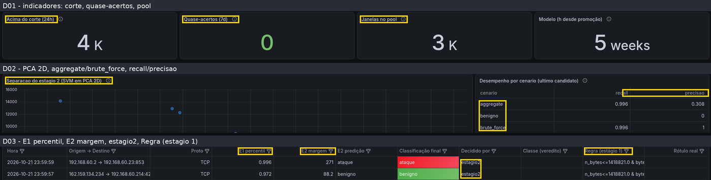                                                                                      |          3 | Aparece em todas as linhas e em toda investigação; afeta a interpretação (MU02) e o erro crítico de tratar margem pequena como confirmada (MU03)                                                   | Usar os signos da Entrega 09 — “quão incomum é o volume”, “incerteza da classificação”, “motivo do sinal”, “quem decidiu: modelo supervisionado” — e deixar o valor técnico no ⓘ                         |
| V04 | H4              | D01 “Modelo (h desde promoção)” e D02 “SVM (h desde promoção)”                    | O título anuncia **horas** e o valor aparece em **semanas** (`5 weeks`), em inglês (I10)                                                                                                                                                                                                    | 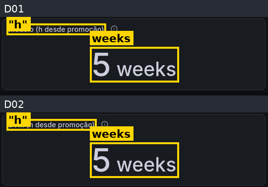                                                                               |          2 | Frequente (D01 e D02), mas contornável: a unidade aparece no próprio valor. É justamente a informação de MU06(b)                                                                                   | Título “Modelo ativo desde” com data e duração na mesma unidade, em português (Entrega 08, guia de estilo 4.2, “unidade coerente com o título”)                                                          |
| V05 | H4              | D01–D03, seletor de intervalo e atualização                                       | Cada dashboard abre com um intervalo diferente — **Last 6 hours** (D01), **Last 24 hours** (D02) e faixa fixa **18h–00h** (D03) — e com atualização de **1m, 1m e 30s**. Ao ir de D03 (20.2K alertas) para D02 (380K classificados), Thiago compara números de períodos diferentes (I05)    | 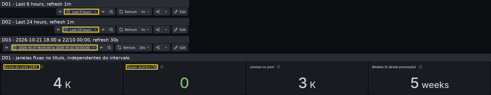                                                                                     |          3 | Ocorre sempre que o fluxo atravessa dashboards (passos A5 e A8); induz conclusão errada sobre volume, sem aviso                                                                                    | Mesmo intervalo e atualização padrão nos três; janela declarada em cada indicador; links que preservam o intervalo                                                                                       |
| V06 | H8              | D03-E4, indicador “Acerto vs. rótulo real”                                        | **sem rótulo** em vermelho, no mesmo tamanho dos números e ao lado do bloco vermelho de “Ataques (final)”: a ausência de dado disputa atenção com o que exige ação (I04)                                                                                                                    | 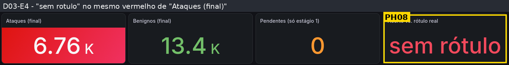                                                                                     |          2 | Permanente em operação (não há rótulo real fora dos dados de teste — Entrega 08, R7); gera ruído, mas não impede a tarefa                                                                          | Cor neutra e texto “sem rótulo no período”, ou ocultar o indicador em operação (guia de estilo 4.2: vermelho reservado ao que exige ação)                                                                |
| V07 | H6              | D03, colunas “Origem → Destino” e “Regra (estágio 1)”                             | Os valores aparecem **truncados** (`192.168.60.2 → 192.168.60.214:42…`, `n_bytes<=1418821.0 & byte…`). Para ver o restante é preciso alargar a coluna ou procurar em outro lugar e memorizar (I06)                                                                                          | 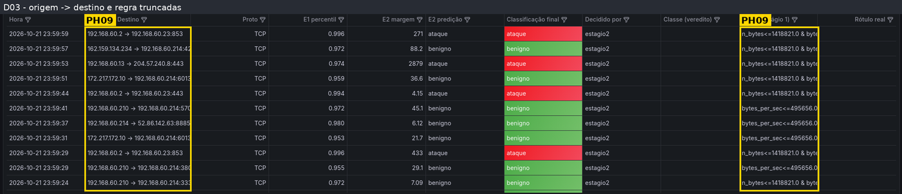                                                                                    |          2 | Frequente (várias linhas por tela); contornável, mas esconde o contexto da conexão (RC02)                                                                                                          | Largura/quebra de linha nas colunas de contexto; regra completa no detalhe da linha                                                                                                                      |
| V08 | H1              | D03-E3, tabela filtrada                                                           | Os filtros por coluna **não atualizam os indicadores do topo** e a tabela **não mostra quantas linhas restaram** (I07). Depois de filtrar por origem, os totais do topo continuam se referindo ao período inteiro                                                                           | 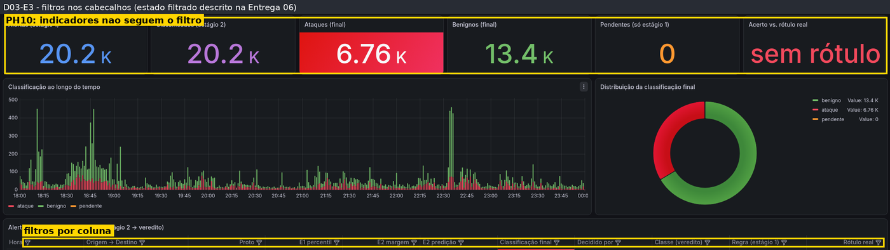 *(captura do estado sem filtro; comportamento descrito na Entrega 06, D03-E3)* |          3 | O recorte por origem é o passo central da investigação (A5, RC04); o analista pode ler os totais como sendo do recorte; ocorre a cada filtro                                                       | Exibir “N de M alertas” junto à tabela; indicadores acompanham o filtro ou avisam explicitamente que não acompanham                                                                                      |
| V09 | H7              | D01, D02, D03                                                                     | Não há link entre os dashboards: para ir de uma linha de D03 ao estágio que a decidiu, volta-se à pasta `netanomaly` e o intervalo muda (I08)                                                                                                                                               | 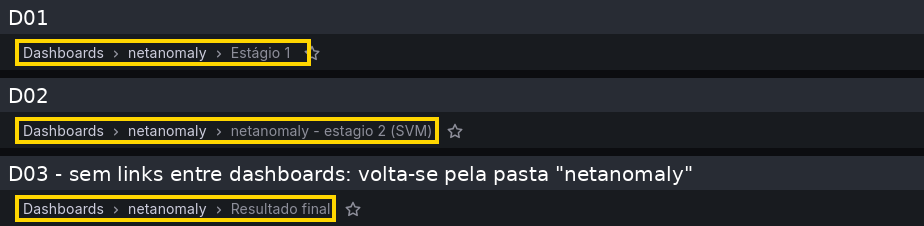                                                                                      |          2 | Ocorre em A5 e A8; custa tempo (MU05), mas não impede                                                                                                                                              | Links de dashboard no topo e *data links* da tabela de D03 preservando origem e intervalo (Entrega 08, C6)                                                                                               |
| V10 | H3              | D03, coluna “Classe (veredito)”; passo A9                                         | A coluna do veredito está **vazia em todas as linhas** e não existe nenhum controle para registrar o veredito (ataque, benigno, indefinido), a justificativa ou o encaminhamento. Thiago não consegue concluir T02 pelo sistema (Entrega 06, seção 3.4)                                     | 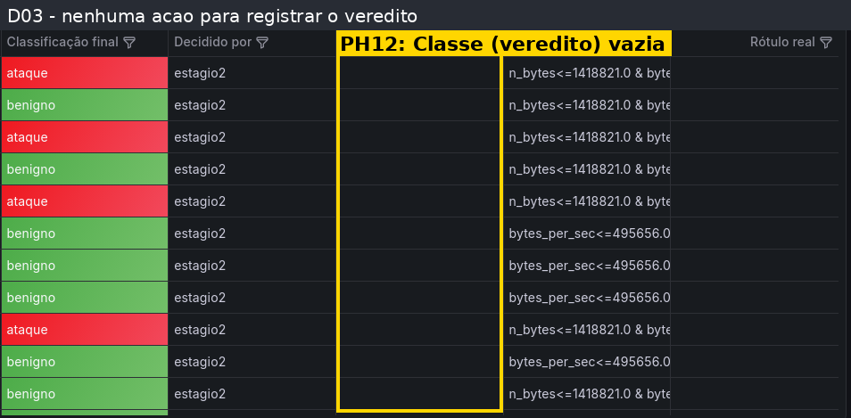                                                                                       |          4 | Impede a tarefa mais crítica (A02; MU01) em toda investigação, sem contorno dentro do sistema                                                                                                      | Tela de registro do veredito e encaminhamento (**D04**, Figma, Entrega 11), com resumo do alcance, confirmação e desfazer; até lá, indicar no painel onde o veredito é registrado                        |
| V11 | H10             | D03, títulos dos indicadores, da série, da rosca e da tabela                      | Em D03 os painéis **não têm o ícone ⓘ** que D01 e D02 têm; a única ajuda é o painel de texto sobre a precedência. Nada explica “E1 percentil” ou “E2 margem” na tela onde aparecem                                                                                                          | 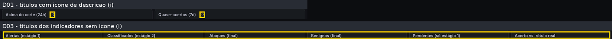                                                                                          |          2 | D03 é o painel principal de Thiago; o painel de texto reduz o impacto, mas não cobre os termos das colunas                                                                                         | Descrições ⓘ em todos os painéis de D03, redigidas para P01 (ex.: “margem: quão perto o SVM ficou de mudar de ideia”)                                                                                    |
| V12 | H7              | D03 série “Classificação ao longo do tempo”; D03-E5                               | O recorte em torno do pico — o que separa rajada legítima de ataque (passo A4) — só é obtido **arrastando sobre a série**; a interface não oferece nem sugere esse caminho                                                                                                                  | 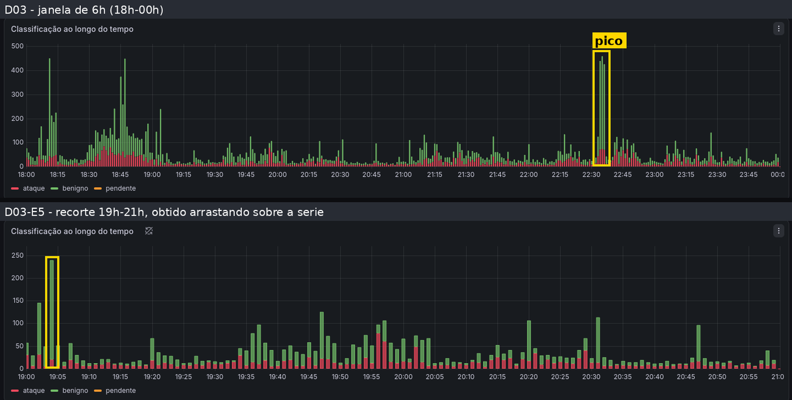                                                                                   |          2 | Quem conhece o gesto chega lá; quem não conhece fica no agregado de 6h e lê errado a composição do pico                                                                                            | Atalho de intervalo em torno do pico ou intervalos rápidos; total por classe ao passar o cursor na série                                                                                                 |
| V13 | H8 (WCAG 1.4.3) | D03, coluna “Classificação final”                                                 | Texto branco sobre célula verde (`benigno`) com contraste medido de **2,2–2,6:1** e sobre célula vermelha (`ataque`) de **3,4–3,9:1**, abaixo de 4,5:1 (seção 8.1)                                                                                                                          | 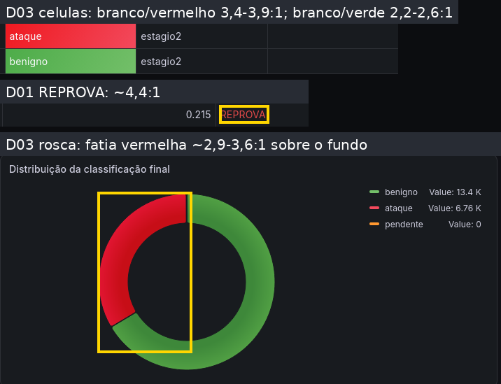                                                                                      |          2 | Em todas as linhas; legível em boa iluminação, mas o SOC tem pouca luz (Entrega 08, WCAG); não impede porque o texto repete a classe                                                               | Texto escuro sobre o verde, cores de célula mais escuras ou célula neutra com marcador colorido; medir de novo                                                                                           |

**Qualidade do relato:** o problema deve ser observável e localizado. Evite “interface confusa” sem dizer **o que**, **onde**, **quando** e **para quem**.

### 6. Boas práticas — heurísticas não violadas (atividade didática)

| Heurística sem violação | Exemplo no sistema                                                                                                                               | Evidência                                                                                      | Por que atende                                                                                                                           |
| ----------------------- | ------------------------------------------------------------------------------------------------------------------------------------------------ | ---------------------------------------------------------------------------------------------- | ---------------------------------------------------------------------------------------------------------------------------------------- |
| H5                      | Painel de texto “Resultado final do stack” com a precedência *veredito → estágio 2 → estágio 1 (pendente)* e coluna “Decidido por” em cada linha | [`estagio_final.png`](../assets/06_prototipos/estagio_final.png), topo e coluna “Decidido por” | Previne o erro de tomar a classificação do SVM por veredito humano — a origem de cada classificação está escrita na linha (I09; MU06(a)) |

---

## 7. Consolidação da equipe

Problemas iguais ou muito semelhantes encontrados por avaliadores diferentes devem ser consolidados, preservando quem os encontrou.

Quando as severidades individuais divergiram, a severidade final foi decidida pela persona mais afetada e pelo contexto real de uso; a justificativa está na coluna “Problema”. A coluna de responsável é uma **proposta** (D03 com Lucas, D01/D02 com Marcela) a confirmar pela equipe.

| ID consolidado | Achados individuais | Heurística | Problema                                                                                                                                                                                                                              | Severidade final | Prioridade | Responsável pela correção |
| -------------- | ------------------- | ---------- | ------------------------------------------------------------------------------------------------------------------------------------------------------------------------------------------------------------------------------------- | ---------------: | ---------- | ------------------------- |
| PH01           | V01(A01), V06(A02)  | H1         | D02-E1: indicador “Fila de revisão” com 380K em vermelho, igual ao total de classificados, e painel da fila em “No data” (I01)                                                                                                        |                3 | alta       | Marcela                   |
| PH02           | V02(A01), V10(A02)  | H9         | D02-E1: painel da fila com ícone de alerta e “No data”, sem causa nem ação. A01 deu 3 e A02 deu 2; fica **3** porque quem encontra o painel é Thiago, que não administra o Grafana                                                    |                3 | alta       | Marcela                   |
| PH03           | V01(A02)            | H1         | D01-E1/D02: portão sem candidato, produção, delta e piso; desempenho só do candidato. Não se vê contra o quê nem por quanto o candidato reprovou (I02)                                                                                |                3 | alta       | Marcela                   |
| PH04           | V03(A01), V02(A02)  | H2         | Termos do pipeline sem tradução em D01–D03 (percentil, margem, corte, pool, fpr, piso, `estagio2`, `aggregate`…). A01 deu 3 e A02 deu 2; fica **3** porque afeta a interpretação de Thiago em toda linha da tabela (MU02, MU03) (I03) |                3 | alta       | Lucas e Marcela           |
| PH05           | V04(A01), V03(A02)  | H4         | “(h desde promoção)” com valor em semanas e em inglês, em D01 e D02 (I10). A01 deu 2 e A02 deu 3; fica **2** porque o valor traz a unidade e a leitura é possível; a correção é barata e entra junto com PH06                         |                2 | média      | Marcela                   |
| PH06           | V04(A02)            | H4         | Grafia sem acento em D01/D02, nomes de dashboards em formatos diferentes e mistura de português e inglês                                                                                                                              |                1 | baixa      | Marcela                   |
| PH07           | V05(A01), V05(A02)  | H4, H5     | Intervalos e atualização diferentes por dashboard (6h/1m, 24h/1m, 18h–00h/30s) e totais que não se encaixam (4K, 380K, 20.2K); comparação errada entre telas (I05)                                                                    |                3 | alta       | Lucas e Marcela           |
| PH08           | V06(A01)            | H8         | D03-E4: “sem rótulo” em vermelho, como se fosse falha (I04)                                                                                                                                                                           |                2 | média      | Lucas                     |
| PH09           | V07(A01)            | H6         | D03: origem → destino e regra truncados (I06)                                                                                                                                                                                         |                2 | média      | Lucas                     |
| PH10           | V08(A01)            | H1         | D03-E3: filtros não atualizam indicadores nem mostram “N de M” (I07) — estado sem captura, descrito na Entrega 06                                                                                                                     |                3 | alta       | Lucas                     |
| PH11           | V09(A01), V08(A02)  | H7         | Sem links entre D01, D02 e D03; volta-se à pasta e o intervalo muda (I08)                                                                                                                                                             |                2 | média      | Lucas e Marcela           |
| PH12           | V10(A01)            | H3         | D03: coluna “Classe (veredito)” sempre vazia e nenhuma forma de registrar veredito, justificativa ou encaminhamento; T02 não se completa no sistema (Entrega 06, 3.4)                                                                 |                4 | imperativa | Lucas (D04)               |
| PH13           | V11(A01)            | H10        | D03 sem ícones ⓘ nos painéis; termos das colunas sem explicação no ponto de uso                                                                                                                                                       |                2 | média      | Lucas                     |
| PH14           | V12(A01)            | H7         | D03-E5: recorte em torno do pico só por gesto de arrastar, sem atalho nem sugestão                                                                                                                                                    |                2 | média      | Lucas                     |
| PH15           | V07(A02)            | H8         | D02: dispersão PCA 2D com eixos sem rótulo ocupando a maior área do painel                                                                                                                                                            |                1 | baixa      | Marcela                   |
| PH16           | V13(A01), V09(A02)  | H8 (WCAG)  | Contraste insuficiente: células `benigno` (2,2–2,6:1) e `ataque` (3,4–3,9:1), “REPROVA” (~4,4:1), fatia vermelha da rosca (2,9–3,6:1); rosca diferenciada só pela cor (MU09)                                                          |                2 | média      | Lucas e Marcela           |

## 8. Síntese e plano de melhoria

- Quantidade de problemas por heurística e severidade.
- Problemas críticos/graves que bloqueiam teste ou release.
- Padrões recorrentes entre telas.
- Correções que serão feitas antes/para a avaliação com usuários.

**Quantidade por heurística (principal) e severidade final** — 16 problemas consolidados a partir de 23 achados individuais (13 de A01, 10 de A02; 7 consolidações com os dois avaliadores):

| Heurística                    | Sev. 1 | Sev. 2 | Sev. 3 | Sev. 4 |  Total | IDs                |
| ----------------------------- | -----: | -----: | -----: | -----: | -----: | ------------------ |
| H1 Visibilidade do status     |      — |      — |      3 |      — |      3 | PH01, PH03, PH10   |
| H2 Sistema × mundo real       |      — |      — |      1 |      — |      1 | PH04               |
| H3 Controle e liberdade       |      — |      — |      — |      1 |      1 | PH12               |
| H4 Consistência e padrões     |      1 |      1 |      1 |      — |      3 | PH06, PH05, PH07   |
| H5 Prevenção de erros         |      — |      — |      — |      — |      0 | (PH07, secundária) |
| H6 Reconhecimento             |      — |      1 |      — |      — |      1 | PH09               |
| H7 Flexibilidade e eficiência |      — |      2 |      — |      — |      2 | PH11, PH14         |
| H8 Estética e minimalismo     |      1 |      2 |      — |      — |      3 | PH15, PH08, PH16   |
| H9 Recuperação de erros       |      — |      — |      1 |      — |      1 | PH02               |
| H10 Ajuda e documentação      |      — |      1 |      — |      — |      1 | PH13               |
| **Total**                     |  **2** |  **7** |  **6** |  **1** | **16** |                    |

**Problemas que bloqueiam o teste da Entrega 14.**

- **PH12 (sev. 4):** nos dashboards, T02 não chega a um veredito registrado — MU01 não pode ser medida neles. O tratamento é a tela **D04** (Figma, Entrega 11); o teste com usuários deve usar D04 para o passo de registro, e D04 passa por esta mesma inspeção antes do piloto.
- **Severidade 3 (PH01, PH02, PH03, PH04, PH07, PH10):** pelo critério de QA16–QA19 da Entrega 12, cada um precisa de tratamento antes da Entrega 14. PH01 e PH02 enganam Thiago já no topo de D02; PH03 impede Vanessa de dizer o motivo da reprovação (MU07); PH04 afeta MU02/MU03; PH07 e PH10 fazem o usuário comparar números que não medem a mesma coisa.

**Padrões recorrentes entre telas.**

1. **Indicador e detalhe que não dizem a mesma coisa** — fila (PH01), janelas diferentes (PH07), filtro que não atualiza o topo (PH10). O topo, que deveria responder “há algo a fazer?”, nem sempre é confiável.
2. **Vocabulário do pipeline no lugar do vocabulário da tarefa** — PH04, PH13, PH15 e, em menor grau, PH06. É a tradução prevista nos signos da Entrega 09 que ainda não chegou à tela.
3. **Uso de vermelho e de contraste** — vermelho em ausência de dado e em fila vazia (PH08, PH01) e contraste abaixo da meta (PH16), contra a regra de cor do guia de estilo 4.2.
4. **Fluxo que atravessa telas sem ligação** — PH11, PH07 e PH14: o caminho panorama → recorte → detalhe depende de o usuário saber onde ir e refazer o intervalo.
5. **Ação que acontece fora do sistema** — PH12 (veredito e encaminhamento); a promoção de modelo, feita pela CLI, recebe tela própria em D05/D06.

**Correções antes da avaliação com usuários (Entrega 14).** Todas já constam como alteração candidata da Entrega 06 (seção 5) e do guia de estilo da Entrega 08 (seção 4.2):

| Correção                                                                                                                 | Resolve    | Onde     |
| ------------------------------------------------------------------------------------------------------------------------ | ---------- | -------- |
| Mesma consulta para indicador e painel da fila; 0 em cor neutra; mensagem distinta para “fila vazia” e “consulta falhou” | PH01, PH02 | D02      |
| Portão com candidato, produção, delta e piso; linha que reprovou destacada; produção ao lado do candidato                | PH03       | D01, D05 |
| Rótulos e descrições ⓘ reescritos com os signos da Entrega 09, inclusive em D03                                          | PH04, PH13 | D01–D03  |
| Intervalo e atualização padrão iguais; janela em cada indicador; links entre dashboards preservando intervalo            | PH07, PH11 | D01–D03  |
| “N de M alertas” na tabela filtrada                                                                                      | PH10       | D03      |
| Registro do veredito e encaminhamento em D04, com confirmação e desfazer                                                 | PH12       | D04      |
| “Modelo ativo desde” com unidade coerente; grafia e idioma padronizados                                                  | PH05, PH06 | D01, D02 |
| Cores de célula e de série ajustadas e medidas de novo; “sem rótulo” neutro                                              | PH08, PH16 | D01, D03 |

PH09, PH14 e PH15 ficam para depois do teste, se houver tempo. **D04–D06** serão inspecionadas pelos dois avaliadores com este mesmo procedimento antes do piloto de 09/11/2026 (QA17 e QA19 da Entrega 12).

### 8.1 Verificação de contraste (MU09 — QA15)

**Método.** Amostragem de pixels nas capturas da Entrega 06 (PNG, 2559 × 1268 px, tema escuro) com Python e Pillow: em cada região, o fundo é a cor mais frequente e o primeiro plano é a cor presente (≥ 3 pixels) de maior contraste com esse fundo; a razão segue a fórmula de luminância relativa da WCAG 2.2. Limites da meta MU09: texto ≥ 4,5:1 (texto grande ≥ 3:1) e marcas gráficas ≥ 3:1.

| Elemento                                                                      | Primeiro plano / fundo                                 |         Razão | Limite | Resultado                                         |
| ----------------------------------------------------------------------------- | ------------------------------------------------------ | ------------: | -----: | ------------------------------------------------- |
| Texto principal: títulos, células, eixos, legendas, painel de texto (D01–D03) | `#ccccdc` / `#181b1f`                                  |        10,9:1 |  4,5:1 | atende                                            |
| Cabeçalhos de coluna e “No data” (D01, D02)                                   | `#8d8e9a` / `#181b1f`                                  |         5,3:1 |  4,5:1 | atende                                            |
| Valores grandes dos indicadores: azul, roxo, verde, laranja (D03)             | `#5794f2`, `#b877d9`, `#73bf69`, `#ff9830` / `#181b1f` |     5,5–8,1:1 |    3:1 | atende                                            |
| “sem rótulo” (D03, texto grande)                                              | `#f2495c` / `#181b1f`                                  |         4,8:1 |    3:1 | atende (problema de cor é PH08, não de contraste) |
| “380K” da fila (D02, texto grande)                                            | `#e34948` / `#181b1f`                                  |         4,4:1 |    3:1 | atende                                            |
| “6.76K” branco sobre bloco vermelho em gradiente (D03, texto grande)          | `#f7f8fa` / `#e2181c`–`#ef2f5c`                        |     4,5–3,8:1 |    3:1 | atende                                            |
| **“REPROVA”** (D01, texto pequeno)                                            | `#e34948` / `#181b1f`                                  |     **4,4:1** |  4,5:1 | **não atende** (limítrofe)                        |
| **Célula `ataque`** (D03)                                                     | `#f7f8fa` / `#f02934`–`#f24456`                        | **3,9–3,4:1** |  4,5:1 | **não atende**                                    |
| **Célula `benigno`** (D03)                                                    | `#f7f8fa` / `#53af4e`–`#6fbd66`                        | **2,6–2,2:1** |  4,5:1 | **não atende**                                    |
| Linhas da série (D01) e pontos da dispersão (D02): azul e laranja             | `#3987e5`, `#d95926` / `#181b1f`                       | 4,8:1 e 4,5:1 |    3:1 | atende                                            |
| Fatia verde da rosca (D03)                                                    | `#3e883a` / `#181b1f`                                  |         3,9:1 |    3:1 | atende                                            |
| **Fatia vermelha da rosca** (D03, gradiente)                                  | `#c70e17`–`#e11531` / `#181b1f`                        | **2,9–3,6:1** |    3:1 | **não atende** em parte da fatia                  |
| Uso de cor (1.4.1) — classificação na tabela                                  | cor + texto (`ataque`/`benigno`/`pendente`)            |             — |      — | atende (I11)                                      |
| Uso de cor (1.4.1) — rosca e barras empilhadas                                | classes só pela cor, nomes na legenda                  |             — |      — | atende parcialmente                               |

**Resultado:** **MU09 não atendida** — a meta é 100% e quatro elementos ficam abaixo do limite (PH16). **Limitações e pendências:** os valores são aproximados, porque a captura suaviza bordas (antialiasing) e alguns fundos têm gradiente; por isso aparecem como faixas. As barras empilhadas de D03 são estreitas demais para amostrar com segurança e ficam **pendentes**. Antes da entrega, a equipe deve confirmar os quatro elementos reprovados com um verificador de contraste no painel em funcionamento, e repetir a medição em D04–D06 e depois das correções de cor.

## Checklist

- [ ] Cada integrante fez uma inspeção completa e identificada. *(listas A01 e A02 redigidas; aguardam revisão e confirmação de cada integrante — seção 3)*
- [ ] Todas as telas/estados relevantes foram examinados.
- [ ] Estados administrativos, filtros, relatórios, históricos, processamento e erros foram incluídos quando existentes.
- [ ] A inspeção avaliou a interface/protótipo, não o mérito técnico do algoritmo/modelo.
- [ ] H1–H10 aparecem na matriz de cobertura de cada avaliador.
- [ ] Parte de violações contém apenas violações, sem “forçar” exemplos.
- [ ] Todo problema tem print/localização e contexto.
- [ ] Severidade possui justificativa, não apenas número.
- [ ] Recomendação resolve a causa ou reduz o impacto.
- [ ] Achados duplicados foram consolidados ao final.
