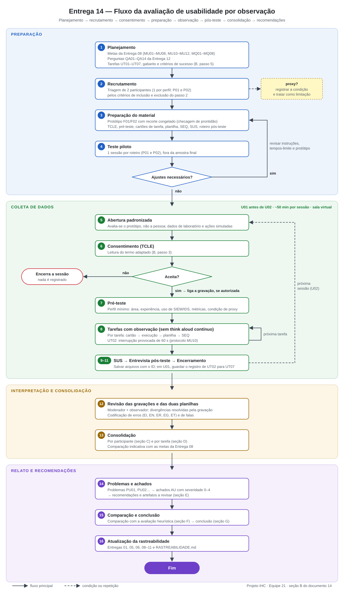

# Entrega 14 — Avaliação de usabilidade por observação de usuários

**Data:** 10/11/2026  
**Status:** `🟩 concluída`     
**Responsabilidade:** solução consolidada por equipe. O número de participantes finais observados deve ser igual ao número de integrantes, conforme o modelo da disciplina; recomenda-se que cada integrante seja responsável por conduzir/analisar ao menos um participante.

## Objetivo da atividade

Observar usuários representativos realizando tarefas reais ou realisticamente simuladas para identificar problemas de eficácia, eficiência, compreensão e satisfação que não podem ser inferidos apenas por inspeção.

> **Participantes finais não devem ser membros da equipe.** Um integrante pode participar do teste piloto apenas para validar roteiro/equipamentos, sem contar na amostra final.

### Quando o usuário é um perfil profissional especializado

Em TCCs técnicos, o público pode ser DBA, analista, pesquisador, administrador, técnico ou outro especialista. Priorize participantes que possuam relação real com as tarefas. Se não for possível recrutar o perfil ideal, qualquer participante aproximado/proxy deve ser **justificado previamente e tratado como limitação**; não apresente o resultado como equivalente ao de especialistas reais.

O teste avalia a **interação com o protótipo**. Não é necessário que o participante valide o desempenho científico do algoritmo. Resultados simulados podem ser usados quando declarados e coerentes com a tarefa.

Tarefas podem envolver, por exemplo, interpretar um dashboard, configurar uma análise, encontrar uma execução no histórico usando filtros, comparar resultados, gerar relatório, revisar alerta ou administrar permissões.

### **Justificativa de não ter gravação dos participantes: Ressaltamos que a demonstração via gravação de tela não necessária de ser incluída nesta entrega, conforme alinhamento prévio e autorização do professor.**

## A. Fluxograma do processo — equipe

O fluxograma deve representar, no mínimo: planejamento → recrutamento → consentimento → preparação → execução das tarefas/observação → pós-teste → consolidação/análise → recomendações.

O fluxograma tem quatro fases, e cada etapa numerada corresponde a um passo da seção B ou a uma seção de resultados (C–G). Os desvios são o laço de ajustes depois do piloto (volta à etapa 3), a saída quando o participante não aceita o termo (etapa 6), o laço por tarefa (etapa 8) e a repetição da coleta para a segunda sessão (U02).

## B. Procedimento de preparação e execução — equipe

### Passo 1 — Objetivos e versão avaliada

**Versão/commit/Figma:** protótipo Figma da Entrega 11 — fluxo **F01** (Lucas: D03 → **D04 — Registro do veredito e encaminhamento**) e fluxo **F02** (Marcela: **D05 — Comparação de modelos e troca** e **D06 — Histórico de trocas**), que reproduzem D01–D03 com recorte de dados **congelado**. Link do protótipo: {{URL do Figma — Entrega 11}}; versão congelada para os testes: {{data/versão do arquivo Figma}}; commit do repositório na data do teste: {{hash}}.  
**O que é simulado (declarado ao participante):** os dados exibidos são de laboratório do TCC, não de uma rede em produção; o registro do veredito, o encaminhamento, a promoção e a reversão do modelo **não executam nada** — são simulados no protótipo (Entrega 08, delimitação; na operação real a promoção continua pela ferramenta de linha de comando do pipeline).  
**Metas de usabilidade relacionadas:** MU01–MU08, MU10–MU12 e MQ01–MQ08 (Entrega 08, seção 3), por meio das perguntas de avaliação **QA01–QA14** que a Entrega 12 encaminha a este teste:

| Pergunta (Entrega 12) | Meta(s) | Tarefa(s) que a respondem |
|---|---|---|
| QA01 | MU01 | UT02 |
| QA02 | MU02 | UT02 |
| QA03 | MU03 | UT02 |
| QA04 | MU04 + MQ01 | UT01 |
| QA05 | MU05 | UT02 |
| QA06 | MU06 + MQ02 + MQ04 | UT02, UT03 |
| QA07 | MU07 + MQ06 | UT05 |
| QA08 | MU08 | UT05 |
| QA09 | MU10 + MQ03 | UT02 (interrupção) |
| QA10 | MU11 (SEQ) | todas, após cada tarefa |
| QA11 | MU12 (SUS) | fim de cada sessão |
| QA12 | MQ05 | UT04 |
| QA13 | MQ07 | UT06 |
| QA14 | MQ08 | UT02 (produz o registro), UT07 (outra pessoa lê o registro) |

**MU09** (contraste) é verificada por inspeção na Entrega 13 e não é medida aqui.

### Passo 2 — Participantes

| ID | Perfil | Critérios que justificam participação | Integrante responsável |
|---|---|---|---|
| U02 | P01 — analista de SOC (T02). Participante a recrutar; sem nome real: {{perfil resumido após a triagem; proxy sim/não}} | Critérios de inclusão P01 verificados na triagem: {{experiência declarada}} | Lucas Kerr do Amaral — 22.123.032-9 (moderador); Marcela Nalesso (observadora) |
| U01 | P02 — administradora da plataforma (T01). Participante a recrutar; sem nome real: {{perfil resumido após a triagem; proxy sim/não}} | Critérios de inclusão P02 verificados na triagem: {{experiência declarada}} | Marcela Nalesso — 22.222.011-3 (moderadora); Lucas Kerr do Amaral (observador) |

### Passo 3 — Consentimento e privacidade

- Termo/registro de consentimento: modelo da disciplina em [`../instrumentos/termo_consentimento_modelo.md`](../instrumentos/termo_consentimento_modelo.md), preenchido para este teste conforme o quadro abaixo (estrutura dos TCLE de exemplo definido em aula: procedimento, riscos, benefícios e custos, confidencialidade, voluntariedade, declaração). O aceite é registrado por formulário eletrônico com cópia ao participante, **antes** de qualquer gravação. Registros de aceite: {{link para pasta restrita — a preencher}}.
- Gravação de tela/áudio/vídeo: **tela e áudio, sim, somente se autorizado** em campo próprio do termo; **vídeo da câmera, não**. Finalidade: conferir tempos, erros e falas na consolidação. Sem autorização, a sessão ocorre apenas com as anotações da planilha.
- Forma de anonimização: IDs `U01` e `U02` atribuídos na triagem; a relação ID–nome fica só com os integrantes, fora do repositório. No repositório entram apenas planilhas e trechos de fala transcritos sob o ID, sem empresa, cargo exato ou instituição de trabalho. Os dados do protótipo são de laboratório, sem IPs de pessoas reais (Entrega 08, LGPD). O registro de U01 lido por U02 em UT07 é o que U01 escreveu no protótipo, sem identificação de U01.
- Local e período de armazenamento: gravações e termos em pasta de nuvem institucional com acesso restrito aos dois integrantes; **descarte das gravações ao fim da disciplina** (critério da Entrega 07); planilhas anonimizadas permanecem no repositório.

**Termo adaptado a este teste** (texto a ser lido e aceito pelo participante):

| Item do termo | Conteúdo |
|---|---|
| Projeto | Projeto de IHC da disciplina CC8122 — camada de interação de um IDS com aprendizado de máquina (TCC), com painéis de monitoramento e telas de decisão |
| Atividade | Teste de usabilidade com observação, em sala virtual |
| Responsáveis | Lucas Kerr do Amaral e Marcela Nalesso; contato institucional: E-mail; docente da disciplina: Plínio Aquino |
| Convite e objetivo | Avaliar se as telas de um protótipo ajudam a investigar alertas de rede (ou a decidir sobre a troca de um modelo de detecção). **Estamos avaliando o protótipo, não a sua capacidade.** Não há respostas certas ou erradas sobre você |
| O que será solicitado | Responder a um questionário curto de perfil; realizar de 4 a 5 tarefas no protótipo e comentar suas decisões ao fim de cada uma; responder a uma pergunta de facilidade após cada tarefa, a um questionário final de 10 itens e a uma entrevista curta. Duração aproximada: 50 minutos. Em uma das tarefas pode haver uma breve interrupção proposital |
| Simulação | Os dados são de laboratório e nenhuma ação no protótipo tem efeito real em rede ou sistema |
| Registros | Gravação de **tela e áudio** somente com autorização marcada neste termo (sim/não). Finalidade: análise da sessão pela equipe. Acesso: apenas os dois responsáveis. Descarte: ao fim da disciplina. O texto que você escrever no protótipo poderá ser lido, sem identificação, por outro participante |
| Riscos e desconfortos | Mínimos: cansaço ou desconforto de ser observado. A sessão pode ser pausada ou encerrada a qualquer momento. Não pedimos informações da sua empresa, rede ou clientes; se citar alguma, ela será omitida da transcrição |
| Benefícios e custos | Sem custo e sem remuneração. A participação contribui para a melhoria do protótipo |
| Confidencialidade | Resultados publicados apenas com identificador anônimo (U01, U02); nome e organização não serão identificados |
| Voluntariedade | Participação voluntária; é possível desistir a qualquer momento, sem justificativa e sem prejuízo; os dados de quem desistir são descartados se assim pedir |
| Declaração | Declaro ter mais de 18 anos, ter recebido informações suficientes e concordar em participar. Autorizo gravação de tela e áudio: ( ) sim ( ) não |

### Passo 4 — Teste piloto

**Data:** 07/11/2026  
**Planejamento:** uma sessão piloto por roteiro, completa e cronometrada. O piloto do roteiro P01 é conduzido por Lucas e o do P02 por Marcela; o participante do piloto é o outro integrante ou um colega de turma que não será U01/U02 — em ambos os casos **não conta** na amostra final.  
**O que foi validado:** roteiro, duração, entendimento das instruções, protótipo, gravação. Itens específicos: (1) os cartões de tarefa não revelam rótulos de controles; (2) todos os estados da tabela de prontidão (passo 1) funcionam e não há links mortos; (3) a interrupção de UT02 cabe em ~1 min e o estado volta intacto; (4) tempos-limite e duração total (~50 min); (5) a gravação capta tela e áudio na sala virtual; (6) moderador e observador classificam do mesmo modo sucesso, erro e ajuda (comparar as duas planilhas do piloto); (7) recalibrar os valores de MU04, MU05, MU08 e MU10, como previsto na Entrega 08, **sem mudar o que cada meta mede**.  
**Mudanças após piloto:** Sem mudanças.

### Passo 5 — Tarefas

| ID | Cenário/instrução apresentada | Critério de sucesso | Métricas | Ligação com modelo |
|---|---|---|---|---|
| UT01 | “Antes de voltar ao seu relatório, você quer saber se está acontecendo algo diferente do normal na rede agora. Diga em voz alta o que você concluiu e, se houver algo, desde quando.” (A tela inicial já está aberta.) | **Total:** sem abrir a tabela nem um alerta, diz que o volume de ataques está acima do período anterior e indica **quando** começou (por volta das 19h, tolerância ±15 min). **Parcial:** acerta o “há algo”, mas não o “quando”, ou só chega lá abrindo a tabela. **Falha:** diz que está normal, cita só a contagem bruta sem referência (“tem 1,6 mil ataques”) ou excede 2 min | sucesso, tempo (MU04), erros, ajudas, fala (MQ01), SEQ · **QA04, QA10** | T02/A01 · O01 · CI01 [1, 2] · F01 (D03) |
| UT02 | “Os alertas vêm de um mesmo segmento de rede. Investigue o período do aumento e decida, para cada um dos três alertas indicados neste cartão, se é ataque, se não é, ou se não dá para afirmar. Deixe a decisão registrada com o motivo, encaminhe à equipe que fará o bloqueio o que for preciso e deixe pronto o que o próximo turno precisa saber.” (O cartão identifica os três alertas pela hora e pela origem — ver Gabarito.) Interrupção provocada durante a tarefa (passo 6) | **Total:** recorta período e origem; registra os três vereditos **coerentes com o gabarito**, cada um com justificativa; encaminha o caso à infraestrutura e deixa a passagem de plantão com o alerta indefinido em aberto; sem erro crítico; sem ajuda. **Parcial:** registra os três, mas com um veredito incoerente não crítico, justificativa ausente, encaminhamento/passagem incompletos, ou com ajuda. **Falha:** não registra algum veredito, comete erro crítico (MU03) ou excede 15 min | sucesso (MU01), vereditos coerentes (MU02), erros críticos (MU03), tempo por alerta (MU05), retomada (MU10, MQ03), fala ao explicar cada alerta (MQ02), registro produzido (MQ08), ajudas, SEQ · **QA01, QA02, QA03, QA05, QA06, QA09, QA14, QA10** | T02/A02 e 3.1 · O02, O03, O05, O06, O07 · CI01 [3–6, 9–11] · F01 (D03 → D04) |
| UT03 | “Antes de seguir, responda com base no que está na tela: (a) nesta linha [o moderador aponta um alerta já classificado], quem decidiu a classificação? (b) há quanto tempo o modelo que está classificando estas conexões está em uso? (c) o volume de ataques destes últimos dias está maior que o normal — o que, na sua opinião, pode explicar isso?” (c) só para U01; pergunta aberta, sem sugerir a troca | **(a)** estágio indicado na linha do recorte congelado: {{estágio da linha escolhida}}. **(b)** desde 27/10, há três dias. **(c)** levanta, **sem indução**, a hipótese da troca de modelo recente. Cada item é certo/errado; sem ajuda | acertos (MU06), fala (MQ02, MQ04), tempo, SEQ · **QA06, QA10** | O03, O04 · CI01 [6, 7] · F01/F02 (D01–D03) |
| UT04 | “Você volta a olhar o sistema e um dos quadros está vazio. O que isso quer dizer para você? O que você faria?” | **Total:** diz que a coleta parou (ou que não chegam dados), que isso **não** significa ausência de alertas e indica a quem recorrer. **Parcial:** suspeita da coleta, mas não descarta “sem alertas”. **Falha:** interpreta como “nenhum alerta”/“rede tranquila” ou excede 2 min | sucesso, tempo, fala (MQ05), SEQ · **QA12, QA10** | O01/O09 · CI01 [12] · F01 e F02 (estado “sem dados”) |
| UT05 | “Os analistas comentaram que muitos alertas da última semana não se confirmaram. Descubra o que está acontecendo e decida se algum dos modelos candidatos disponíveis deve substituir o modelo atual. Se decidir trocar, faça a troca; a janela de manutenção já foi autorizada pelo coordenador. Explique em voz alta o que encontrou e por que decidiu assim.” | **Total:** (1) identifica a subida da proporção de alertas não confirmados após a troca de 27/10 e descarta coleta/equipamento (coleta ativa, atraso ~40 s, carga 62%); (2) **promove o v8**, citando o cenário e a métrica que decidiram (benigno; fração do benigno marcada como ataque 0,21 → 0,04, máximo 0,05) e o efeito/custo para os analistas (≈ 35% menos alertas; dois ataques de força bruta do conjunto de teste deixariam de ser sinalizados); (3) **não promove** o candidato reprovado, citando cenário benigno e taxa de falso positivo 0,215 acima do máximo 0,05; (4) confirma a troca com motivo registrado. **Parcial:** decisões corretas sem o motivo completo (cenário + métrica) ou sem considerar o custo, diagnóstico incompleto, ou com ajuda. **Falha:** não decide, promove o candidato reprovado (erro crítico de T01), não conclui a troca ou excede 10 min | sucesso, decisões + motivo (MU07, MQ06), tempo total de T01 (MU08), erros, ajudas, SEQ · **QA07, QA08, QA10** | T01 (1–4) · O08, O09, O10, O11, O12, O13 · CI02 [1–7, 10] · F02 (D05, D06) |
| UT06 | “É o dia seguinte. Você concluiu que a troca de ontem não teve o efeito esperado. Faça o que for preciso e diga como a equipe fica sabendo.” | **Total:** reverte para o modelo anterior com confirmação e indica onde a troca fica registrada (histórico de trocas) e que os analistas são avisados; não manifesta receio de “quebrar a produção”. **Parcial:** reverte, mas não sabe dizer onde fica registrado/como a equipe é avisada, ou com ajuda. **Falha:** não encontra o caminho de reversão ou excede 5 min | sucesso, tempo, fala (MQ07), ajudas, SEQ · **QA13, QA10** | T01 (4.3, 5) · O12, O13 · CI02 [7–9] · F02 (D05, D06) |
| UT07 | Aplicada a U02, ao fim das tarefas: “Um analista do turno anterior deixou este registro [o moderador mostra **somente** o registro e o encaminhamento produzidos por U01 em UT02, sem o protótipo]. Qual foi a conclusão dele? Com base em quê?” | **Total:** reproduz a conclusão e ao menos um elemento da base registrada. **Falha:** não consegue dizer a conclusão ou a base. (Se U01 não tiver concluído o registro, o moderador usa um registro-padrão preparado pela equipe e anota isso como limitação) | sucesso, fala (MQ08) · **QA14** | O05, O06 · CI01 [10, 11] · F01 (D04) |

### Passo 6 — Protocolo do moderador

1. Receber participante e explicar que **o produto está sendo avaliado, não a pessoa**.
2. Obter consentimento.
3. Aplicar perfil pré-teste mínimo necessário.
4. Ler instruções padronizadas.
5. Observar sem ensinar o caminho; registrar pedidos de ajuda separadamente.
6. Se usar *think aloud*, explicar e aplicar de forma consistente.
7. Após cada tarefa, registrar satisfação/SEQ ou escala definida.
8. Fazer pós-teste/entrevista breve.
9. Encerrar e explicar uso dos dados.

**Aplicação ao projeto** (roteiro base: [`../instrumentos/roteiro_teste_usabilidade.md`](../instrumentos/roteiro_teste_usabilidade.md)):

| Momento | Duração | O que acontece | Quem |
|---|---:|---|---|
| Antes da sessão | — | Abrir o protótipo na versão congelada em janela de navegador de **1366 × 768** (pior caso da Entrega 08: plantão remoto em notebook); voltar o protótipo ao estado inicial; testar gravação; abrir planilha, cartões de tarefa e formulários SEQ/SUS. Para U02: separar o registro produzido por U01 (UT07) | moderador + observador |
| Abertura | 3 min | Agradecer; explicar o objetivo geral **sem revelar hipóteses**; reforçar que o protótipo é avaliado, não a pessoa; dizer que os dados são de laboratório e que as ações são simuladas; explicar que pode parar a qualquer momento | moderador |
| Consentimento | 3 min | Leitura do termo (passo 3) e aceite; só então liga a gravação, se autorizada | moderador |
| Pré-teste | 3 min | Função/área e tempo de experiência; frequência de uso de SIEM/IDS/painéis de monitoramento; familiaridade com métricas de classificação (precisão, recall, taxa de falso positivo); dificuldade de distinguir cores (a classificação usa cor + texto); condição de proxy | moderador |
| Verbalização | 1 min | Conforme a Entrega 12, **não** se usa *think aloud* contínuo nas tarefas cronometradas, porque distorceria MU04, MU05, MU08 e MU10. O participante pode comentar livremente; comentários espontâneos são anotados, e a explicação de cada decisão é pedida **depois** da tarefa (retrospectiva curta). O moderador não pede que o participante fale durante a tarefa | moderador |
| Tarefas | ~25 min | Na ordem do passo 5. Para cada uma: moderador lê o cartão e o envia por escrito no chat; o observador inicia o cronômetro ao fim da leitura; ao fim, SEQ (“No geral, quão fácil ou difícil foi esta tarefa?”, 1 = muito difícil, 7 = muito fácil) e “O que tornou a tarefa fácil ou difícil?” | moderador lê; observador cronometra e preenche a planilha |
| SUS | 3 min | Questionário SUS de 10 itens (versão em português), sobre a sessão inteira | participante |
| Entrevista pós-teste | 5 min | “O que foi mais difícil?”; “Em que momento você ficou em dúvida sobre o que a tela queria dizer?”; “Você confiaria nesta tela num plantão real (U01) / para trocar o modelo em produção (U02)? Por quê?”; “O que você mudaria primeiro?”; esclarecer comportamentos anotados durante as tarefas | moderador; observador pode acrescentar perguntas |
| Encerramento | 2 min | Agradecer; confirmar uso e descarte dos dados; salvar arquivos com o ID; registrar limitações da sessão (ambiente, conexão, proxy). Em U01: salvar o registro e o encaminhamento produzidos em UT02 para UT07 | moderador + observador |

### Passo 7 — Registro e forma de análise

**Planilha.** Uma planilha por participante, no modelo de [`../instrumentos/planilha_observacao_modelo.md`](../instrumentos/planilha_observacao_modelo.md), com as colunas do modelo (início, fim, sucesso, erros, ajudas, hesitações, fala relevante, satisfação) acrescidas de: **erros críticos**, **tipo de erro** (códigos abaixo), **vereditos × gabarito** (UT02), **retomada** (UT02) e **pergunta QA** atendida. Moderador e observador preenchem planilhas separadas; divergências são resolvidas pela gravação.

**Definições adotadas** (as mesmas para os dois observadores):

| Termo | Definição |
|---|---|
| Sucesso total | Critério da tarefa atingido sem ajuda, dentro do tempo-limite |
| Sucesso parcial | Critério atingido com ajuda, ou com um elemento não crítico faltando (conforme a coluna “Critério de sucesso”) |
| Falha | Critério não atingido, abandono, tempo-limite excedido ou erro crítico |
| Erro | Ação ou interpretação verbalizada que se afasta do caminho para o objetivo e precisa ser desfeita ou corrigida. Códigos: **EI** interpretação (ler incerteza alta como confirmado, contagem como tendência, vazio como “sem alertas”), **EN** navegação (procurar a informação na tela errada), **ER** recorte (filtro ou período errado), **EG** registro (alcance ou classe errados no veredito ou na troca), **ET** retomada (refazer recorte já feito) |
| Erro crítico | T02 (definição de MU03): registrar como benigno o alerta que o gabarito define como ataque, ou registrar como ataque o alerta de margem pequena sem consultar o detalhe. T01: promover o candidato reprovado |
| Ajuda | Intervenção do moderador sobre a interface (passo 6) |
| Hesitação | Mais de 10 s sem ação nem fala, ou ida e volta entre áreas sem ação; anotada, mas **não** convertida em problema sem evidência adicional (fala, erro ou SEQ baixo) |
| Tempo | Do fim da leitura do cartão até o critério de conclusão da tarefa, medido na gravação (ou cronômetro do observador, sem gravação). MU04: até a resposta verbal com o “quando”. MU05: por alerta — o primeiro conta desde o fim da leitura do cartão (inclui o recorte); o segundo e o terceiro, desde a confirmação do registro anterior; termina na confirmação do registro (interrupção descontada). MU08: duração de UT05 (do fim da leitura à confirmação da troca) |

**Codificação das falas e problemas.** Falas e comportamentos relevantes são transcritos sob o ID do participante e agrupados por tarefa e por objetivo (O01–O13). Cada dificuldade observada vira um **problema de usabilidade (PU01, PU02…)** com: tarefa, tela, evidência quantitativa (“x de n”) e qualitativa (fala/comportamento), meta e pergunta QA afetadas. A severidade usa a escala 0–4 da Entrega 13, considerando impacto (erro crítico, falha, tempo) e persistência (repetiu-se em mais de uma tarefa); com n = 1 por perfil, a frequência entre participantes só pesa para problemas vistos nos dois perfis (UT03, UT04).

**Comparação com as metas.** Cada meta é comparada pela regra da seção D e marcada como **indicativa**: com um participante por perfil, “atendida” significa “o participante teve o desempenho previsto na meta”, não que a meta foi verificada para a população.

## C. Resultados — por participante

### U01 — designer de interfaces (participante *proxy*)

**Perfil:** designer, externa à equipe, sem prática em SOC nem em administração de modelos de detecção. É **proxy** dos perfis P01 e P02 (passo 2): avalia bem a leitura das telas, a hierarquia da informação e a representação do protótipo, mas não substitui um analista no plantão. Não participou da construção dos protótipos, do *walkthrough* da Entrega 06 nem da inspeção da Entrega 13.  
**Moderador:** Lucas Kerr do Amaral · **Observadora:** Marcela Nalesso · **Data:** 07/11/2026   
**Telas vistas:** fluxo **F01** (D03 — panorama e restrição; detalhe do alerta; D04 — registro do veredito) e fluxo **F02** (D05 — comparação de modelos).  
**Forma de coleta:** comentários verbalizados durante e depois da exploração do protótipo, transcritos sob o ID U01 com o mínimo de edição (só os trechos que identificavam pessoas foram retirados).

#### Registro das falas

| Fala | Tela / elemento | O que a participante disse (transcrição) | Leitura da equipe | Problema |
|---|---|---|---|---|
| U01-F01 | D03, título e trilha “D03 Resultado final” | “Primeira dúvida que fiquei é se o dash é *near real time* ou se é uma fotografia. Toda hora que você vai abrir, vai ser um novo dash? Porque se for isso, o título tá errado.” | O nome “Resultado final” vem do pipeline (é a saída do último estágio). Para quem lê a tela, ele sugere um relatório fechado, que contradiz o estado “Coleta ativa · último dado 20:47” | PU01 |
| U01-F02 | D03, título | “Tá escrito resultado final. Toda hora vai ficar abrindo e carregando uma nova tela?” | O título também faz supor um modelo de navegação errado, em que cada consulta geraria uma tela nova | PU01 |
| U01-F03 | D03, indicadores do topo (⑤) | “O primeiro retângulo tá escrito ataque e na sequência tá escrito benigno. É essa informação que vocês querem? Talvez não deveria ser o benigno na frente e da quantidade de benignos teve 1.4 que foram ataques? Tipo o primeiro retângulo ser volumetria total e o segundo retângulo ser a quantidade de ataques que teve.” | A ordem atual (Ataques → Benignos → Pendentes → Alertas do período) põe a parte antes do todo. A participante procura a proporção de ataques, e hoje ela só aparece na legenda do último indicador (“≈ 1/3 classificado como ataque”) | PU02 |
| U01-F04 | D03, título | “Título está errado porque aí não é resultado final, nunca acaba (dado que é *near real time*).” | Confirma F01/F02: o problema é o nome da tela, não o conteúdo | PU01 |
| U01-F05 | D03, painel “Origens mais alertadas” (⑥) | “Eu não consegui entender o que significa a informação que está do ladinho, que é origens mais alertadas, aí tá 10.0.4/24. Aquilo ali não significou nada pra mim.” | Um analista reconhece a notação CIDR, mas o painel só mostra o endereço e “maioria dos ataques”, sem nome do segmento e sem quantidade. Em uma participante *proxy*, o efeito é maior | PU03 |
| U01-F06 | Detalhe do alerta (F01.2 ①) e coluna “Quem decidiu” de D03 | “Tem um retângulo escrito alerta e depois do lado está quem decidiu… quem decidiu o quê?” | O signo “quem decidiu” (Entrega 09) não diz o que foi decidido. Ao lado do *badge* “ataque”, ele pode ser lido como o veredito do analista, e não como a classificação do modelo | PU04 |
| U01-F07 | Detalhe do alerta (F01.2 ③) e coluna “Incerteza” | “Tá aparecendo como um ataque, mas a incerteza é baixa… se é um ataque, o grau de incerteza não deveria ser alto?” | A participante leu “incerteza” como risco ou gravidade do alerta, e não como a dúvida do modelo sobre a classificação. Os dois signos juntos (“ataque” + “incerteza baixa”) pareceram contraditórios | PU05 |
| U01-F08 | *Badge* de classificação | “Ou então a tag deveria ser ataque mesmo? Ou será possibilidade de ataque?” | O rótulo “ataque” é lido como fato confirmado. Na interface, ele é a hipótese do modelo até o analista registrar o veredito | PU05 |
| U01-F09 | D04, campo “Decisão” (F01.3 ①) | “Tá muito estranho o campo decisão no F01… Nenhuma ação vem marcada por padrão… Aqui Thiago já escolheu ataque… Não entendi o que vocês quiseram dizer aqui.” | A frase é uma anotação de especificação do wireframe que ficou dentro da tela. Ela diz que nada vem marcado e, na mesma tela, mostra “ataque” marcado | PU06 |
| U01-F10 | Campo de busca da barra superior | “O que a busca teria de função dentro dessa tela? Que a princípio eu entendi que são todos os campos preenchidos, né? É busca o quê? Busca cliente? Não entendi a função da busca.” | A busca vem do padrão da barra do Grafana (que busca dashboards), mas não foi projetada nem explicada. Ela também compete com a restrição (“+ Adicionar critério”), que é como se busca alertas | PU08 |
| U01-F11 | D05, legenda sob a tabela de métricas (F02.1 ④) | “O que está na lupa ali em cada métrica abre uma explicação de uma frase. Isso deveria estar no protótipo ou dentro do protótipo vocês deveriam estar mostrando que vocês estão clicando e só abrir a explicação? Achei estranho ter esse tipo de subtítulo.” | O comportamento do ⓘ foi descrito em texto, em vez de ser prototipado como interação | PU07 |
| U01-F12 | Busca (F02) | “Ficou bem legal, só achei que a busca não foi explorada ali, né? Não sei o que vocês quiseram explorar ali com ela.” | Mesmo problema de F10, também visto em F02 | PU08 |
| U01-F13 | D03, indicadores do topo | “Os *big numbers* aí eu entendi que o objetivo de vocês é colocar os ataques, mas eu não sei se eu colocaria total e depois ataques, até para entender a porcentagem do quanto tá sendo atacado.” | A participante entendeu a intenção (destacar ataques), mas para ler a proporção ela quer partir do total | PU02 |
| U01-F14 | Geral | “O restante tá bem legal.” | Nenhuma objeção ao fluxo de registro e encaminhamento (fora a anotação de F09) nem ao fluxo de troca em D05 | — |

#### Tarefas

| Tarefa | Grau de sucesso | Erros | Tipos de erro/dificuldade | Ajudas | Tempo | Satisfação | Evidência/observação |
|---|---|---:|---|---:|---|---|---|
| UT01 | {{não registrado}} | {{n}} | EI (indício) | {{n}} | {{não registrado}} | SEQ {{—}} | Entendeu que o painel destaca os ataques (F13), mas não conseguiu ler a proporção nem saber se os dados são atuais (F01, F03). Indício contrário a MQ01 |
| UT02 | {{não registrado}} | {{n}} | EI (indício) | {{n}} | {{não registrado}} | SEQ {{—}} | “ataque” + “incerteza baixa” lidos como contradição (F07, F08). No gabarito, A-1 é justamente esse caso, o que pode provocar veredito incoerente. Indício contrário a MQ02 |
| UT03 | (a) indício de erro | — | EI | {{n}} | {{não registrado}} | SEQ {{—}} | Não identificou o que “quem decidiu” significa (F06). Indício contrário a MU06 no item (a) |
| UT04 | {{não aplicada / não registrado}} | — | — | — | — | — | Sem comentário sobre o estado “sem dados” |
 
**Link da gravação (se autorizado):** Não foi gravado.  
**Resposta pós-teste:** avaliação geral positiva (“Ficou bem legal”, “O restante tá bem legal”). As dúvidas se concentraram em nomenclatura (título, “quem decidiu”, “incerteza”, rótulo “ataque”), na ordem dos indicadores e em elementos do protótipo sem função definida (busca, anotações).

### U02 — engenheira civil, foco em pavimentos (Participante *proxy*)

**Perfil:** engenheira civil com ~10–11 anos em pavimentação (projeto, avaliação e planejamento de manutenção rodoviária e urbana), casada. Nunca trabalhou com TI, administração de sistemas ou segurança de redes. Usa dashboards quase todo dia: sistema de gerência de pavimentos com trechos coloridos por condição (IRI, PCI, deflexão), painéis de obra e Excel. Conhece "falso positivo" por analogia com exame médico, entende "precisão" no sentido metrológico e não conhecia "recall". Usa média, desvio padrão e percentil de ensaios. Sem dificuldade com cores. **Proxy distante de P02:** não atende nenhum critério de inclusão do passo 2.  
**Moderadora:** Marcela Nalesso (papel simulado) · **Observador:** Lucas Kerr do Amaral (notas do observador geradas pelo mesmo agente da moderadora) · **Data da simulação:** 10/11/2026  
**Consentimento (simulado):** aceito, com gravação de tela e áudio autorizada. Nenhuma gravação real existe.  
**Ordem aplicada:** abertura → consentimento → pré-teste → **exploração livre** de D03 e D05 (desvio do roteiro, para captar a visão de quem é de fora) → UT04 → UT03 (a, b) → UT05 → UT06 → UT07 → SUS → entrevista.  
**Esclarecimentos que não contam como ajuda:** os marcadores roxos e os rodapés são notas da equipe; qual quadro de cada imagem considerar; o texto do motivo é um exemplo do wireframe; o ⓘ não está prototipado; "Vanessa" é a persona do cenário.

| Tarefa | Grau de sucesso | Erros | Tipos de erro/dificuldade | Ajudas | Tempo | Satisfação | Evidência/observação |
|---|---|---:|---|---:|---|---|---|
| UT04 | total | 0 | hesitação no "o que fazer" | 0 | não cronometrado | SEQ 5 | Disse que a coleta parou, que isso "não é o mesmo que zero" e que não daria veredito sobre o período. Iria verificar a coleta na "Saúde do pipeline" (D05) ou com a TI. "É como quando o perfilômetro para de gravar no meio do trecho… se eu lesse aquilo como IRI zero seria um erro feio." Travou porque o aviso manda "acionar o responsável pela plataforma", que no cenário é ela, sem oferecer ação: "eu não sei o que é o coletor nem onde eu vejo isso" (PU12) |
| UT03 (a, b) | 2 de 2 | 0 | hesitação em (a) | 0 | não cronometrado | SEQ 6 | (a) "o modelo decidiu", depois de hesitar: "'supervisionado' me fez pensar duas vezes. Supervisionado por quem? Por um analista?", reforçado pelo ✓ de "Examinado". (b) "três dias, desde 27 de outubro", mas o selo já tinha sido lido na exploração livre. "Uma hora fala 'SVM v7', outra hora fala 'modelo supervisionado', e para quem é de fora parecem duas coisas diferentes" (PU16) |
| UT05 | parcial | 0 (críticos: 0) | elemento faltante: candidato reprovado não examinado | 0 | não cronometrado (MU08 não medida) | SEQ 5 | Diagnóstico correto: 41% contra 12% depois da troca de 27/10; infraestrutura descartada pela saúde do pipeline. Promoveu o v8 citando a fração de benigno marcada como ataque (0,21 → 0,04, dentro do exigido) e o custo (≈ 35% menos alertas; dois ataques de força bruta perdidos, "dentro do mínimo"). Escreveu um motivo próprio e detalhado: "se alguém perguntar daqui a seis meses por que trocaram, eu quero que esteja escrito". **Não avaliou o candidato reprovado**, porque D05 não mostra outros candidatos: "a tarefa fala 'modelos candidatos', no plural, e eu só vejo o v8" (PU09). Tentou abrir o ⓘ de recall, que não está prototipado, e entendeu o termo pela frase da própria linha. Decidiu "meio confiando no 'aprovado' e no 'atende'" porque os valores ‹v› faltavam (PU11) |
| UT06 | total | 0 | — | 0 | não cronometrado | SEQ 7 | Achou "Voltar ao v7…" na hora e previu a confirmação pelas reticências. Disse que a troca "fica registrada no histórico" antes de ver a mensagem e, depois dela: D06, nome, horário, motivo e aviso aos analistas. Não mostrou receio. Ressalva: o diálogo de reversão "não lembra que o v7 é justamente aquele que estava com 41% de alerta falso… você volta para a condição antiga, com os defeitos antigos" (PU13) |
| UT07 | total (registro-padrão) | — | vocabulário | 0 | não cronometrado | SEQ 6 | Feita com o **registro-padrão da equipe**, porque U01 não produziu registro. Reproduziu a conclusão (ataque da origem 10.0.4.0/24 contra o portal; 310 ataque + 2 indefinidos; bloqueio encaminhado; 2 pendentes) e os três elementos da base. Ligou o registro aos 312 alertas de D03. "Parece diário de obra bom: o que aconteceu, por quê, o que foi feito e o que ficou pendente." Leu "encaminhado" como pedido pendente. A dúvida sobre "> 99% do habitual" voltou (PU15) |

**Link da gravação (se autorizado):** Não foi gravado.   
**Resposta pós-teste:** Similar a primeira. Avaliação geral positiva (“Ficou bem legal”, “O restante tá bem legal”). As dúvidas se concentraram em nomenclatura (título, “quem decidiu”, “incerteza”, rótulo “ataque”), na ordem dos indicadores e em elementos do protótipo sem função definida (busca, anotações).

**Exploração livre — falas sobre a visão de quem é de fora** (antes das tarefas):

| Fala | Tela / elemento | O que a participante disse (simulado) | Problema |
|---|---|---|---|
| U02-F01 | D03, indicadores | "O que pula aos olhos é esse quadro vermelho, 'Ataques, 1,6 mil', e embaixo '4× as 2 h anteriores'… foi bom ter colocado em vermelho." Somou ataques + benignos e se perguntou: "Quer dizer que o sistema dá alerta para coisa que no fim é normal?" | — (positivo); modelo de "alerta" pouco claro |
| U02-F02 | D03, topo | "Tem um verde dizendo 'Coleta ativa' e, colado nele, um amarelo dizendo 'Dados congelados'. Afinal está ativo ou está congelado?" Resolveu ao reler | PU17 |
| U02-F03 | D03, faixa de retomada | "É tipo o sistema lembrando onde eu parei… como quando o AutoCAD reabre no último arquivo." | — (positivo) |
| U02-F04 | D03, gráfico | "A tela fala que os ataques quadruplicaram, mas no gráfico a parte vermelha está mais ou menos igual o tempo todo… não consegui ver no gráfico esse '4×'." | PU18 |
| U02-F05 | D03, origens | "As barras não têm número, só 'maioria dos ataques'. Eu ia querer ver quanto é." | PU19 |
| U02-F06 | D03, tabela | "'> 99% do habitual'… É 99% acima do normal, quase o dobro? Ou é como percentil?" | PU15 |
| U02-F07 | D03, botão de veredito | "'Registrar veredito dos 312 alertas' me deu um pouco de medo. Eu dou uma resposta para os 312 de uma vez, sem olhar um por um?" | PU20 |
| U02-F08 | D05, alertas não confirmados | "É como trocar o equipamento de medição de irregularidade e ele começar a acusar defeito onde não tem… a linha tracejada com a troca ajuda muito." | — (positivo) |
| U02-F09 | D05, saúde do pipeline | "Está escrito embaixo 'o problema não é de infraestrutura'… Gostei dessa frase de conclusão, poupa trabalho." | — (positivo) |
| U02-F10 | D05, linha brute_force | "A diferença diz 'pior: 2 ataques do teste', em laranja, e a situação diz 'atende'. Ficou pior mas atende?… soa contraditório." | PU10 |
| U02-F11 | D05, efeito previsto | "Dois ataques passando é grave ou não?… Eu não saberia decidir sozinha se vale a pena." | PU11 |

**Resposta pós-teste:**
- *Mais difícil:* "a troca de modelo. Não pelos cliques… mas por decidir… No fim decidi pelo 'aprovado' e pelo 'atende', meio na confiança."
- *Confiaria para trocar o modelo em produção?* "Em parte. Eu gostei muito que a tela é honesta: mostra o que se perde, pede motivo, registra com nome e horário, avisa os analistas e deixa voltar atrás… Mas eu não trocaria só com base naquele 'aprovado' verde… Na minha área, eu confio no critério de aceitação porque sei de qual norma ele vem. Aqui eu não sabia de onde vinha o 'exigido'." (PU11)
- *Mudaria primeiro:* a linha do brute_force ("piorou, mas continua acima do mínimo de tanto", com o número) e o diálogo de reversão, para lembrar os problemas do modelo para o qual se volta.
- *Candidatos:* "Eu esperava uma lista… com v8, v9… cada um com 'aprovado' ou 'reprovado'… como quando você compara duas ou três alternativas de solução de restauração lado a lado." Imaginou um seletor no título "Comparação: candidato SVM v8" ou um menu ao lado de "Histórico de trocas" (PU09).
- *O que sentiu falta, comparando com o sistema de pavimentos:* uma visão de "onde" o problema acontece (o mapa); um acompanhamento **antes × depois** do efeito da troca ("aqui ele só sugeriu 'rever amanhã'", PU14); e um glossário à mão ("o 'i' do lado de cada métrica já era isso, se funcionasse", PU22). Sugeriu também que o aviso aos analistas mencione a perda conhecida na detecção de força bruta (PU21).

## D. Consolidação por tarefa

| Tarefa | Taxa de sucesso | Tempo típico | Erros recorrentes | Satisfação | Meta atendida? | Problemas prioritários |
|---|---:|---|---|---|---|---|
| UT01 | U01: não medido | não medido | EI: título e ordem dos indicadores atrapalham a leitura do panorama (U01); o gráfico não mostra o "4×" (U02 sim., exploração) | — | MU04 não medida; MQ01 (QA04): **indício contrário** (U01) | PU01, PU02, PU03, PU18 |
| UT02 | U01: não medido | não medido | EI: "ataque" + "incerteza baixa" lidos como contradição (U01); "> 99% do habitual" ambíguo (U02 sim.) | — | MU01–MU03, MU05, MU10 não medidas; MQ02 (QA06): **indício contrário** (U01) | PU05, PU06, PU15 |
| UT03 | U02 sim.: 2 de 2; U01: não medido | não medido | Termos do decisor: "quem decidiu" sem objeto (U01); "modelo supervisionado" não ligado a "SVM v7" (U02 sim.) | U02 sim.: SEQ 6 | MU06 (QA06): não calculável sobre 4 (U01 sem resposta); MQ04: **indício parcial** (U02 sim.) | PU04, PU16 |
| UT04 | U02 sim.: 1 de 1; U01: não aplicada | não medido | Aviso de coleta parada sem ação (U02 sim.) | U02 sim.: SEQ 5 | MQ05 (QA12): **a favor** (U02 sim.) | PU12 |
| UT05 | U02 sim.: parcial (0 de 1 total) | não medido | Candidato reprovado inacessível; "pior" + "atende"; valores e origem do "exigido" ausentes (U02 sim.) | U02 sim.: SEQ 5 | MU07: 1 de 2 (U02 sim.); MU08 não medida; MQ06 (QA07): **a favor no motivo, contrária na confiança** (U02 sim.) | PU09, PU10, PU11, PU07 |
| UT06 | U02 sim.: 1 de 1 | não medido | Diálogo de reversão sem a consequência (U02 sim.) | U02 sim.: SEQ 7 | MQ07 (QA13): **a favor** (U02 sim.) | PU13, PU14 |
| UT07 | U02 sim.: 1 de 1 (registro-padrão) | não medido | Vocabulário do registro ("varredura", "> 99%") (U02 sim.) | U02 sim.: SEQ 6 | MQ08 (QA14): **a favor**, com registro-padrão (U02 sim.) | PU15 |

## E. Achados e recomendações

| ID | Achado | Evidência (quant. + qual.) | Impacto | Recomendação | Artefatos a revisar |
|---|---|---|---|---|---|
| AU01 | O título “Resultado final” passa a ideia de relatório fechado num painel contínuo (PU01) | 1 de 1; U01-F01, F02, F04 (três falas sobre o mesmo ponto). Reforço em U02 sim. (F02, PU17): "Coleta ativa" ao lado de "Dados congelados" parece contraditório | **2** — a pessoa duvida se os dados são atuais antes de ler qualquer número; MQ01 (QA04) | Renomear D03 pelo que o usuário faz, por exemplo “Alertas em tempo real” (no título, na trilha e nas telas derivadas F01.2–F01.4). Ao lado do estado da coleta, mostrar o ritmo de atualização (“atualização automática a cada 30 s”), como D05 já faz, para que “congelado desde 20:47” leia como pausa de uma tela viva. Manter “resultado final” só como termo técnico do pipeline | Figma F01.1–F01.4 e trilhas; Entrega 09 (signos de D03); Entrega 10 (nome da cena); Entrega 11 (tabela de telas) |
| AU02 | Os indicadores começam pela parte (ataques) e não pelo todo, então a proporção de ataques não aparece onde se procura (PU02) | 1 de 1; U01-F03, F13 | **2** — UT01 depende de ler “o que está fora do padrão”; MQ01, MU04 | Reordenar: **Alertas do período (4.350)** → **Ataques (1,6 mil · ≈ 37% do total · ≈ 4× as 2 h anteriores)** → Benignos → Pendentes. A porcentagem sai da legenda do total e vai para o indicador de ataques. O vermelho continua só no indicador de ataques (guia de estilo), que segue como o mais visível pela cor, embora em segundo lugar | Figma F01.1 (⑤); Entrega 11 (justificativa de ⑤); gabarito de UT01 (sem mudança no critério) |
| AU03 | Origem mostrada só em notação de rede (10.0.4.0/24), sem nome nem quantidade (PU03) | 1 de 1 (*proxy*); U01-F05. Reforço em U02 sim. (F05, PU19): "eu ia querer ver quanto é" | **1** — um analista lê CIDR; o risco cai com o perfil-alvo, mas o painel não diz *quanto* é “maioria” | Mostrar nome do segmento e quantidade ao lado do endereço (“10.0.4.0/24 · ‹rede do atendimento› · N ataques, X% do período”) e explicar em uma frase no ⓘ o que é um segmento. Título: “Segmentos de origem com mais alertas” | Figma F01.1 (⑥); Entrega 09 (signo *origem*) |
| AU04 | “Quem decidiu” não diz o que foi decidido e pode ser confundido com o veredito do analista (PU04) | 1 de 1; U01-F06. Reforço em U02 sim. (UT03, PU16): "supervisionado por quem?"; "modelo supervisionado" e "SVM v7" "parecem duas coisas diferentes" | **2** — é a pergunta UT03 (a); MU06 (QA06) | Trocar por **“classificado por: modelo supervisionado (SVM v7)”** no detalhe e **“Classificado por”** na coluna de D03, sempre com a versão, para ligar a linha ao selo "Modelo ativo". Explicar "supervisionado" no ⓘ ("treinado com exemplos rotulados; não há uma pessoa revisando cada conexão"). Reservar “veredito de ‹analista›” para o que é registrado em D04. A distinção “classificação do modelo × veredito do analista” passa a estar no próprio rótulo | Figma F01.1 (⑧), F01.2 (①); Entrega 09 (signo *quem decidiu*); Entrega 11 (terminologia) |
| AU05 | “ataque” + “incerteza baixa” é lido como contradição: “incerteza” é entendida como risco do alerta, e “ataque” como fato confirmado (PU05) | 1 de 1; U01-F07, F08 | **3** — afeta como se interpreta cada linha da tabela e o caso A-1 do gabarito; pode levar a veredito incoerente (MU02) e ao erro crítico de A-2 (MU03); MQ02 | (1) Mostrar no *badge* que é hipótese do modelo: “**classificado como ataque**” (na tabela, “ataque” com o cabeçalho “Classificação do modelo”) até o veredito ser registrado. (2) Inverter a polaridade do signo: **“Confiança da classificação: alta / média / baixa ⚠ (perto de mudar)”**, com o ⓘ explicando que se trata da firmeza do modelo, não da gravidade do ataque. (3) Ajustar o aviso de F01.3A (“2 alertas com confiança baixa”) e a ordenação (“confiança baixa primeiro”). Reconferir o contraste do *badge* âmbar | Figma F01.1 (⑧), F01.2 (③), F01.3 (②); Entrega 09 (signos *classificação* e *incerteza*); Entrega 11 (terminologia); gabarito de UT02 (linguagem do cartão, sem mudar os vereditos) |
| AU06 | Notas de especificação dentro das telas: a decisão “sem padrão” aparece já marcada, e o comportamento do ⓘ é descrito em texto em vez de ser prototipado (PU06, PU07) | 1 de 1; U01-F09, F11. Reforço em U02 sim. (UT05, PU22): tentou abrir o ⓘ de recall, que não está prototipado, e pediu um glossário | **2** — invalida a observação de UT02 e UT05: a nota responde pelo participante ou o confunde; afeta a prontidão do protótipo (passo 1) | Tirar dos frames usados no teste todo texto dirigido ao avaliador (manter só os marcadores ● n, explicados na Entrega 11). Separar F01.3 em dois estados: **inicial**, sem decisão marcada, e **preenchido**, depois do clique em “ataque”. Prototipar o ⓘ como interação (clique → *overlay* com a frase) em D01–D03 e D05, e apagar a legenda “ⓘ em cada métrica abre…” | Figma F01.3, F02.1 (④) e demais frames com notas; tabela de prontidão (passo 1); Entrega 11 |
| AU07 | Busca sem função definida na barra superior (PU08) | 1 de 1; U01-F10, F12 (F01 e F02) | **1** — não bloqueia tarefa, mas gera dúvida e compete com a restrição | Decidir o escopo. **(a)** Se for a busca nativa do Grafana (dashboards), rotular “Buscar dashboards” ou ocultá-la no protótipo. **(b)** Se a equipe quiser explorá-la, defini-la como busca de investigação (“Buscar IP, alerta ou caso encaminhado…”) que cria um critério de restrição, para não ser um segundo caminho paralelo ao “+ Adicionar critério” | Figma (barra superior de F01 e F02); Entrega 10 (MoLIC: se (b), nova fala de acesso à restrição); Entrega 11 |
| AU08 | D05 mostra só um candidato e não dá caminho até os outros, então o candidato reprovado não pode ser avaliado nem rejeitado (PU09) | U02 sim.: UT05 parcial; "a tarefa fala 'modelos candidatos', no plural, e eu só vejo o v8"; "fiquei com a sensação de que talvez eu tivesse deixado passar alguma coisa" | **3** (provisória) — impede o item (3) de UT05 e a evidência de MU07; num caso real, a administradora pode promover sem saber que havia alternativa | Abrir D05 com a **lista de candidatos avaliados**, lado a lado, com o resultado do portão (✓ aprovado / ✕ reprovado, cenário e métrica decisivos) e um seletor no título "Comparação: candidato ‹v› × em produção". O reprovado aparece na lista com a promoção indisponível e o motivo, como em F02.1E | Figma F02.1, F02.1E; Entrega 10 (MoLIC M02: fala de escolha do candidato); Entrega 09 (signo *candidato*); tabela de prontidão (passo 1) |
| AU09 | A linha da métrica de ataque perdido diz "pior" e "atende" ao mesmo tempo, sem número, e o "exigido" não diz de onde vem (PU10, PU11) | U02 sim.: exploração (F10, F11), SEQ de UT05, SUS item 9 e primeira mudança desejada no pós-teste: "'Pior' e 'atende' juntos confundem"; "eu confio no critério de aceitação porque sei de qual norma ele vem" | **2** (provisória) — a decisão de troca fica "na confiança"; MU07, MQ06 | Reescrever a célula: **"piorou 2 ataques do teste · continua acima do mínimo (‹valor› ≥ ‹mínimo›)"**, com o número sempre visível. Ao lado de "Exigido", indicar a origem do critério (ex.: "mínimo definido pela política de detecção, rev. ‹data›") com acesso por ⓘ. Fixar no wireframe os valores hoje marcados ‹v› para o próximo teste | Figma F02.1 (④); Entrega 09 (signos *mínimo exigido* e *diferença*); Entrega 11 |
| AU10 | O aviso de coleta parada manda "verificar o coletor ou acionar o responsável pela plataforma", mas não oferece nenhuma ação, e para P02 a orientação é circular (PU12) | U02 sim.: UT04 com SEQ 5 ("se tivesse um botão ou link ali, eu daria 6 ou 7"); SUS item 4 | **2** (provisória) — o estado é entendido (MQ05), mas a recuperação para; quem administra não tem o próximo passo | Adaptar a mensagem ao perfil: para o analista, "acione ‹responsável›" com contato; para a administração, link **"Ver saúde da coleta"** (painel de D05) e o horário do último dado. Nomear o coletor em linguagem do usuário ("o serviço que recebe o tráfego do equipamento") | Figma F01.5 (F01.1E) e equivalente em D05; Entrega 10 (fala de recuperação); Entrega 09 |
| AU11 | O diálogo de reversão não mostra a consequência de voltar (o v7 traz de volta os ~41% de alertas não confirmados), e depois da troca não há como acompanhar o efeito (PU13, PU14) | U02 sim.: UT06 ("você volta para a condição antiga, com os defeitos antigos"); pós-teste ("eu ia gostar de ver um painel acompanhando o efeito da troca") | **2** (provisória) — a promoção e a reversão deixam de ser consistentes; MQ07 e o objetivo de T01 de decidir sabendo a consequência | Dar ao diálogo de reversão o mesmo resumo da promoção: o que volta ("alertas não confirmados com o v7: 41%"), o que se perde e o aviso. Depois de cada troca, mostrar em D05 um quadro **antes × depois** dos alertas não confirmados, a partir do horário da troca, no lugar do simples "rever amanhã" | Figma F02.3, F02.4R, D06; Entrega 10 (M02); Entrega 11 (consistência dos diálogos de alto efeito) |
| AU12 | "> 99% do habitual" é ambíguo: pode ser lido como percentil ou como "99% acima do normal" (PU15) | U02 sim.: exploração (F06), UT07 e pós-teste — três vezes | **2** (provisória) — a base da decisão (motivo do sinal) é lida de dois jeitos; MQ02, MQ08 | Escrever a comparação por extenso: **"volume maior que 99 de cada 100 janelas habituais deste destino"**, ou mostrar o múltiplo ("≈ 6× o volume típico") com o percentil como informação secundária no ⓘ | Figma F01.1 (tabela), F01.2 (③), F01.3 (justificativa pré-preenchida); Entrega 09 (signo *quão incomum*) |
| AU13 | O indicador diz "≈ 4× as 2 h anteriores", mas o gráfico só cobre a janela atual e não mostra essa comparação (PU18) | U02 sim.: exploração (F04) | **1** (provisória) — o número e o gráfico parecem se contradizer; MQ01 | Incluir as 2 h anteriores no eixo, em tom mais claro, ou uma linha de referência "média das 2 h anteriores" na série de ataques | Figma F01.1 (⑥) |
| AU14 | O botão "Registrar veredito dos 312 alertas" dá receio de decidir em lote sem examinar um a um (PU20) | U02 sim.: exploração (F07) — perfil leigo, fora das tarefas de U02 | **1** (a confirmar com perfil P01) — se se confirmar com analistas, toca MU03 | Mostrar no rótulo quantos foram examinados ("Registrar veredito dos 312 · 6 examinados") e manter o resumo de D04, que já separa os de incerteza alta. Verificar numa sessão real com P01 antes de mudar | Figma F01.1 (⑩), F01.3 |
| AU15 | O aviso de troca aos analistas informa só "a troca e o horário", sem a perda conhecida na detecção (PU21) | U02 sim.: UT05 ("eu ia gostar que os analistas fossem avisados também que o modelo pode deixar passar um pouco mais de força bruta") | **1** (provisória) — a passagem de informação entre perfis fica incompleta; MQ07, PF03 | Incluir no aviso o efeito previsto em uma linha: "Modelo ativo mudou para v8 às 14:10 · menos alertas falsos no tráfego benigno · atenção: detecção de força bruta um pouco menor" | Figma F02.2, F02.3T; Entrega 10 (PF03) |

## F. Comparação com a avaliação heurística

| Problema | Detectado na heurística? | Detectado por usuários? | O que aprendemos |
|---|---|---|---|
| PU05 — “ataque” + “incerteza” lidos como contradição | Parcialmente: HC04 (termos do pipeline sem tradução, “margem”) | sim (U01) | A correção de HC04 trocou “margem” por “incerteza”, mas a palavra nova tem polaridade negativa e, ao lado de “ataque”, é lida como risco. Traduzir um termo não basta; é preciso testar a leitura junto com o signo vizinho |
| PU04 — “quem decidiu” sem objeto | não (o signo foi criado depois da Entrega 13, para resolver I03) | sim (U01) | Signo novo, introduzido pela correção, que ainda não tinha passado por inspeção. Correções da heurística também precisam ser avaliadas |
| PU01 — título “Resultado final” | Parcialmente: HC06 (nomes de dashboards em formatos diferentes) e HC07 (atualização diferente por dashboard) | sim (U01) | A heurística viu inconsistência entre nomes e intervalos, mas não percebeu que o nome em si contradiz a natureza contínua da tela. Os avaliadores conheciam o pipeline e liam “final” como “último estágio” |
| PU02 — ordem dos indicadores | não (HC07 tratou de totais que não se encaixam, não da ordem) | sim (U01) | A hierarquia parte → todo só aparece para quem tenta ler a proporção, o que a inspeção por heurística não simulou |
| PU03 — origem em CIDR sem contexto | Parcialmente: HC09 (origem → destino truncados), HC04 | sim (U01, *proxy*) | Depende do perfil. Fica como risco baixo até ser visto com participante P01 |
| PU06, PU07 — notas de especificação nas telas | não (a heurística avaliou o Grafana existente, não o Figma) | sim (U01) | Problema do **artefato de teste**, não da interface. Só aparece quando alguém de fora usa o protótipo; o piloto (passo 4) deve verificá-lo |
| PU08 — busca sem função | não | sim (U01) | Elemento herdado do padrão Grafana sem decisão de projeto. O que entra na tela sem tarefa associada vira ruído |
| HC12 — falta de registro de veredito (corrigido com D04) | sim (severidade 4) | U01 não apontou problema no fluxo de registro, só na anotação de F01.3 | Indício fraco (*proxy*, n = 1) de que a correção é compreensível |
| HC01, HC02, HC08 — estados vazios/previstos vistos como erro | sim | U02 sim.: o estado "sem dados" foi lido corretamente | Indício (simulado) de que a correção funcionou: cor neutra, tracejado e "não é o mesmo que zero" evitaram a leitura como "nenhum alerta". O que restou foi a falta de ação no aviso (AU10), que a heurística não avaliou |
| HC03 — portão sem candidato, produção, delta e piso | sim (severidade 3) | U02 sim.: o portão foi entendido ("como num ensaio que tem que ficar abaixo do valor de norma"), mas faltam a lista de candidatos e a origem do mínimo | A correção de HC03 resolveu a comparação de um par; o problema passou para o nível acima, a escolha entre candidatos (AU08) e a confiança no critério (AU09) |
| HC04 — termos do pipeline sem tradução | sim | U02 sim.: as frases em português embaixo de cada métrica permitiram entender recall sem o ⓘ; "> 99% do habitual" continuou ambíguo | A tradução inline funcionou melhor que o ⓘ não prototipado. A tradução de "percentil" criou uma ambiguidade nova (AU12) |
| PU09 — lista de candidatos ausente | não | U02 sim. | Só aparece quando a tarefa pede uma escolha entre alternativas; a inspeção olhou a tela, não a decisão |
| PU13 — reversão sem consequência | Parcialmente: H4 (consistência) não foi aplicada ao par promoção/reversão, que ainda não existia na Entrega 13 | U02 sim. | Diálogos que fazem ações opostas devem ser inspecionados juntos |

## G. Conclusão

1. **Metas atingidas.** Nenhuma meta pôde ser verificada com usuário real. Em U01 há **indícios contrários** a MQ01 (ler o panorama), MQ02 (explicar o alerta e sua incerteza) e MU06 no item "quem decidiu". Na simulação U02, MQ05 (estado sem dados), MQ07 (troca reversível e comunicada) e MQ08 (registro legível) tiveram evidência a favor. MU07 ficou em 1 de 2, porque o candidato reprovado não aparece. MU11 (SEQ mediano 6) ficou acima do limite e MU12 (SUS 65,0) abaixo. Esses números da simulação não contam como medida.
2. **Problemas recorrentes.** O mais forte é a **nomenclatura dos signos de D03 e do detalhe do alerta**: "quem decidiu"/"modelo supervisionado" apareceu nas duas sessões (AU04), e o título e o estado da coleta também (AU01). "Incerteza" ao lado de "ataque" (AU05) e "> 99% do habitual" (AU12) mostram o mesmo padrão: traduções que resolveram o jargão, mas deixaram dupla leitura. Em D05, a simulação apontou que a decisão de troca se apoia em informação incompleta: um só candidato visível, "pior" junto de "atende" e mínimos sem origem (AU08, AU09).
3. **O que surpreendeu a equipe.** Dois signos criados para corrigir a Entrega 13, "incerteza" e "quem decidiu", causaram as principais dúvidas em U01. Na simulação, o que gerou confiança não foram os números, e sim a **honestidade da tela**: custo explícito, motivo obrigatório, autor, aviso e reversão ("se eu errar dá para desfazer, e fica rastreável"). E a falta de confiança veio de não saber **de onde vem o critério**, uma necessidade que nenhum dos dois perfis-alvo tinha levantado.
4. **Mudanças prioritárias.** Antes das sessões reais: AU05 e AU06 (P01) e AU08 (P02), junto com fixar no wireframe os valores marcados ‹v› e retirar as anotações de design dos frames. Depois: AU04, AU09 e AU11.
5. **Limitações.** Não houveram limitações.

## Checklist

- [ ] Número de participantes finais atende ao enunciado.
- [ ] Participantes são representativos do público e não são membros da equipe. 
- [ ] Se foram usados participantes proxy, a justificativa e a limitação estão explícitas.
- [ ] O teste avalia a interação; não confunde usabilidade do protótipo com desempenho técnico do TCC.
- [ ] Tarefas administrativas/analíticas usadas no teste são rastreáveis a objetivos e cenários.
- [ ] Há consentimento e anonimização. 
- [ ] Foi realizado teste piloto.
- [ ] Tarefas têm critérios de sucesso definidos antes do teste.
- [ ] Moderadores não ensinaram o caminho durante a tarefa. 
- [ ] Resultados estão separados por usuário e por tarefa.
- [ ] Foram registrados sucesso, erros, ajudas, tempo e satisfação quando aplicáveis. 
- [ ] Conclusão combina evidência quantitativa e qualitativa.
- [ ] Achados geram recomendações e atualização da rastreabilidade. 
